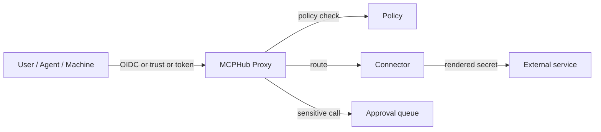

# Concepts

MCPHub has a small set of concepts. Everything in the web UI maps to one of these, and each
is stored as a Kubernetes custom resource (see [CRDs](crds.md)) — but you never have to
write YAML; the UI and CLI translate clicks into resources.

## Connector

A **connector** is a registered tool provider: how to reach it, where its tool catalog comes
from, and the credential it uses. It is the addressable, credentialed unit served to MCP
clients over the MCP protocol at `/mcp/<name>`. Three CRD kinds specialize it:

- **`McpConnector`** — a Model Context Protocol server. It need not ship a container image: a
  `runtime` picks how it starts — a **container** image (e.g. `ghcr.io/github/github-mcp-server`),
  an **npx** package (`npx @scope/mcp-server`), a **uvx** package (`uvx some-mcp`), or a
  **remote** endpoint reached directly over MCP **Streamable HTTP**. Package (`npx`/`uvx`)
  and stdio servers are wrapped with [Supergateway](runtime-isolation.md) and exposed over
  Streamable HTTP too — SSE is not used. Every locally-run MCP runs in a tightly jailed container.
- **`OpenApiConnector`** — an OpenAPI/REST service, or several grouped into one connector
  (e.g. Google = Gmail + Calendar + Drive + Docs). Tools are compiled from the spec and run in-process.
- **`GraphqlConnector`** — a GraphQL endpoint; tools are compiled from introspection and run
  in-process.

For `OpenApiConnector`/`GraphqlConnector` the spec is fetched, hashed, and rebuilt into tools
on demand; credentials and policies survive a rebuild. The UI seeds new connectors from a
**preset catalog** (Google, Stripe, GitHub REST, Vercel, …) or from a pasted URL it
auto-detects. The connector is itself the live, credentialed unit — once it carries a
credential its tools are callable at its proxied URL. Backed by the
[`McpConnector`](crds.md#mcpconnector) resource.

## Credentials & accounts

Each connector is itself **credentialed** — the credential lives on the connector object, not
in a separate resource. To use the same provider with different credentials or accounts you
create **multiple connectors**, each scoped to its own tools and reachable at its own proxied
URL.

The motivating case: for Grafana you create two `McpConnector`s —

- **`grafana-read`** → a read-only token, exposes `get_* / search_* / list_*`,
- **`grafana-write`** → an admin token, exposes everything, with write tools approval-gated.

Agents point at `/mcp/grafana-read` or `/mcp/grafana-write`; each is independently shared and
governed. A connector reads its credential from a Kubernetes **Secret** by convention (named
`mcphub-<connector-name>`, assumed to already exist) — **either** an api-key/header value
**or** an OAuth grant minted via a reusable **OAuth app** (below).

## OAuth app

An **OAuth app** is a registered, reusable OAuth client. Register a provider (e.g. Google)
once, then connect many accounts against it — each connector references the app and
requests its own scopes. The client secret and minted tokens live in a Kubernetes Secret,
never inline. Backed by the [`OAuthApp`](crds.md#oauthapp) resource.

## Tool

A **tool** is a single callable exposed by a connector (e.g.
`github_create_pull_request`). Tools have input/output JSON schemas and can be flagged
sensitive (requiring approval). MCPHub indexes every tool from every connector into one
searchable **catalog**.

## Tag

A **tag** is a label on a connector (e.g. `code`, `infra`, `sensitive`). Tags are a
sharing and policy primitive: grant access by tag and any new connector carrying that tag
is automatically included. Tags also drive default approval behavior (e.g. `sensitive`).

## Subject

A **subject** is who or what is making a call:

- a **user** (authenticated via OIDC — Google or Okta),
- a **group** (from the identity provider's `groups` claim),
- an **email domain** (everyone at `example.com`),
- a **service account** or **token** (a machine identity).

These are the subject kinds the authorization model matches on: `User`, `Group`,
`EmailDomain`, `ServiceAccount`, `Token`. See [Authorization](authorization.md#the-rule).

## Policy

A **policy** maps subjects to what they may do with tools: **allow**, **ask**,
or **block**. Rules are authored in two places, both compiling to one rule primitive:

- **`Policy`** — most policy lives here ([`Policy`](crds.md#policy)): per-connector sharing
  (who may use a specific MCP and which of its tools) plus org-wide guardrails and defaults
  (e.g. "all `sensitive` tools require approval"). Connectors carry no access of their own.
- **Role** — identity-side packaging: reusable grants assigned to users, groups, or service
  accounts (see [Users & Roles](users.md)).

They resolve together: grants are additive, and a global guardrail can only **tighten** a
grant (force ask or block), never loosen it. See [Authorization](authorization.md).

## Service account & token

A **service account** is an org-owned machine identity that survives its creator. It
authenticates one of two ways:

- **Tokenless (preferred):** a trusted relationship (OIDC, Kubernetes ServiceAccount,
  SPIFFE, cloud instance identity). No secret is stored; MCPHub mints a short-lived
  credential per call.
- **Fine-grained token:** a GitHub-style token scoped to resources × tools × effect × expiry,
  short-lived and re-minted on expiry.

See [Tokens & Identity](tokens-and-identity.md).

## Execution & approval

An **execution** is a single tool call flowing through the proxy. When a tool requires
approval (or needs auth), the execution **pauses** and waits for a human decision, then
resumes. See [Authorization](authorization.md#approvals) and [Web UI](web-ui.md).

## How they fit together

