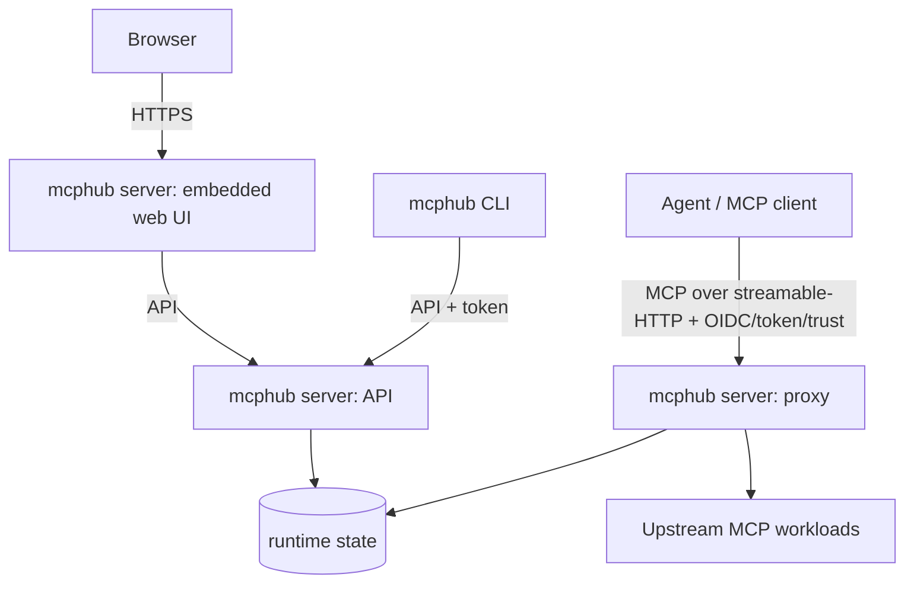

# Architecture

MCPHub is a Kubernetes control plane for MCP servers. It ships as **self-contained Go
binaries** (no build step, no repo required) and a set of Custom Resource Definitions (CRDs).
Configuration is **not** a single YAML file — every object is modeled as a CRD, and the
desired state is persisted in a **pluggable backing store** (Kubernetes/etcd, Postgres, or
SQLite).

The MCP surface agents connect to **is the proxy itself**: it speaks MCP over
streamable-HTTP, so any MCP client points straight at a connector or bundle URL. There is no
separate agent-side package to install.

## Components at a glance

| Component | Language | Role |
|-----------|----------|------|
| `mcphub` (server) | Go | Controller + management API + MCP proxy + **embedded web UI**. One self-contained binary. |
| `mcphub` (CLI) | Go | Operator/dev CLI: manage connectors/bundles/policies/tokens, discovery, resume |

The server is a single static binary (also shipped as a container image). The web UI is
**embedded** into it, so a solo user runs one binary and gets the API, proxy, and UI. Larger
deployments can optionally run the UI as a separate front tier, but nothing requires it.

## Binaries

### `mcphub` server (controller + API + proxy + UI)

One self-contained process, multiple responsibilities:

- **Controller.** Watches `McpConnector`, `Bundle`, `Policy`, `Token`, and
  `ServiceAccount` objects. Reconciles them into runtime state: spawns/tears down MCP
  workloads, resolves and renders referenced secrets, keeps the proxy routing table current.
  On the Kubernetes backend it **installs its own CRDs** on first run (or `mcphub install`),
  so there is no `kubectl apply` of a repo manifest required.
- **API.** REST/JSON used by the web UI, CLI, and automation. CRUD over all objects, tool
  discovery, execution control (pause/resume), token/identity management.
- **MCP proxy.** The data plane and the MCP surface. Each `Connector` is reachable at
  its own URL; each `Bundle` at an aggregated endpoint. The proxy authenticates the
  caller, applies policy, renders the connector's secret, and forwards the call — speaking
  MCP over streamable-HTTP directly to agents.
- **Web UI.** The Vite/React UI is **embedded** in the binary and served by it (can be
  disabled or fronted separately).

### `mcphub` CLI

A standalone client over the API (authenticating with an OIDC token or service token). It
never touches the store directly, so the same validation, policy, and audit apply. The CLI also
**embeds an MCP server** that exposes CLI operations as tools for programmatic access by
AI agents. See [CLI](cli.md).

### The MCP surface (proxy direct, or the CLI's MCP server)

Agents connect **directly to the proxy** over streamable-HTTP at a connector or bundle URL
(e.g. `/mcp/grafana-read`, `/bundle/devtools`), presenting their token. There is no separate
npm package or sidecar to install.

For clients that can only launch a local **stdio** command (Claude Code, Cursor, etc.), the
`mcphub` **CLI ships its own MCP server**: running `mcphub mcp serve` exposes an MCP endpoint
locally that bridges to the hub (carrying your token, honoring policy and approvals). So the
stdio bridge is just the CLI you already have — not a distinct component. See [CLI](cli.md).

## State model

Every object — `McpConnector`, `Bundle`, `Policy`, `Token`, `ServiceAccount` — is defined as a
CRD (schema, validation, versioning). Two layers of state:

1. **Desired state + audit — the configured store.** CRD objects (created via `kubectl`,
   GitOps, the API, or the web UI) and the **audit/event records** live in the **same** store.
   Like Teleport's Auth Service, the controller is the authority: every write goes through it
   into the configured backend, which is the single source of truth. **The UI and the CRD
   create each other:** anything created in the UI is written as a CRD object, and any CRD
   applied out-of-band appears in the UI — two faces of the same object, not a copy. Unlike
   Teleport, there is **no separate events database**; config and audit share one store (see
   [Storage backends](storage.md)).
2. **Runtime state — controller store.** Resolved routing tables, rendered (in-memory)
   secrets, live health, cached permissions, in-flight/paused executions. Rebuilt by
   reconciliation; never checked into Git.

See [Storage backends](storage.md) for how desired state is persisted (Kubernetes/etcd,
Postgres, or SQLite) without changing what the objects are.

## Runtime backends (where MCP servers run)

The controller reconciles each MCP into a real running workload. The runtime mirrors the
environment:

- **Local / single host:** MCP servers run as **Docker containers** (Podman works too). The
  controller starts/stops containers, mounts volumes, and applies the sandbox/egress config
  directly to them. This is the mode for a solo user on the SQLite/Postgres backends — no
  cluster needed.
- **Kubernetes:** MCP servers run as **Pods**, driven by the `McpConnector` CRD.
  The controller creates the Pods (with `runtimeClass`, securityContext, NetworkPolicy, and
  KubeArmor policy) and reconciles them like any operator.

Either way the model is identical — the same objects, the same proxy, the same isolation
knobs (see [Runtime & Isolation](runtime-isolation.md)); only the thing that runs the
container differs (Docker engine vs the kube scheduler).

## Everything is API-driven

There is one **controller** exposing one **API**, and every surface is a client of it:

- the **web UI** is a client (it calls the API),
- the **CLI** ([`mcphub`](cli.md)) is a client,
- your own automation/CI is a client,
- on Kubernetes, `kubectl`/GitOps is an additional path that writes the same CRD objects.

No surface has a private side door: creating an MCP, minting a token, or editing a policy is
the same API call (and the same resulting object) regardless of who initiates it, so
validation, policy, and audit are uniform. See [API](api.md).

## Request paths

- **Management:** Browser → embedded web UI → API.
- **Automation:** CLI/CI → API (service token / tokenless).
- **Tool execution:** Agent → proxy (direct streamable-HTTP) → upstream MCP.

## Tech stack

- **Server (controller/API/proxy):** Go, controller-runtime; static self-contained binary
  and container image; web UI embedded.
- **CLI:** Go.
- **MCP surface:** the proxy speaks MCP over streamable-HTTP; no separate package.
- **Web:** Vite + React (TypeScript), built and embedded into the server binary.
- **Auth:** OIDC (Google, Okta) for users; tokenless trust + short-lived tokens for machines.
- **Authorization:** `Policy` compiled to Cedar, evaluated in-process.
- **Persistence:** CRD-modeled desired state in a pluggable backend; controller store for
  runtime state.
