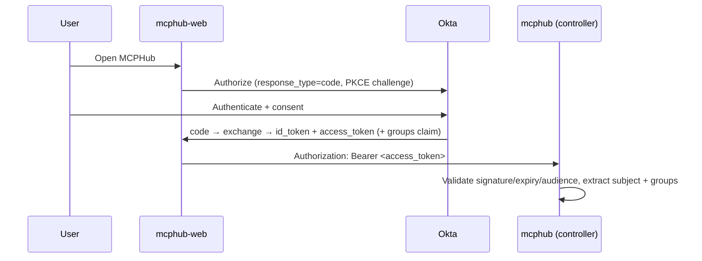

# Technologies

The technology pool MCPHub is built from, why each is in, and how it shows up at runtime.
Organized like the other design pages:

- **Spec** — what we need from the stack (the constraints a choice must satisfy).
- **Design** — the chosen technologies and how they fit the [package layers](project-structure.md).
- **Usage** — concrete flows: how a user logs in with Okta, how a service account uses a token.

---

## Spec

Constraints every technology choice is measured against:

1. **Single self-contained Go binary.** The server (controller + API + proxy + embedded UI)
   ships as one static binary and a container image. No runtime build step, no repo required.
2. **Same model solo → team.** Must run on SQLite for one person and Kubernetes/Postgres for
   a team without changing the object model (see [Storage backends](storage.md)).
3. **CRDs are the source of truth.** Objects are Kubernetes custom resources under
   `mcphub.io/v1alpha1`; the operator framework must own schema, validation, and
   reconciliation.
4. **Wiring at one composition root.** Dependencies are injected, not constructed ad hoc, to
   keep the [call-down-only rule](project-structure.md#the-dependency-rule) enforceable.
5. **Short-lived, tokenless-first identity.** Auth tech must support OIDC (humans) and
   trust-based machine identity (K8s SA, SPIFFE, cloud), with fine-grained tokens only as a
   fallback (see [Authentication](authentication.md)).
6. **MCP over streamable-HTTP.** The proxy speaks MCP over streamable-HTTP; no SSE.

---

## Design

### The pool

| Area | Technology | Layer | Why |
|------|-----------|-------|-----|
| Language | **Go 1.24+** | all | one static binary, strong K8s ecosystem |
| Dependency injection | **Uber FX** | `cmd/` | wires the composition root; lifecycle hooks for start/stop |
| Operator framework | **Kubebuilder / controller-runtime** | `controller` | CRD scaffolding, reconcilers, manager |
| API surface | **net/http (std) + chi-style routing** | `api` | thin REST/JSON, no heavy framework |
| MCP proxy | **streamable-HTTP MCP** | `proxy` | the data plane and MCP surface |
| Persistence | **etcd (via K8s) / Postgres / SQLite** | `store` | pluggable backend, same objects |
| Runtime | **Docker/Podman or Kubernetes Pods** | `runtime` | local containers or cluster Pods |
| Sandbox/egress | **runtimeClass, NetworkPolicy, KubeArmor** | `runtime` | isolation knobs |
| Identity | **OIDC (Google, Okta), K8s TokenReview, SPIFFE** | `auth` | tokenless-first machine + human auth |
| CLI | **Cobra** | `cli` | commands + embedded `mcp serve` bridge |
| UI | **Vite + React, embedded** | `web` | click-driven, no YAML, served by the binary |
| Observability | **Prometheus client + structured logs** | cross | `/metrics`, leveled logging |

### Dependency injection — Uber FX

FX is the wiring for the [composition root](project-structure.md#cmd-top). Each binary's
`main` builds an `fx.App` from provider functions; no package constructs its own
dependencies. FX's `OnStart`/`OnStop` hooks own process lifecycle so the HTTP server, the
controller manager, and runtime backends start and drain in dependency order.

```go
func main() {
    fx.New(
        // pick the infrastructure impls here — the ONLY place that knows concrete types
        fx.Provide(store.NewFromConfig),      // returns domain.Store (sqlite|postgres|etcd)
        fx.Provide(runtime.NewFromConfig),    // returns domain.Runtime (docker|kubernetes)
        fx.Provide(auth.NewVerifier),         // returns domain.IdentityVerifier
        fx.Provide(secret.NewRenderer),
        fx.Provide(proxy.New, api.New, controller.NewManager),
        fx.Invoke(func(*proxy.Proxy, *api.Server, controller.Manager) {}),
    ).Run()
}
```

Why FX over hand-wiring: the graph is large (store × runtime × auth × proxy × controller) and
the start/stop ordering matters (drain the proxy before stopping runtimes). FX makes the
edges explicit and the lifecycle declarative. It lives **only** in `cmd/`; no domain or
delivery package imports `fx`.

> **ponytail:** FX earns its keep at this graph size and lifecycle ordering. For a two-
> dependency tool we'd hand-wire and skip it.

### Operator framework — Kubebuilder

The `controller` package is a Kubebuilder project: CRD types are tagged Go structs,
controller-runtime provides the manager, caches, and reconcile loop. On the Kubernetes
backend the controller **installs its own CRDs** on first run, so there's no `kubectl apply`
of a repo manifest.

The same CRD *types* are reused on Postgres/SQLite — the store persists them as rows instead
of going through the API server, but the schema and validation are identical (see
[CRDs](crds.md) and [Storage backends](storage.md)). Kubebuilder is confined to
`controller`; the rest of the code depends on `domain` types, not on controller-runtime.

---

## Usage

How the auth technologies actually behave, end to end.

### A user connects with Okta (OIDC, OAuth 2.0 authorization-code + PKCE)

Humans never hold a long-lived secret. Login is OIDC against Okta:



1. **Admin → Identity Providers** in the UI registers Okta: issuer URL, client ID/secret,
   and the `groups` claim mapping. Okta is a first-class provider alongside Google.
2. The browser runs the **authorization-code flow with PKCE**; the UI only ever holds a
   short-lived access token, refreshed by Okta.
3. The controller validates the token against Okta's published keys and extracts the
   **subject**, email, and **groups**.
4. **Groups drive sharing.** A policy granted to an Okta group resolves membership from the
   claim at request time — joiners/leavers gain/lose access with no policy edit. See
   [Authentication](authentication.md) and [Authorization](authorization.md).

### A service account uses a token (machine identity)

Machines authenticate via a [`ServiceAccount`](crds.md#serviceaccount). Tokenless trust is
preferred; a fine-grained token is the fallback.

**Tier 0 — tokenless (preferred).** The ServiceAccount carries a *trust rule*, not a secret.
At call time the workload presents a platform-signed document and MCPHub mints a short-lived
(~1h, non-renewable) credential:

- **Kubernetes ServiceAccount token** — an audience-bound projected token, validated via the
  cluster OIDC issuer / `TokenReview`.
- **OIDC JWT** (e.g. GitHub Actions) — match `iss`/`aud`/`sub` against the issuer's keys.
- **SPIFFE / SVID** — verify the `spiffe://` identity against the trust bundle.
- **Cloud instance identity** — AWS/GCP/Azure attestation.

**Fallback — fine-grained token.** When tokenless isn't possible, mint a GitHub-PAT-style
token bound to a subject and scoped to resources × tools × effect × expiry. The secret is
shown **once** at creation and stored only as a hash; it's revocable.

All paths resolve to one bearer credential on the proxy/API:

```
Authorization: Bearer <oidc-access-token | minted-tokenless-credential | mh_svc_token>
```

The proxy authenticates, resolves the subject, and hands off to
[Authorization](authorization.md). See [Tokens & Identity](tokens-and-identity.md) for the
full model.
