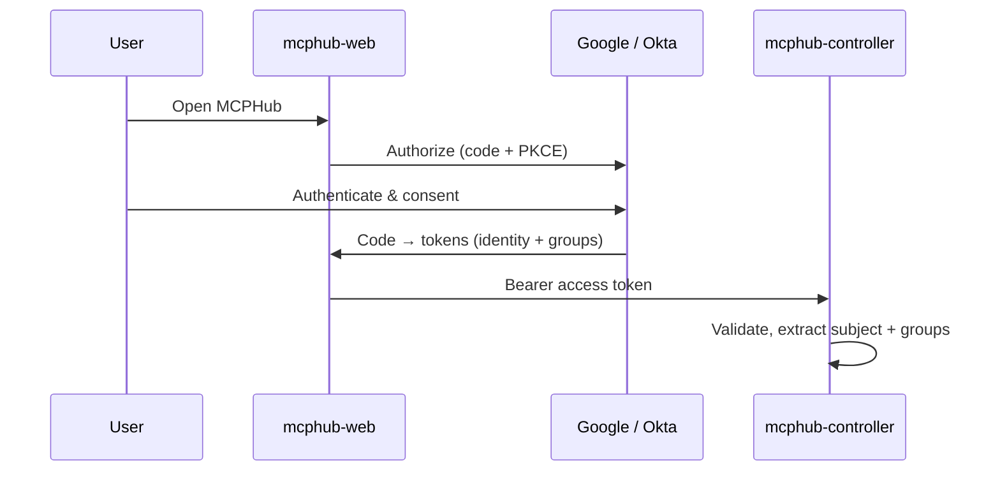

# Authentication

MCPHub separates **humans** (interactive OIDC) from **machines** (tokenless trust, or
short-lived tokens). Identity is always resolved to a **subject** that authorization acts on.

## Humans — OIDC (Google & Okta)

User login is OIDC (OpenID Connect), authorization-code flow with PKCE. Providers are
pluggable; **Google** and **Okta** are first-class.



- The web UI holds only a short-lived access token, never a long-lived secret.
- The controller validates the token (signature, expiry, audience) and extracts identity
  (subject, email) and **groups** from the provider's `groups` claim.
- **Groups drive sharing.** Granting a policy to an Okta group means membership is resolved
  from the claim at request time — joiners/leavers gain/lose access with no policy edit.
  This is the basis of the [share-with-a-team](getting-started.md#3-share-it-with-an-okta-team)
  flow.

Configure providers under **Admin → Identity Providers** in the UI; the schema is the
[`IdentityProvider`](crds.md#identityprovider) CRD, whose `claimsToRoles` mapping turns IdP
group claims into MCPHub roles.

## Machines — tokenless trust (preferred)

Machines (CI, agents, Hermes) should authenticate via a **trusted relationship** instead of
a stored secret. The workload presents a platform-signed document; MCPHub validates it
against a configured trust rule and mints a short-lived credential. Nothing to leak.

The supported trust types (OIDC JWT, Kubernetes ServiceAccount token, SPIFFE/SVID, and cloud
instance identity) and full examples live in
[Tokens & Identity](tokens-and-identity.md#tier-0--tokenless-preferred).

## Machines — fine-grained tokens (fallback)

When tokenless is not possible, mint a fine-grained, short-lived token (GitHub-PAT-style)
bound to a subject and scoped to resources × tools × effect × expiry. See
[Tokens & Identity](tokens-and-identity.md).

## Connecting a client — one login for every MCP

You don't add upstream MCP servers to your client. You add **one MCPHub URL** — the global
endpoint (`/mcp`) or a single connector (`/mcp/<name>`) — and MCPHub
proxies the MCPs you're allowed to use behind it.

Authentication is **domain-based** against MCPHub itself: you log in **once** to the MCPHub
domain and that session covers **every** connector you reach through it. There is no
per-MCP login, and no upstream secret in your client config — MCPHub holds the upstream
credentials and renders them in-cluster (see [Where credentials live](#where-credentials-live)).

### Add the URL — browser login, no token (recommended)

Clients that speak MCP over Streamable HTTP point **straight at an MCPHub URL with no token in
the config**. On the first call MCPHub returns `401` with a `WWW-Authenticate` header; the
client discovers MCPHub's authorization server, registers itself, and opens the **browser**
for login + consent. It receives access + refresh tokens scoped to the MCPHub domain —
refreshed automatically — so you authenticate **once**, not once per MCP. This is the
Notion-style experience proven in `hack/pocs/mcp-auth/`.

```json
{
  "mcpServers": {
    "mcphub": {
      "type": "http",
      "url": "https://mcphub.example.com/mcp"
    }
  }
}
```

`/mcp` is the **global** endpoint (every connector you may use); target a single
connector with `/mcp/<name>`. Stdio-only clients reach the
same URL through `mcp-remote` — the same shape as Notion's hosted MCP:

```json
{
  "mcpServers": {
    "mcphub": {
      "type": "stdio",
      "command": "bunx",
      "args": ["-y", "mcp-remote", "https://mcphub.example.com/mcp"]
    }
  }
}
```

`mcp-remote` caches the MCPHub tokens locally (`~/.mcp-auth`, override with
`MCP_REMOTE_CONFIG_DIR`; clear with `rm -rf ~/.mcp-auth`).

This is standard MCP OAuth 2.1 ([Authorization spec, 2025-06-18](https://modelcontextprotocol.io/specification/2025-06-18/basic/authorization)):
authorization-code + **PKCE**, discovery via **RFC 9728** (protected-resource metadata) and
**RFC 8414** (authorization-server metadata), **RFC 7591** dynamic client registration (no
pre-shared secret), and **RFC 8707** resource indicators to bind the token to MCPHub.

### Or use the `mcphub` CLI bridge

Also token-free: [`mcphub login`](cli.md) runs the browser/device OIDC flow **once** and
caches the token, then the CLI embeds a local MCP server that forwards to the proxy — handy
for clients that only launch a stdio command and don't implement MCP OAuth.

```bash
mcphub login            # browser/device flow → cached token (once, for all MCPs)
```

```json
{
  "mcpServers": {
    "mcphub": {
      "command": "mcphub",
      "args": ["mcp", "serve", "--transport", "stdio"]
    }
  }
}
```

### Non-interactive (CI, agents)

When there's no browser, authenticate the workload with [tokenless trust](tokens-and-identity.md)
(its platform identity) or pass a [minted token](tokens-and-identity.md) as a header. The
`add-mcp` helper writes either form:

```bash
# Interactive: add by name, resolve the URL, log in via browser
npx add-mcp '<mcp name>' --name mcphub

# Non-interactive: add the URL directly with a bearer token
npx add-mcp https://mcphub.example.com/mcp/<name> \
  --transport http --name mcphub \
  --header 'Authorization: Bearer mh_svc_...'
```

The URL can target the global endpoint (`/mcp`) or a single connector (`/mcp/<name>`); the
token's grants still decide which tools resolve.

## Presenting credentials to the proxy

All three resolve to a bearer credential on the proxy/API:

```
Authorization: Bearer <oidc-access-token | minted-tokenless-credential | mh_svc_token>
```

The proxy authenticates, resolves the subject, then hands off to
[Authorization](authorization.md).

## Where credentials live

- **Human OIDC tokens:** in the browser session, short-lived, refreshed by the IdP.
- **Tokenless:** no stored secret anywhere; a credential is minted per call (~1h).
- **Service tokens:** secret shown once at creation, stored only as a hash; revocable.
- **Upstream MCP credentials** (the secrets MCPs need) are owned by the MCP and never
  exposed to callers. See [Security](security.md).
