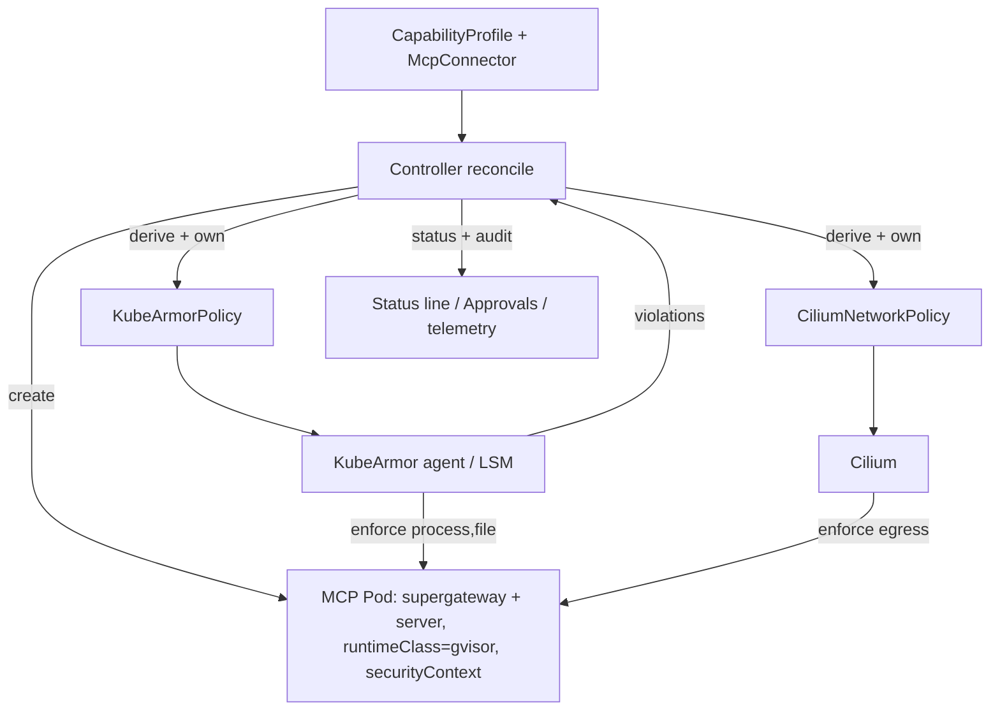

# Capability Enforcement (Design)

Architectural design for how a [Capability Profile](capability-profiles.md) — the user's
plain-language intent — becomes real enforcement on whatever the cluster provides. This is
the **container capability plane**, distinct from request authorization (`Policy`).

## Goals

- Users author **intent once**, in a stable, cluster-agnostic vocabulary.
- The controller **compiles** that intent to the strongest enforcement the cluster offers.
- **Graceful degradation** with honest status — never a silent gap.
- **No new control-plane surface**: it's another thing the controller reconciles and reads
  alerts from.

## Two layers

```
CapabilityProfile (intent)  ──compile──▶  enforcer-native objects (per cluster)
   what it may reach/touch/run               CiliumNetworkPolicy, KubeArmorPolicy,
   sandbox level, enforce posture            RuntimeClass + securityContext, ...
```

The profile never names an enforcer. The controller owns the mapping.

## Enforcement planes and the v1 provider set

A profile has a few clause types; each routes to a provider. **For starters we standardize
on Cilium for the network plane**, KubeArmor for process/file, and gVisor for the sandbox:

| Clause | v1 provider | Fallback chain |
|--------|-------------|----------------|
| Network (`can reach`) | **Cilium** (FQDN/L7 egress) | plain NetworkPolicy by resolved CIDR → egress proxy → unenforced |
| Process / file / capabilities (`can run`, `can touch`) | **KubeArmor** (LSM, Block) | generated AppArmor/seccomp (coarser) → audit-only |
| Sandbox | **gVisor** RuntimeClass | Kata → none (rely on other planes) |
| Pod hardening (always) | Kubernetes `securityContext` | n/a (baseline) |

Cilium-first matters because the network clause is written as **domains**
(`grafana.example.com:443`), and only an FQDN-aware layer can enforce that faithfully;
without it the controller must resolve to IPs/CIDRs and the fidelity drops (surfaced in
status).

## Capability detection

On startup and on a watch, the controller probes the cluster and builds a capability matrix:

- Cilium present (CRDs/CNI) and FQDN policy supported?
- KubeArmor DaemonSet present; per-node LSM (BPF-LSM/AppArmor) = enforce vs audit-only?
- `RuntimeClass`es for gVisor / Kata registered?
- seccomp/AppArmor availability; Kyverno for admission.

This matrix is what every profile is compiled against. It is also re-evaluated as the
cluster changes (installing Cilium later lights up FQDN enforcement for existing profiles).

## Compilation & the reconcile loop

The capability work hangs off the normal MCP reconcile — the controller already creates the
workload; it adds derived enforcement objects:



- Derived objects (`CiliumNetworkPolicy`, `KubeArmorPolicy`) are **controller-owned children**
  (ownerReferences), selected onto the pod by label, updated on profile change, GC'd with the
  McpConnector.
- On the **local/Docker backend**, the same profile compiles to Docker flags
  (`--cap-drop`, `--read-only`, seccomp, gVisor runtime) plus KubeArmor systemd-mode rules and
  egress proxy/firewall rules — same intent, different emitted artifacts.

## Fail-open vs fail-closed

The profile's `enforce` field decides behavior when the matrix can't satisfy a clause:

- **`require`** → fail closed: the MCP is not started (or is quarantined) if any clause can't
  be truly enforced. For credentialed/sensitive MCPs.
- **`best-effort`** → run, and record per-clause enforcement strength in `status` and audit.

Either way, `status.enforcement` reports, per clause, one of `enforced | degraded | audit |
unenforced`, plus which provider satisfied it. That is what the user-facing status line
summarizes in plain language.

## Status model (what the controller writes)

```yaml
status:
  posture: require
  planes:
    network:   { state: enforced,  by: cilium }
    process:   { state: enforced,  by: kubearmor }
    file:      { state: enforced,  by: kubearmor }
    sandbox:   { state: enforced,  by: gvisor }
  derived:
    ciliumNetworkPolicy: grafana-jail-net
    kubeArmorPolicy:     grafana-jail-ka
```

If, say, Cilium were absent under `best-effort`, `network` would read
`{ state: degraded, by: networkpolicy, note: "domain allowlist resolved to IPs" }` and the UI
status line would show "Network limited to IPs."

## Extensibility

Providers are a plug point. A new enforcer (a different runtime, a custom admission/policy
engine, a future network layer) registers a `clause → provider` mapping with a capability
probe and a compiler. Existing profiles automatically use it where it's the strongest match —
no change to the profile vocabulary users write.

## Boundaries

- This plane governs **what the container may do**. Who may call which tool is
  [Authorization](authorization.md) (`Policy` → Cedar/OPA), enforced in the proxy.
- It complements, not replaces, the kernel sandbox: gVisor/Kata is the boundary the container
  runs inside; KubeArmor/Cilium constrain behavior within it.
- See [Runtime & Isolation](runtime-isolation.md) for the broader runtime picture and the
  transport (Supergateway, Streamable HTTP only).
