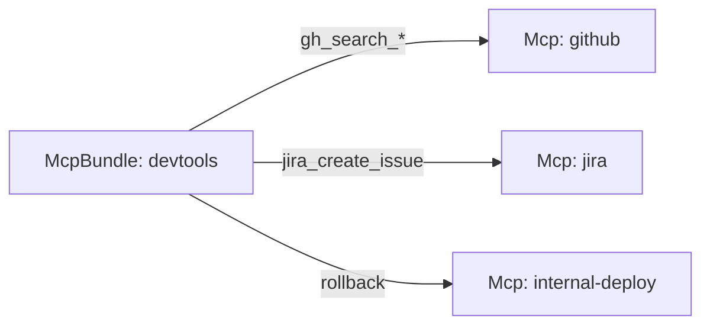

# Bundles

A **bundle** composes a curated set of tools from one or more MCPs behind a single endpoint,
optionally renaming tools and flagging which need approval. Bundles are how you give a team
exactly the tools they need without exposing whole MCPs.

Backed by the [`McpBundle`](crds.md#mcpbundle) resource; built in the UI's drag-and-drop
composer (no YAML).

## Why bundles

- **Curate per use case.** A `devtools` bundle for engineers, a `support` bundle for the
  help desk — each with only the right tools.
- **Span multiple MCPs.** Pull `search_*` from GitHub, `create_issue` from Jira, and a
  custom internal MCP into one endpoint.
- **Rename for a clean surface.** Present consistent tool names to agents, decoupled from
  upstream naming.
- **One auth boundary.** Grant a team the bundle without granting the underlying MCPs.

## How it resolves

When the controller reconciles a bundle, for each source it:

1. resolves `from` to an `Mcp` and that server's discovered tools,
2. applies `select` globs, intersected with the source MCP's own allow/deny,
3. applies the `as` rename template to produce exposed names,
4. registers a route: exposed name → `(source MCP, upstream tool)`,
5. publishes the bundle at `/bundle/<name>`.



## Approvals in a bundle

List tools under `approvals.require` and any call to them pauses for human approval before
forwarding — independent of the underlying MCP's own settings. See
[Authorization → Approvals](authorization.md#approvals).

## Calling a bundle

```jsonc
{
  "mcpServers": {
    "mcphub-devtools": {
      "type": "streamable-http",
      "url": "https://mcphub.example.com/bundle/devtools",
      "headers": { "Authorization": "Bearer <token>" }
    }
  }
}
```

The agent sees only the bundle's exposed tools. The proxy maps each call to the right
upstream MCP, renders that MCP's secret in-cluster, enforces policy, and pauses for approval
where required.
