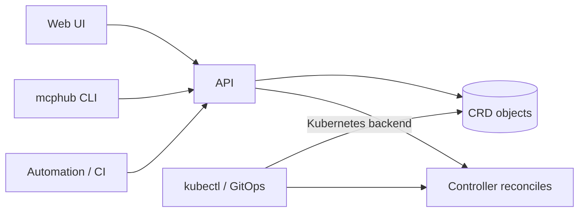

# API

MCPHub is **API-first**. The `mcphub` server runs a single **controller** that exposes one
management **API**; the web UI, the [CLI](cli.md), and your automation are all clients of it.
Anything you can do in the UI you can do over the API.

## What the API is for

- CRUD over every object: `Mcp`, `McpConnection`, `McpBundle`, `McpPolicy`, `Token`,
  `ServiceAccount`, `Repo`.
- Tool **discovery** and schema inspection across the catalog.
- **Execution control**: invoke/replay tools for debugging, and resume paused
  (approval/auth) executions.
- **Identity & access**: mint/revoke tokens, configure trusted relationships, manage
  identity providers.

Because every surface goes through the same API, validation, policy, and audit are uniform
no matter who initiates a change. On the Kubernetes backend, `kubectl`/GitOps is an
additional path that writes the **same** CRD objects the API does.

## Authentication

Send a bearer credential, exactly as agents do at the proxy:

```
Authorization: Bearer <oidc-access-token | service-token | tokenless-minted-credential>
```

See [Authentication](authentication.md) for how humans (OIDC: Google/Okta) and machines
(tokenless trust or fine-grained tokens) obtain one. The API enforces the same
[authorization](authorization.md) as everything else.

## Shape

- REST/JSON over HTTPS, resource-oriented (`/api/v1/mcps`, `/api/v1/connections`,
  `/api/v1/bundles`, `/api/v1/policies`, `/api/v1/tokens`, `/api/v1/executions`, …).
- Objects are the CRD schemas documented in [CRDs](crds.md); the API is a typed front over
  the same objects whether they live in Kubernetes/etcd, Postgres, or SQLite.
- List/get/watch semantics are consistent across [storage backends](storage.md).

> Endpoint paths and payloads are indicative and pre-1.0; treat the CRD schemas as the
> contract and the API as the way to read/write them. The [CLI](cli.md) is the convenient
> wrapper over this API.

## Two ways in, one model


