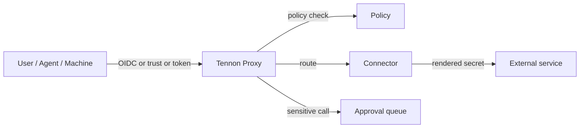
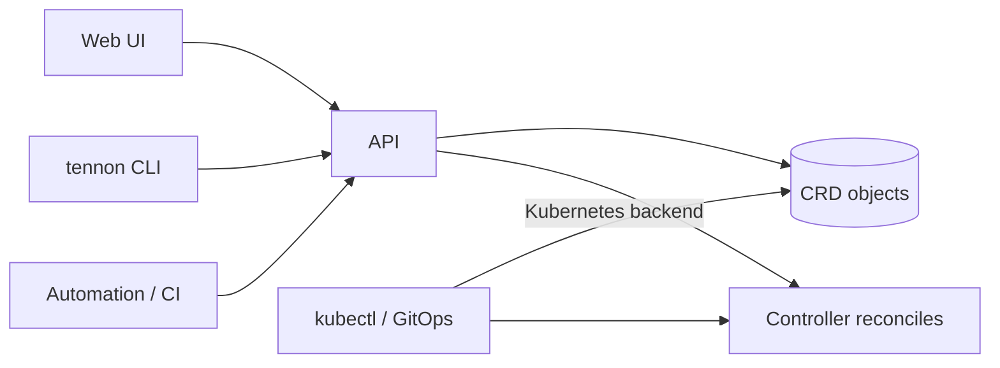
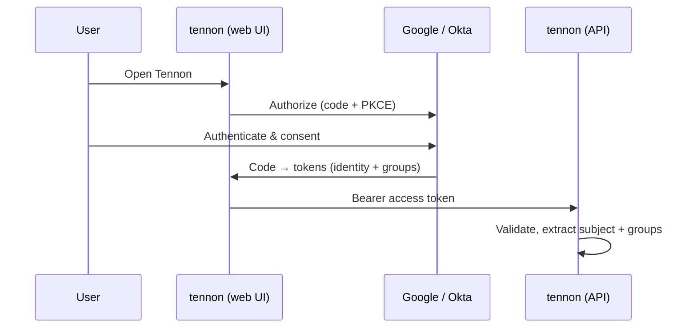
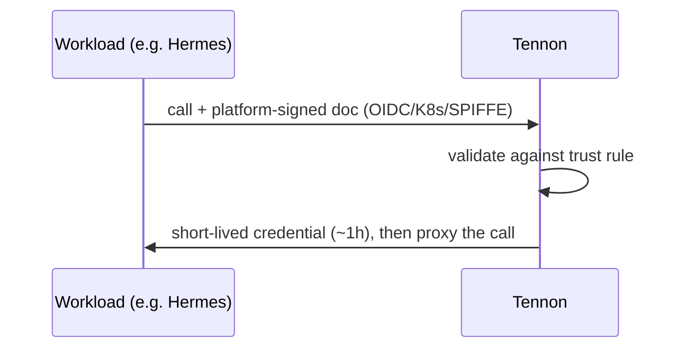
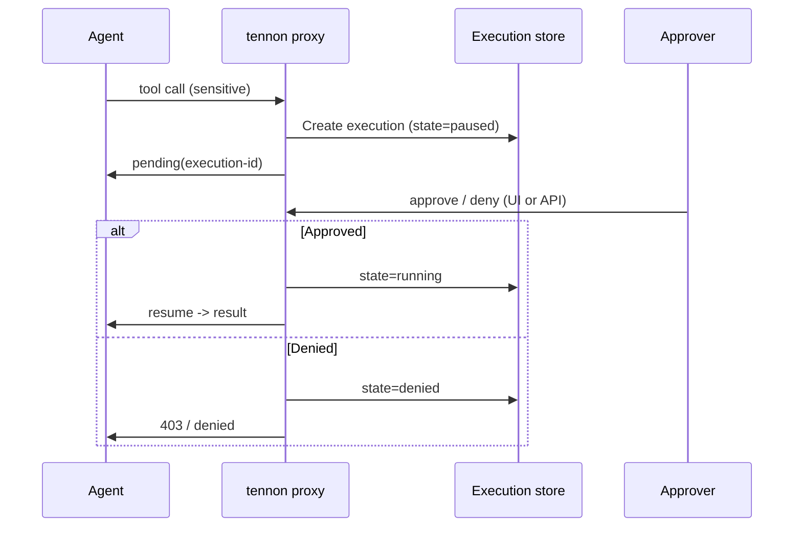

# Tennon Documentation

> The Kubernetes-native control plane and proxy for Model Context Protocol (MCP) servers.

Tennon lets one person or a whole team register MCP servers, share them safely (credentials
never leave the platform), and govern every tool call with
fine-grained authorization, short-lived tokens, and human-in-the-loop approvals — all driven
from a click-through web UI that translates to Kubernetes custom resources behind the scenes.

## Why Tennon

- **One catalog, every agent.** Point Claude Code, Cursor, OpenCode, or Pi at Tennon and
  share the same tools, auth, and policies across all of them.
- **Credentials stay put.** Configure an MCP that needs a credential (e.g. Grafana) once;
  share it with a teammate or an Okta group without ever handing them the secret.
- **Tokenless by default.** Machines authenticate via a trusted relationship (OIDC, K8s
  ServiceAccount, SPIFFE, cloud identity) — no shared secret to leak. Fine-grained
  short-lived tokens are the fallback.
- **Scales from solo to team.** The same model runs on SQLite for one person and on
  Postgres or Kubernetes for a team.

## Start here

- New to Tennon? Read [Getting Started](#getting-started) and the [Concepts](#concepts).
- Building or contributing to Tennon? The design, architecture, and internals live under
  **[Architecture](arch/README.md)** (`/arch`).

## Documentation map

### Get started
- [Getting Started](#getting-started) — install, first connector, connect an agent.
- [Concepts](#concepts) — connector, tool, tag, subject, policy, token, service account.

### Use the features
- [Web UI](#web-ui) — the click-through console.
- [CLI](#cli) — `tennon` and `tctl` from the terminal.
- [API](#api) — the HTTP surface.
- [Spec Connectors (OpenAPI & GraphQL)](#spec-connectors-openapi-amp-graphql) — compile tools from a spec.
- [Capability Profiles](#sandbox-amp-access-capability-profiles) — what an MCP container may do.
- [Catalog Features](#catalog-features-executor-inspired) — catalog capabilities.

### Access & security
- [Authentication](#authentication-2) — OIDC (Google, Okta) and machine trust.
- [Authorization](#authorization) — policies, Cedar, allow / ask / block.
- [Users & Roles](#users-amp-roles) — human identity and role packaging.
- [Tokens & Identity](#tokens-amp-identity) — tokenless trust + fine-grained tokens.
- [Security model](#security-model) — secret handling, revocation, audit.

### Reference & operating
- [Custom Resources (CRDs)](#custom-resources-crds) — `TennonConnector`, `Policy`, `Token`, `ServiceAccount`.
- [Storage backends](#storage-backends) — Kubernetes/etcd, Postgres, SQLite.
- [Deployment](#deployment)
- [FAQ](#faq)

### Architecture & internals → [`/arch`](arch/README.md)
Requirements, architecture, project structure, technologies, CRD lifecycle, connector
extensibility, the proxy, runtime isolation, capability architecture, roadmap, contributing,
and research notes.

## Project status

Tennon is pre-1.0 and under active design. APIs and CRD schemas may change. See the
[Roadmap](arch/README.md#roadmap) for the phased plan.

## License

Apache License 2.0.


# Getting Started

This guide gets Tennon running and walks the flagship flow: register a credentialed connector and
share it with a teammate — without exposing the credential.

## Prerequisites

- A place to run the controller: a Kubernetes cluster, or any host (for the Postgres/SQLite
  backends). See [Storage backends](#storage-backends).
- An OIDC provider for user login (Google or Okta).
- For agents: an MCP-capable client (Claude Code, Cursor, OpenCode, or Pi via a bridge).

## 1. Run the control plane

Solo / local (SQLite backend) — one binary, UI embedded:

```bash
tennon \
  --store=sqlite --store-path=./tennon.db \
  --api-addr=:8080 --proxy-addr=:8081 \
  --oidc-issuer=https://accounts.google.com \
  --oidc-client-id=tennon
```

The API, MCP proxy, and web UI are all served by this one process (the UI on the API port).

Team / cluster (Kubernetes backend) — install with Helm:

```bash
helm install tennon oci://ghcr.io/yurifrl/charts/tennon -n tennon --create-namespace \
  --set oidc.issuer=https://accounts.google.com --set oidc.clientId=tennon
```

The controller installs its own CRDs on first start, so there is no separate CRD step. If you
prefer a single declarative manifest, apply the released bundle instead:

```bash
kubectl apply -f https://github.com/yurifrl/tennon/releases/latest/download/tennon.yaml
```

On an empty store the controller logs a one-time **bootstrap admin token** so you can get in
before any identity provider is wired up:

```
No users found — first-run bootstrap.
  → Open:  http://localhost:8080/?token=tn_boot_8f3c1d9a7be240xZ
  → Or run: tctl open
```

Open that URL (or run `tctl open`), then create your first [User](#users-amp-roles). The token
expires in 1h or the moment the first user exists. After that, sign in with Google or Okta.

## 2. Add a credentialed connector (Grafana)

From the web UI: **Connectors → Add connector**. Paste the Grafana MCP server URL; Tennon
detects the transport and discovers tools. Add the credential as a secret reference (the
value is stored in the configured secret backend and never shown again).

From the CLI:

```bash
tctl secret create grafana-creds --from-literal=token=$GRAFANA_TOKEN
tctl connector add grafana \
  --remote https://grafana.example.com/mcp --transport streamable-http \
  --header "Authorization=Bearer {{secret:grafana-creds.token}}" \
  --expose-prefix grafana_ --tag observability
```

The credential lives with the connector. Anyone you share it with calls Grafana **through the
proxy**; they never receive the token.

## 3. Share it with an Okta team

Sharing is a **`Policy`** decision — the connector itself carries no access. From the
web UI: **Policies** → **New share**, pick the `grafana` connector, subject **Group →
Okta → `observability`**, choose which tools, save.

From the CLI (sugar that authors a `Policy` rule):

```bash
tctl connector share grafana \
  --to "group:okta:observability" \
  --tools "grafana_get_*,grafana_search_*,grafana_list_*"
```

Membership resolves from the Okta `groups` claim at request time — people joining or leaving
the Okta team gain or lose access automatically, with no edit. Org-wide guardrails (e.g.
"`sensitive` tools always require approval") are other Policy rules and can only
tighten this grant.

## 4. Connect an agent

You add **one Tennon URL** to your client — **no token in the config**. The first call opens a
**browser login** (the same experience Notion ships at `https://mcp.notion.com/mcp`): your
client discovers Tennon's authorization server, registers itself (RFC 7591), runs the
authorization-code + PKCE flow against your IdP, and caches the token — reused silently on
every later call and across **every** MCP behind that URL. Tennon injects each upstream's own
credential server-side, so you never hold it. This is the flow proven in
`hack/pocs/mcp-auth/` and documented in [Authentication](#authentication-2).

Stdio clients bridge to the URL with `mcp-remote` — same shape as the Notion example:

```json
{
  "mcpServers": {
    "tennon": {
      "type": "stdio",
      "command": "bunx",
      "args": ["-y", "mcp-remote", "https://tennon.example.com/mcp"]
    }
  }
}
```

`/mcp` is the **global** endpoint — every connector you're allowed to use, behind
one login. Point at a single connector instead with `/mcp/grafana`.

Clients that speak MCP over Streamable HTTP natively need just the URL — no headers:

```json
{
  "mcpServers": {
    "tennon": {
      "type": "http",
      "url": "https://tennon.example.com/mcp"
    }
  }
}
```

**Non-interactive (CI, agents like Hermes):** there's no browser, so use
[tokenless trust](#tokens-amp-identity) (the workload's platform identity) or pass a minted
token as an `Authorization` header.

## 5. Try a tool, see an approval

Call a read tool — it runs immediately. Call a tool flagged sensitive and the execution
**pauses**; approve it from **Approvals** in the
UI (or `tctl resume`).

## Next steps

- Mint a [granular token or set up tokenless trust](#tokens-amp-identity).
- Tune [Authorization](#authorization).


# Concepts

Tennon has a small set of concepts. Everything in the web UI maps to one of these, and each
is stored as a Kubernetes custom resource (see [CRDs](#custom-resources-crds)) — but you never have to
write YAML; the UI and CLI translate clicks into resources.

## Connector

A **connector** is a registered tool provider: how to reach it, where its tool catalog comes
from, and the credential it uses. It is the addressable, credentialed unit served to MCP
clients over the MCP protocol at `/mcp/<name>`. Three CRD kinds specialize it:

- **`TennonConnector`** — a Model Context Protocol server. It need not ship a container image: a
  `runtime` picks how it starts — a **container** image (e.g. `ghcr.io/github/github-mcp-server`),
  an **npx** package (`npx @scope/mcp-server`), a **uvx** package (`uvx some-mcp`), or a
  **remote** endpoint reached directly over MCP **Streamable HTTP**. Package (`npx`/`uvx`)
  and stdio servers are wrapped with [Supergateway](arch/README.md#runtime-amp-isolation) and exposed over
  Streamable HTTP too — SSE is not used. Every locally-run MCP runs in a tightly jailed container.
- **`OpenApiConnector`** — an OpenAPI/REST service, or several grouped into one connector
  (e.g. Google = Gmail + Calendar + Drive + Docs). Tools are compiled from the spec and run in-process.
- **`GraphqlConnector`** — a GraphQL endpoint; tools are compiled from introspection and run
  in-process.

For `OpenApiConnector`/`GraphqlConnector` the spec is fetched, hashed, and rebuilt into tools
on demand; credentials and policies survive a rebuild. The UI seeds new connectors from a
**preset catalog** (Google, Stripe, GitHub REST, Vercel, …) or from a pasted URL it
auto-detects. The connector is itself the live, credentialed unit — once it carries a
credential its tools are callable at its proxied URL. Backed by the
[`TennonConnector`](#tennonconnector) resource.

## Credentials & accounts

Each connector is itself **credentialed** — the credential lives on the connector object, not
in a separate resource. To use the same provider with different credentials or accounts you
create **multiple connectors**, each scoped to its own tools and reachable at its own proxied
URL.

The motivating case: for Grafana you create two `TennonConnector`s —

- **`grafana-read`** → a read-only token, exposes `get_* / search_* / list_*`,
- **`grafana-write`** → an admin token, exposes everything, with write tools approval-gated.

Agents point at `/mcp/grafana-read` or `/mcp/grafana-write`; each is independently shared and
governed. A connector reads its credential from a Kubernetes **Secret** by convention (named
`tennon-<connector-name>`, assumed to already exist) — **either** an api-key/header value
**or** an OAuth grant minted via a reusable **OAuth app** (below).

## OAuth app

An **OAuth app** is a registered, reusable OAuth client. Register a provider (e.g. Google)
once, then connect many accounts against it — each connector references the app and
requests its own scopes. The client secret and minted tokens live in a Kubernetes Secret,
never inline. Backed by the [`OAuthApp`](#oauthapp) resource.

## Tool

A **tool** is a single callable exposed by a connector (e.g.
`github_create_pull_request`). Tools have input/output JSON schemas and can be flagged
sensitive (requiring approval). Tennon indexes every tool from every connector into one
searchable **catalog**.

## Tag

A **tag** is a label on a connector (e.g. `code`, `infra`, `sensitive`). Tags are a
sharing and policy primitive: grant access by tag and any new connector carrying that tag
is automatically included. Tags also drive default approval behavior (e.g. `sensitive`).

## Subject

A **subject** is who or what is making a call:

- a **user** (authenticated via OIDC — Google or Okta),
- a **group** (from the identity provider's `groups` claim),
- an **email domain** (everyone at `example.com`),
- a **service account** or **token** (a machine identity).

These are the subject kinds the authorization model matches on: `User`, `Group`,
`EmailDomain`, `ServiceAccount`, `Token`. See [Authorization](#the-rule).

## Policy

A **policy** maps subjects to what they may do with tools: **allow**, **ask**,
or **block**. Rules are authored in two places, both compiling to one rule primitive:

- **`Policy`** — most policy lives here ([`Policy`](#policy-1)): per-connector sharing
  (who may use a specific MCP and which of its tools) plus org-wide guardrails and defaults
  (e.g. "all `sensitive` tools require approval"). Connectors carry no access of their own.
- **Role** — identity-side packaging: reusable grants assigned to users, groups, or service
  accounts (see [Users & Roles](#users-amp-roles)).

They resolve together: grants are additive, and a global guardrail can only **tighten** a
grant (force ask or block), never loosen it. See [Authorization](#authorization).

## Service account & token

A **service account** is an org-owned machine identity that survives its creator. It
authenticates one of two ways:

- **Tokenless (preferred):** a trusted relationship (OIDC, Kubernetes ServiceAccount,
  SPIFFE, cloud instance identity). No secret is stored; Tennon mints a short-lived
  credential per call.
- **Fine-grained token:** a GitHub-style token scoped to resources × tools × effect × expiry,
  short-lived and re-minted on expiry.

See [Tokens & Identity](#tokens-amp-identity).

## Execution & approval

An **execution** is a single tool call flowing through the proxy. When a tool requires
approval (or needs auth), the execution **pauses** and waits for a human decision, then
resumes. See [Authorization](#approvals) and [Web UI](#web-ui).

## How they fit together




# Web UI

The web UI (embedded in the `tennon` server, built with Vite + React) is the primary way to operate
Tennon. It is **click-driven**: you never write YAML. Every action translates to a custom
resource behind the scenes (see [CRDs](#custom-resources-crds)), and resources created out-of-band
(`kubectl`, GitOps) appear here too.

A clickable mockup of the UI ships alongside these docs — open `mock.html`. Press
<kbd>⌘K</kbd> / <kbd>Ctrl K</kbd> anywhere for a command palette that searches connectors
and tools and jumps between pages.

## Sign in

OIDC only — **Google** or **Okta** (see [Authentication](#authentication-2)). Machines do not
use the UI; they authenticate tokenless or with tokens.

## Layout

A collapsible sidebar (toggle with the button in the top bar) groups pages:

### Catalog
- **Dashboard** — cluster overview: connector health, active tokens, pending
  approvals, recent activity.
- **Connectors** — list and detail. Each connector shows its `kind` (mcp / openapi /
  graphql) and `runtime` (container image, **npx** package, **uvx** package, or **remote**
  endpoint) — an MCP need not ship an image. Detail shows configuration, rendered secrets
  (masked), tool exposure rules, sandbox/capability status, and the exposed
  tool list. Click-driven, no YAML.
- **Tool Catalog** — search every tool across every connector by intent; inspect schemas
  and the effective policy.

### Access
- **Tokens** — list and the granular token builder (see below).
- **Service Accounts** — org-owned machine identities; tokenless trust or token.
- **OAuth Apps** — reusable OAuth clients; register a provider once, connect many accounts.
- **Secrets** — the Kubernetes Secrets that back connectors, one per connector by convention
  (`tennon-<connector-name>`), shown masked.
- **Policies** — org-wide guardrails &amp; defaults; subjects, grants, approvals.
- **Approvals** — the human-in-the-loop queue; approve or deny paused executions.

### Admin
- **Identity Providers** — configure Google/Okta OIDC and machine trust relationships.
- **Storage** — view/select the backend (Kubernetes / Postgres / SQLite).

## The token / identity builder

The **New Token** screen offers two issuance methods:

- **Tokenless · trusted relationship (preferred):** choose a trust type (OIDC JWT, Kubernetes
  ServiceAccount, SPIFFE, cloud identity), set issuer/audience/subject. No secret is stored;
  a short-lived credential is minted per call.
- **Fine-grained token:** grant access **by connector & tools**, **by group**, or **by tag**; set a
  short lifetime. A plain-English "What this allows" panel previews the grant.

Both translate to resources ([`ServiceAccount`](#serviceaccount) /
[`Token`](#token) / [`Policy`](#policy-1)) — shown to you as controls, not
YAML.

## Design principle

The UI is a full control surface that *translates* CRDs, in the spirit of a click-through
product: forms, toggles, chips, and tables — never raw manifests. Power users who want YAML
can still use `kubectl`/GitOps on the Kubernetes backend; the two stay in sync.


# CLI

`tctl` is a standalone Go binary (separate from the `tennon` server): a thin client over
the server API. It authenticates with an OIDC token or a service token and never touches the
store directly, so the same validation, policy, and audit apply as the UI.

The CLI also **embeds an MCP server** that exposes CLI operations as tools, allowing AI
agents to interact with Tennon programmatically through the Model Context Protocol.

Command names below are indicative of the planned surface; run `tctl --help` for the
authoritative list in your build.

## Auth

```bash
tctl login                       # OIDC device/browser flow → cached token
tctl login --token mh_svc_…      # use a service token (CI)
tennon whoami                      # show resolved subject + groups
```

## Connectors

```bash
tctl connector list
# an MCP server (TennonConnector)
tctl connector add github --container ghcr.io/github/github-mcp-server:latest \
  --transport stdio --expose-prefix github_ \
  --allow "search_*,get_*,list_*" --deny "delete_*" --tag code,prod
# an OpenAPI service (OpenApiConnector)
tctl connector add billing --openapi https://billing.acme.internal/openapi.json
tctl connector describe github
tctl connector refresh github          # re-discover/recompile tools
tctl connector delete github
```

## Secrets

```bash
tctl secret create github-credentials --from-literal=token=$GITHUB_TOKEN
# referenced by a connector as {{secret:github-credentials.token}}; value never printed back
```

## Sharing & policy

```bash
# share a connector (sugar that authors a Policy rule)
tctl connector share grafana \
  --to "group:okta:observability" \
  --tools "grafana_get_*,grafana_search_*"

# org-wide guardrail (Policy)
tctl policy list
tctl policy create sensitive-needs-approval \
  --where "tag:sensitive" --effect ask
```

## Tokens & service accounts

```bash
# tokenless (preferred)
tennon sa create hermes --owner platform-team \
  --trust oidc --issuer https://token.actions.githubusercontent.com \
  --audience tennon --subject "repo:acme/hermes:ref:refs/heads/main"

# fine-grained token (fallback)
tctl token create support-bot --grant "tag:chat" --ttl 1h
tctl token revoke support-bot
```

## Tools: discover, inspect, call, resume

```bash
tennon tools search "open a pull request"
tennon tools describe github_create_pull_request
tennon call github_get_issue '{"owner":"acme","repo":"app","number":12}'
tctl resume --execution-id exec_123    # approve/continue a paused call
```

## Embedded MCP Server

The CLI embeds an MCP server that exposes CLI operations as tools, enabling AI agents to
interact with Tennon programmatically:

```bash
# Start the embedded MCP server (stdio — for clients that launch a command)
tctl mcp serve
tctl mcp serve --transport stdio

# Or expose it over Streamable HTTP (SSE is not used anywhere in Tennon)
tctl mcp serve --transport streamable-http --port 8080

# Available tools include:
# - tennon_connector_list:   List connectors
# - tennon_connector_create: Create a connector
# - tennon_secret_create:    Create secrets
# - tennon_tool_call:        Call tools through Tennon
# - tennon_policy_manage:    Manage access policies
```

This allows AI coding assistants (like Claude Code, Cursor, etc.) to connect to Tennon
and perform operations through the MCP protocol without manual CLI usage.

## Output

Most commands accept `--json` for machine-readable output, suitable for scripting and CI.


# API

Tennon is **API-first**. The `tennon` server runs a single **controller** that exposes one
management **API**; the web UI, the [CLI](#cli), and your automation are all clients of it.
Anything you can do in the UI you can do over the API.

## What the API is for

- CRUD over every object: `TennonConnector`, `Policy`, `Token`,
  `ServiceAccount`, `Repo`.
- Tool **discovery** and schema inspection across the catalog.
- **Execution control**: invoke/replay tools for debugging, and resume paused
  (approval/auth) executions.
- **Identity & access**: mint/revoke tokens, configure trusted relationships, manage
  identity providers.

Because every surface goes through the same API, validation, policy, and audit are uniform
no matter who initiates a change. On the Kubernetes backend, `kubectl`/GitOps is an
additional path that writes the **same** CRD objects the API does.

## Authentication

Send a bearer credential, exactly as agents do at the proxy:

```
Authorization: Bearer <oidc-access-token | service-token | tokenless-minted-credential>
```

See [Authentication](#authentication-2) for how humans (OIDC: Google/Okta) and machines
(tokenless trust or fine-grained tokens) obtain one. The API enforces the same
[authorization](#authorization) as everything else.

## Shape

- REST/JSON over HTTPS, resource-oriented (`/api/v1/connectors`,
  `/api/v1/policies`, `/api/v1/tokens`, `/api/v1/executions`, …).
- Objects are the CRD schemas documented in [CRDs](#custom-resources-crds); the API is a typed front over
  the same objects whether they live in Kubernetes/etcd, Postgres, or SQLite.
- List/get/watch semantics are consistent across [storage backends](#storage-backends).

> Endpoint paths and payloads are indicative and pre-1.0; treat the CRD schemas as the
> contract and the API as the way to read/write them. The [CLI](#cli) is the convenient
> wrapper over this API.

## Two ways in, one model




# Spec Connectors (OpenAPI & GraphQL)

`OpenApiConnector` and `GraphqlConnector` turn an API **specification** into MCP tools. Unlike
an [`TennonConnector`](#tennonconnector) — which connects to an MCP server and *discovers*
its tools — a spec connector **compiles** tools from a document and runs **in-process** in the
controller/proxy. There is no Pod, no container, and nothing to sandbox: a tool call is just
an outbound HTTP or GraphQL request that Tennon makes on the caller's behalf.

This page covers how spec connectors are built, authenticated, versioned, and how
provider-specific cases like **Google** are handled without bespoke code. For the extension
strategy behind it, see [Connector Extensibility](arch/README.md#connector-extensibility-design-note).

## Lifecycle

```
spec source ──fetch──▶ parse ──compile──▶ tools (name + JSON schema) ──serve──▶ /mcp/<name>
                                                                  │
                                          call ◀──render request──┘  (+ injected credential)
```

1. **Fetch.** The controller pulls the spec from `specUrl` (OpenAPI) or introspects the
   `endpoint` (GraphQL). The spec text is stored by hash, never inline.
2. **Compile.** Each OpenAPI operation (or GraphQL field/mutation) becomes a tool with an
   `inputSchema`/`outputSchema` derived from the spec. `tools.allow`/`deny` globs scope which
   operations are exposed; `tools.exposePrefix` namespaces them.
3. **Serve.** The compiled tools are served over the MCP protocol at `/mcp/<name>`, exactly
   like any other connector — the proxy and authorization engine cannot tell a spec connector
   from an MCP one.
4. **Invoke.** On a tool call the connector renders the concrete request (path/params/body
   for OpenAPI, query/variables for GraphQL) and applies the injected credential via
   declarative placements (header/query, name, prefix). The credential value is resolved at
   call time and never captured in the tool definition.

Because tools are compiled rather than discovered, the **output is uniform** with every other
connector: a set of tools with schemas and annotations that policy and approvals act
on identically.

## Authentication

A spec connector reads its credential from a Kubernetes `Secret` by convention
(`tennon-<connector-name>`) and declares *how* it is applied:

```yaml
spec:
  auth:
    in: header                 # header | query
    name: Authorization
    format: "Bearer {{ .value }}"
```

For OpenAPI, Tennon can **derive** candidate auth methods from the spec's `securitySchemes`
and pre-fill them in the UI; if none are found it surfaces "No authentication detected — add a
method, or connect without auth." OAuth2 upstreams reference a reusable
[`OAuthApp`](#oauthapp); the minted token lands in the connector's Secret and is
refreshed on expiry.

## Versioning & refresh

- The fetched spec is **content-hashed** into `status.specHash`; this is the tools cache key.
- Re-fetching is explicit (`tctl connector refresh <name>`) or, where configured, on the
  next apply. When the hash changes, tools are rebuilt; sharing, credentials, and policy are
  preserved across the rebuild.
- There is no dependency or package version to pin — the "library" is a remote document, so a
  version is whichever spec the URL points at, captured by its hash.

## Provider-specific cases: Google is not a special kind

A provider like **Google Workspace** does **not** get its own connector kind or any bespoke
runtime. Google is an `OpenApiConnector` fed by Google's **API Discovery** documents, which
the controller converts to OpenAPI 3.x in-process and then compiles like any other spec:

```yaml
apiVersion: tennon.io/v1alpha1
kind: OpenApiConnector
metadata:
  name: google-gmail
spec:
  specUrl: https://www.googleapis.com/discovery/v1/apis/gmail/v1/rest
  auth:
    in: header
    name: Authorization
    format: "Bearer {{ .value }}"   # OAuth2 token from an OAuthApp; tennon-google-gmail Secret
```

The only Google-specific *code* is the Discovery→OpenAPI converter. Everything else is data:

- **A curated catalog** (the list of Google services, their Discovery URLs, icons, and
  scopes) lives as preset data the UI seeds from — adding a service is a data row, not code.
- **An OAuth consent grouping** (which scopes are standard-user vs admin-only) is a small
  classification on those presets, driving the UI's grouping and warnings.

Multiple Google accounts (work, personal) are simply two connectors with two Secrets — there
is no connection sub-resource. See [Connectors](#connectors-1).

## Runtime contrast

| | spec connector | `TennonConnector` (container) |
|--|----------------|----------------------------|
| Tools | compiled from a spec | discovered by connecting |
| Runs | in-process, no Pod | a jailed container/Pod |
| Scaling | n/a (stateless HTTP) | `replicas` / native HPA |
| Sandbox | nothing to jail | [Capability Profile](#sandbox-amp-access-capability-profiles) |

This is why spec connectors carry no `runtime` or `scaling` block, and why most integrations
should be a spec connector when an API offers a spec — there is far less to run and secure.

See also: [Custom Resources](#custom-resources-crds) · [Authentication](#authentication-2) ·
[Connector Extensibility](arch/README.md#connector-extensibility-design-note).


# Sandbox & Access (Capability Profiles)

Every MCP runs in a locked-down container. A **Capability Profile** is how you say, in plain
terms, **what that container is allowed to do** — what it can reach on the network, which
files it can touch, and what it can run. Anything you don't list is denied.

You write *intent*. Tennon enforces it with whatever the cluster has (today: Cilium for
network, plus process/file and sandbox enforcement); you never name those tools yourself.

## The mental model

> List only what it's **allowed** to do. Everything else is blocked automatically.

You never write "block X." You list the few things the MCP legitimately needs, and that's the
whole allowlist.

## What you set

- **Sandbox** — how hard the container is isolated: `Strong` (default), `Maximal`, or `Off`.
- **Can reach** — network destinations it may call out to, e.g. `grafana.example.com:443`.
- **Can touch** — files/paths and Repo mounts it may read or write.
- **Can run** — which programs may execute (defaults to just the MCP server).
- **Enforcement** — `Require` (refuse to start if it can't be enforced) or `Best effort`.

## Writing one

Three equivalent ways — pick what fits.

### In the web UI

On an MCP, open the **Sandbox & access** panel and fill it in:

```
Sandbox:      [ Strong ▾ ]
Can reach:    + grafana.example.com:443         (everything else blocked)
Can touch:    + /etc/grafana          [read]
              + repo: notes → /vault  [read-write]
Can run:      (default: the server)   + /app/grafana-mcp
Enforcement:  (•) Require   ( ) Best effort
Status:       ✓ Fully enforced
```

A dropdown, a few rows you type into, one radio. No syntax.

### From the CLI

```bash
tennon profile create grafana-jail \
  --sandbox strong \
  --allow-net  grafana.example.com:443 \
  --allow-file /etc/grafana:read \
  --allow-repo notes:/vault:rw \
  --allow-run  /app/grafana-mcp \
  --enforce require
```

### As a text file (GitOps)

```yaml
profile: grafana-jail
sandbox: strong
allow:
  network: [ grafana.example.com:443 ]
  files:
    - /etc/grafana          read
    - repo:notes -> /vault  read-write
  run: [ /app/grafana-mcp ]
enforce: require
```

All three produce the same profile object.

## Attaching it to an MCP

- **UI:** on the MCP, set **Capability profile: `grafana-jail`** (a dropdown).
- **CLI:** `tctl mcp set grafana --profile grafana-jail`.

One profile can be reused across many MCPs, or you can edit it inline on a single MCP. If you
don't attach one, a safe default profile is applied.

## Enforcement: Require vs Best effort

Clusters differ in what they can enforce. You choose how strict to be:

- **Require** — if any part of the profile can't be truly enforced here, the MCP **refuses to
  start**. Use this for anything credentialed or sensitive.
- **Best effort** — the MCP runs, and the **Status** line tells you exactly what is fully
  enforced and what is only audited or weaker on this cluster. No silent gaps.

## The status line

The one place the cluster's reality shows up, in plain language:

- `✓ Fully enforced` — everything in the profile is actively blocked where it should be.
- `⚠ Network limited to IPs` — egress is allowed, but by address rather than domain (a
  network add-on isn't present).
- `⚠ Process rules audited only` — exec rules are logged but not blocked on this cluster.

You read intent + status; Tennon handles the rest. For how that translation works, see
[Capability Enforcement (design)](arch/README.md#capability-enforcement-design).


# Authentication

Tennon separates **humans** (interactive OIDC) from **machines** (tokenless trust, or
short-lived tokens). Identity is always resolved to a **subject** that authorization acts on.

## Humans — OIDC (Google & Okta)

User login is OIDC (OpenID Connect), authorization-code flow with PKCE. Providers are
pluggable; **Google** and **Okta** are first-class.



- The web UI holds only a short-lived access token, never a long-lived secret.
- The controller validates the token (signature, expiry, audience) and extracts identity
  (subject, email) and **groups** from the provider's `groups` claim.
- **Groups drive sharing.** Granting a policy to an Okta group means membership is resolved
  from the claim at request time — joiners/leavers gain/lose access with no policy edit.
  This is the basis of the [share-with-a-team](#_3-share-it-with-an-okta-team)
  flow.

Configure providers under **Admin → Identity Providers** in the UI; the schema is the
[`IdentityProvider`](#identityprovider) CRD, whose `claimsToRoles` mapping turns IdP
group claims into Tennon roles.

## Machines — tokenless trust (preferred)

Machines (CI, agents, Hermes) should authenticate via a **trusted relationship** instead of
a stored secret. The workload presents a platform-signed document; Tennon validates it
against a configured trust rule and mints a short-lived credential. Nothing to leak.

The supported trust types (OIDC JWT, Kubernetes ServiceAccount token, SPIFFE/SVID, and cloud
instance identity) and full examples live in
[Tokens & Identity](#tier-0-tokenless-preferred).

## Machines — fine-grained tokens (fallback)

When tokenless is not possible, mint a fine-grained, short-lived token (GitHub-PAT-style)
bound to a subject and scoped to resources × tools × effect × expiry. See
[Tokens & Identity](#tokens-amp-identity).

## Connecting a client — one login for every MCP

You don't add upstream MCP servers to your client. You add **one Tennon URL** — the global
endpoint (`/mcp`) or a single connector (`/mcp/<name>`) — and Tennon
proxies the MCPs you're allowed to use behind it.

Authentication is **domain-based** against Tennon itself: you log in **once** to the Tennon
domain and that session covers **every** connector you reach through it. There is no
per-MCP login, and no upstream secret in your client config — Tennon holds the upstream
credentials and renders them in-cluster (see [Where credentials live](#where-credentials-live)).

### Add the URL — browser login, no token (recommended)

Clients that speak MCP over Streamable HTTP point **straight at an Tennon URL with no token in
the config**. On the first call Tennon returns `401` with a `WWW-Authenticate` header; the
client discovers Tennon's authorization server, registers itself, and opens the **browser**
for login + consent. It receives access + refresh tokens scoped to the Tennon domain —
refreshed automatically — so you authenticate **once**, not once per MCP. This is the
Notion-style experience proven in `hack/pocs/mcp-auth/`.

```json
{
  "mcpServers": {
    "tennon": {
      "type": "http",
      "url": "https://tennon.example.com/mcp"
    }
  }
}
```

`/mcp` is the **global** endpoint (every connector you may use); target a single
connector with `/mcp/<name>`. Stdio-only clients reach the
same URL through `mcp-remote` — the same shape as Notion's hosted MCP:

```json
{
  "mcpServers": {
    "tennon": {
      "type": "stdio",
      "command": "bunx",
      "args": ["-y", "mcp-remote", "https://tennon.example.com/mcp"]
    }
  }
}
```

`mcp-remote` caches the Tennon tokens locally (`~/.mcp-auth`, override with
`MCP_REMOTE_CONFIG_DIR`; clear with `rm -rf ~/.mcp-auth`).

This is standard MCP OAuth 2.1 ([Authorization spec, 2025-06-18](https://modelcontextprotocol.io/specification/2025-06-18/basic/authorization)):
authorization-code + **PKCE**, discovery via **RFC 9728** (protected-resource metadata) and
**RFC 8414** (authorization-server metadata), **RFC 7591** dynamic client registration (no
pre-shared secret), and **RFC 8707** resource indicators to bind the token to Tennon.

### Or use the `tennon` CLI bridge

Also token-free: [`tctl login`](#cli) runs the browser/device OIDC flow **once** and
caches the token, then the CLI embeds a local MCP server that forwards to the proxy — handy
for clients that only launch a stdio command and don't implement MCP OAuth.

```bash
tctl login            # browser/device flow → cached token (once, for all MCPs)
```

```json
{
  "mcpServers": {
    "tennon": {
      "command": "tennon",
      "args": ["mcp", "serve", "--transport", "stdio"]
    }
  }
}
```

### Non-interactive (CI, agents)

When there's no browser, authenticate the workload with [tokenless trust](#tokens-amp-identity)
(its platform identity) or pass a [minted token](#tokens-amp-identity) as a header. The
`add-mcp` helper writes either form:

```bash
# Interactive: add by name, resolve the URL, log in via browser
npx add-mcp '<mcp name>' --name tennon

# Non-interactive: add the URL directly with a bearer token
npx add-mcp https://tennon.example.com/mcp/<name> \
  --transport http --name tennon \
  --header 'Authorization: Bearer mh_svc_...'
```

The URL can target the global endpoint (`/mcp`) or a single connector (`/mcp/<name>`); the
token's grants still decide which tools resolve.

## Presenting credentials to the proxy

All three resolve to a bearer credential on the proxy/API:

```
Authorization: Bearer <oidc-access-token | minted-tokenless-credential | mh_svc_token>
```

The proxy authenticates, resolves the subject, then hands off to
[Authorization](#authorization).

## Where credentials live

- **Human OIDC tokens:** in the browser session, short-lived, refreshed by the IdP.
- **Tokenless:** no stored secret anywhere; a credential is minted per call (~1h).
- **Service tokens:** secret shown once at creation, stored only as a hash; revocable.
- **Upstream MCP credentials** (the secrets MCPs need) are owned by the MCP and never
  exposed to callers. See [Security](#security-model).


# Authorization

Authorization decides, for every call, whether the subject may proceed — and whether a human
must approve first. Tennon has two planes:

- **Control plane:** who may edit connectors, policies, roles, tokens. On the Kubernetes backend
  this is native RBAC; on Postgres/SQLite it is an equivalent role check.
  Coarse, low frequency. It lives in [`Role.rules`](#roles).
- **Data plane:** who may call which tool, evaluated on **every** proxied request. Fast,
  fine-grained, and the subject of this page.

Because every [connector](#custom-resources-crds) — a containerized MCP server, a compiled OpenAPI spec, a
GraphQL endpoint — is served to clients over the **MCP protocol**, the proxy sees the same
JSON-RPC on every call: the method, the tool `name`, and the `arguments`. That single,
uniform chokepoint is what lets one model gate every connector identically, down to the
argument level.

## Three outcomes

Every call resolves to exactly one of:

- **Allow** — runs without interruption.
- **Ask** — pauses for a human (see [Approvals](#approvals)).
- **Block** — cannot be called.

These are ordered by restrictiveness: `block > ask > allow`.

## The rule

Every grant, from every authoring surface, compiles to one primitive:

```
rule =
  subject     # user | group | email-domain | token | service-account
  × resource  # what it matches (see "Granularity" below)
  × when?     # optional condition over arguments / time / rate (ABAC)
  × effect    # allow | ask | block
```

There is no separate "deny" concept: a deny **is** a rule with `effect: block`. This is what
makes "deny always wins" simply the top of the restrictiveness order, not a second algorithm.

### Granularity

`resource` matches at four levels, coarse to fine. All four are MCP-native, because the proxy
is reading MCP JSON-RPC:

1. **Connector** — every tool of `grafana`.
2. **Tool glob** — `grafana/get_*`, `*/delete_*`.
3. **Exact tool** — `internal-deploy/rollback`.
4. **Tool + argument condition** (`when`) — `rollback` only when `args.env != "prod"`;
   `send_mail` only when `args.to` ends in `@acme.com`; `ask` when
   `args.amount > 1000`.

The same `resource` match also covers the other MCP objects the proxy exposes —
`resources/read` (a resource URI) and `prompts/get` (a prompt name) — so granular
permissioning is not limited to tool calls.

A worked set, increasing in precision:

```
allow    sre         */get_*, */list_*
ask      sre         internal-deploy/rollback   when args.env == "prod"
block    contractor  */delete_*
```

## Authoring surfaces

Two places author rules. They do not overlap — each has one job, and both emit the
primitive above. **Connectors carry no access of their own**; authorization is kept entirely
separate from the connector that defines how to reach an upstream.

### Policy — the default home
Most grants live in a [`Policy`](#custom-resources-crds). A Policy holds both per-connector sharing and
org-wide guardrails: "share the `grafana-read` connector with the Okta `observability` group,
deletes requiring approval" is a Policy rule, just like "every tool tagged `sensitive` requires
approval everywhere." Rules name connectors, tools, or tags, so a single Policy can be as
narrow as one connector's tools or as broad as an org-wide default.

### Role — identity-side packaging
A [`Role`](#roles) packages reusable grants and assigns them to subjects or personas.
It carries **both** planes: control-plane RBAC (`rules`: resources × verbs) and data-plane
tool grants. Use a Role when you manage access by persona ("devtools-user") rather than
by Policy. A Role's tool grants compile to the *same rule primitive* as a Policy — they
differ only in who authors them and why, not in what they mean.

> Rule of thumb: **grant in a Policy; package per-persona grants in a Role.**

## Resolution

One algorithm, evaluated on every call:

1. Resolve the caller's **subject and groups** (from OIDC claims, the token, or the service
   account).
2. Gather **every matching rule** for `(subject, resource)` from both surfaces: every
   `Role` assigned to the subject and all `Policy` objects (cached in-memory; watched, not
   re-read per request).
3. Evaluate each rule's `when` predicate against the live request (`arguments`, time, rate);
   drop rules whose condition fails.
4. **Most-restrictive matching effect wins:** any `block` ⇒ block; else any `ask`
   ⇒ pause; else an `allow` ⇒ allow.
5. **No matching `allow` ⇒ block.** Access is default-deny; a tool runs only because some
   rule grants it.

Because `deny` is just `effect: block`, "deny overrides allow" and "global guardrails can
only tighten" are the same step (4), not separate rules. An org-wide `Policy` can force
approval or block over an `allow` from a Role or another Policy; it can never loosen one.

## Engine: compiled to Cedar

The authoring surfaces are the human-facing layer; the controller **compiles them all to
[Cedar](https://www.cedarpolicy.com/)** (`Policy` rules and `Role` grants together) and
evaluates Cedar **in-process** on each call. This gives:

- **RBAC** — subjects → resources → tools.
- **ABAC** — the `when` predicate becomes a Cedar condition on request context (arguments,
  time, rate).
- **Analyzability** — Cedar can flag over-broad or unused grants, important when tokens grant
  tool access dynamically.

A simple compiled grant:

```
permit(
  principal in Group::"okta:observability",
  action == Action::"call",
  resource in Connector::"grafana"
);
```

An argument condition (the `when` predicate) — block destructive tools unless privileged:

```
forbid(principal, action == Action::"call", resource)
when {
  resource.tags.contains("sensitive") &&
  !principal.scopes.contains("infra:write")
};
```

### Ask as an obligation

Cedar decides permit/forbid, not a third state. Tennon models ask as a Cedar
**obligation** (advice annotation): the policy permits the call but tags it for approval, and
the proxy routes it into the approvals queue instead of forwarding.

```
@advice("ask")
permit(
  principal in Group::"sre@example.com",
  action == Action::"call",
  resource == Tool::"internal-deploy/rollback"
)
when { context.args.env == "prod" };
```

> You do not write Cedar by hand. It is a compilation target shown here for transparency.

## Approvals

When a call resolves to ask (or needs auth), the execution **pauses** and
becomes a first-class object with an id, subject, target tool, and arguments. A human
approves or denies it from **Approvals** in the [Web UI](#web-ui), or via the API/CLI
(`tctl resume --execution-id …`). The same mechanism handles pausing for an upstream auth
step. Pending approvals have a timeout.

## Why not a relationship engine (OpenFGA/SpiceDB)?

Those excel when permissions are a deep relationship graph (org → team → connector → tool with
overrides). Tennon's needs are tool globs + group/tag membership + argument conditions, which
Cedar handles in-process with no extra stateful service — preserving the embeddable SQLite
story. If relationship inheritance becomes dominant, a relationship backend can be revisited.

## Scaling from one person to a team

For a solo user there are typically no groups: rules bind directly to the user or a single
service account. Adding a team is additive — grant a connector to a group — with no
change to the model. See [Requirements](arch/README.md#tennon-core-requirements) (design note).


# Users & Roles

Tennon manages **human identity and permissions the way [Teleport](https://goteleport.com)
does**: every user and role is a resource with the familiar `kind` / `metadata` / `spec`
envelope, stored in the backend and editable as YAML. There are two condition sets on every
role — `allow` and `deny` — and **deny always overrides allow**.

This page is the human-facing guide; the schemas live in [CRDs](#user). For machine
identities (CI, agents) use [`ServiceAccount`/`Token`](#tokens-amp-identity) instead.

## First access: the bootstrap token

On a fresh store there are no users yet, so the controller mints a one-time **bootstrap admin
token** and prints it on startup (see [Features §7](#catalog-features-executor-inspired)):

```
No users found — first-run bootstrap.
  → Open:  http://localhost:3000/?token=mh_boot_8f3c1d9a7be240xZ
  → Or run: tctl open
```

Open that URL (or run `tctl open`), then create your real account. The bootstrap token dies
the moment the first `User` exists, or after 1h.

## Users

A **User** is a human identity. It holds no permissions itself — access comes entirely from
the [`Role`](#roles)s in `spec.roles`. Users come in two flavors:

- **Local users** — created explicitly and stored in the backend:

  ```bash
  tctl users add joe --roles=devtools-user
  # or, declaratively:
  tctl create -f joe.yaml
  ```

- **SSO users** — created automatically at login from an [identity provider](#authentication-2).
  Their OIDC claims populate `spec.traits` (notably `groups`), and roles are assigned by the
  identity provider's [`claimsToRoles`](#identityprovider) mapping.

Either way the user is a real backend object you can `tctl get users`, edit, or **lock**:

```bash
tctl users lock joe       # instantly cut off access without deleting the account
```

Locking terminates live sessions and blocks new ones — the emergency stop.

## Roles

A **Role** says what a subject may do, on two planes at once:

- **Control plane (`rules`)** — which Tennon resources you may *manage*
  (`connector`, `role`, `user`, `token`, …) and with which verbs
  (`list`, `read`, `create`, `update`, `delete`, or `*`).
- **Data plane (`tools`)** — which tools you may *call*, by `tag` or `connector`,
  each with a tool glob. These grants compile to the **same rule primitive** as a
  [`Policy`](#the-rule); a `Role` is just the Teleport-style packaging of
  them that also carries control-plane RBAC.

```yaml
apiVersion: tennon.io/v1alpha1
kind: Role
metadata: { name: devtools-user }
spec:
  options: { maxSessionTtl: 8h }
  allow:
    rules:
      - { resources: [connector], verbs: [list, read] }
      - { resources: [token], verbs: [list, create, read, update, delete] }
    tools:
      - { connector: github, tools: ["*"] }
      - { tag: infra, tools: ["status"] }
    connectorLabels: { tags: ["code", "tickets"] }
  deny:
    tools:
      - { tools: ["*delete*"] }
```

### How permissions resolve

```
identity ──carries──▶ traits ──assigned──▶ roles ──contain──▶ rules + tool grants
```

1. An identity (local or SSO) carries **traits** — `spec.traits` for local users, OIDC
   claims for SSO users.
2. Traits map to **roles** (directly via `User.spec.roles`, or via the identity provider's
   claim-to-role mapping for SSO).
3. Roles contain **rules** (manage) and **tool grants** (call).
4. Every grant — from a role or a `Policy` — compiles to one
   rule primitive, and the call resolves by **most-restrictive-wins** (`block >
   ask > allow`). A `deny` is just a rule with `effect: block`, so "deny wins"
   is the top of that order. See [Authorization → Resolution](#resolution)
   for the single algorithm.

### Templating with traits

Roles can interpolate the subject's traits, so one role serves many users:

```yaml
spec:
  allow:
    tools:
      - { tag: "{{external.groups}}", tools: ["*"] }   # SSO group claim
      # {{internal.<trait>}} pulls from a local user's spec.traits
```

### Label matching

`connectorLabels` selects connectors by label, like Teleport's `node_labels`: multiple
values under one key are **OR**, multiple keys are **AND**, and `'*': '*'` matches anything.
New connectors carrying a matching label are picked up automatically.

## Just-in-time access (optional)

A role can grant the right to *request* a more powerful role for a bounded window instead of
holding it permanently:

```yaml
spec:
  allow:
    request:        { roles: ["prod-admin"], maxDuration: 8h }   # may request
    reviewRequests: { roles: ["prod-admin"] }                    # may approve
```

A request becomes an `AccessRequest` that pauses until a reviewer approves; on approval the
subject assumes the role only for `maxDuration`, then drops back down. The built-in
`requester` and `reviewer` roles provide the basic flow.

## Two ways to manage (just like Teleport)

Identity is editable from either side; both converge on the backend store:

| Path | How | Best for |
|------|-----|----------|
| **CLI / API / UI** | `tctl users add`, `tctl create -f role.yaml`, web UI | day-to-day, ad-hoc |
| **Kubernetes Operator** | apply `User`/`Role` CRs; the controller reconciles them into the store | GitOps / Argo / Terraform |

On the cluster backend the **CRD *is* the resource**: `kubectl apply` a `Role` and it becomes
a live backend role; delete the CR and the role is removed. A finalizer blocks deletion until
the backend object is gone, and the `tennon.io/keep: "true"` annotation keeps the backend
object when you remove the CR. This mirrors Teleport's `resources.teleport.dev` operator,
where `tctl`/Terraform and the Kubernetes Operator are two front doors to one backend.

See also: [Authentication](#authentication-2) · [Authorization](#authorization) ·
[Tokens & Identity](#tokens-amp-identity) · [CRDs](#user).


# Tokens & Identity

Tennon's machine authentication is tiered. **Tokenless** (a trusted relationship) is
preferred; **fine-grained tokens** are the fallback. Both end up as a short-lived credential
the proxy validates, and both resolve to a subject that [Authorization](#authorization)
acts on.

This design borrows from three systems: Teleport (tokenless, certificate/trust based),
Tailscale (short-lived scoped tokens, tags as the sharing primitive), and GitHub
fine-grained tokens (the granularity bar).

## Principle

> Short-lived, audience-scoped, auto-rotated identity backed by a pre-established trust
> relationship — not a copied shared secret. The verifier trusts the platform's signing
> keys; the workload proves who/where it is, not what secret it holds.

## Tier 0 — Tokenless (preferred)

A [`ServiceAccount`](#serviceaccount) is an org-owned identity (survives its creator).
Instead of a secret, it carries a **trust rule**. At call time the caller presents its
platform-signed document; Tennon validates it and mints a short-lived (~1h, non-renewable)
credential scoped to the account's policy. There is nothing to leak.

Trust types:

- **OIDC JWT** (e.g. GitHub Actions): match `iss`, `aud`, `sub` against the issuer's keys.
- **Kubernetes ServiceAccount token:** audience-bound projected token, validated via the
  cluster OIDC issuer / TokenReview.
- **SPIFFE / SVID:** verify the `spiffe://` identity against the trust bundle.
- **Cloud instance identity:** AWS IAM / GCP / Azure attestation.

This is the recommended path for CI and for agent workloads such as Hermes: the workload
runs with a platform identity, Tennon trusts it, and no token is copied around.



## Tier 1 — Fine-grained token (fallback)

When tokenless is not possible, mint a [`Token`](#token) bound to a subject. Its grant
is as granular as a GitHub fine-grained token:

```
token = (resources: connectors / tags)
      × (tools)
      × (effect: allow / ask / block)
      × (expiry)
      × (owner)
```

- **Tags are the sharing primitive** (Tailscale-style): grant `tag:observability` and new
  Grafana-tagged MCPs are included automatically.
- **Short-lived by default** (~1h), re-minted on expiry; an org-enforceable `maxLifetime`
  caps how long any token can live.
- The secret is shown once and stored only as a hash.

## Revocation

- **Expiry** is the default cutoff — credentials are short-lived.
- **Revoke** a token or service account to **immediately invalidate all derived
  credentials**.
- **Emergency lock** terminates in-flight sessions for a subject at once.

## Sharing flow (Grafana → Okta team), end to end

1. Owner registers the `grafana` connector with a `secretKeyRef` credential (never exposed).
2. Owner shares via policy to the Okta group `observability`.
3. A teammate authenticates via Okta (human OIDC), **or** Hermes authenticates tokenless via
   its workload identity.
4. The proxy injects the owner's Grafana credential, enforces the group's tool grants and
   approvals, and forwards the call. Members call Grafana tools; they never see the
   credential.

## Choosing a tier

- Use **Tier 0 (tokenless)** for any workload that can carry a platform identity. It is the
  most secure and the least operational overhead.
- Use **Tier 1 (token)** for clients that cannot federate identity, scripts, or quick local
  use — always short-lived.

## Open design questions

See the design note [token-identity-reference](arch/README.md#token-amp-identity-reference-and-ideas) for the
research these decisions are based on and remaining choices (bearer tokens vs mTLS certs,
which trust types ship first, default TTLs).


# Security Model

Tennon's job is to let people share access to powerful tools without sharing the credentials
behind them. This page summarizes the security properties and where to verify them.

## Credential isolation

- A connector's upstream credential is **referenced**, never inlined: `secretKeyRef` to a
  Kubernetes `Secret` (Kubernetes backend) or an encrypted store-native secret
  (Postgres/SQLite). Multiple credentialed variants (e.g. a read connector and a write
  connector) are separate `TennonConnector` objects, each with its own credential.
- The controller **renders** the secret into the upstream MCP at call time (env vars for
  container MCPs, headers for remote MCPs), inside the cluster boundary.
- Rendered values **never** appear in API responses, resource status, logs, or the web UI.
- Callers (teammates, agents, CI) **never receive** the upstream credential. They present
  their own Tennon identity; the proxy injects the connector's secret. This is what makes
  "share Grafana with an Okta team" safe — and lets you hand out a read connector widely
  while keeping the write connector's admin credential narrow.

## Identity & least privilege

- **Humans:** OIDC (Google/Okta), short-lived access tokens, groups from claims.
- **Machines (preferred):** tokenless trust — no stored secret; a short-lived credential is
  minted per call after validating a platform-signed document.
- **Machines (fallback):** fine-grained, short-lived tokens scoped to resources × tools ×
  effect × expiry, with an org-enforceable maximum lifetime.
- Authorization is per-tool, additive, most-restrictive-wins, with allow / ask /
  block. See [Authorization](#authorization).

## Short-lived by default & revocation

- Credentials are short-lived (~1h); **expiry is the primary cutoff**.
- **Revoking** a token or service account invalidates all derived credentials immediately.
- An **emergency lock** terminates in-flight sessions for a subject.

## Human-in-the-loop

Sensitive tools (by tag or connector setting) **pause** for explicit human
approval before executing. Approvals are auditable.

## Audit

Mint, revoke, policy change, connector reconcile, and every tool call (allow/ask/block) are
recorded with the acting subject. (Audit sink configuration is deployment-specific.)

## Trust boundaries

- The embedded web UI holds no secrets and no business logic — it calls the API like any
  other client. The proxy and API surfaces of `tennon` can be exposed or kept internal
  independently.
- The CLI's MCP server (`tctl mcp serve`) is a thin local stdio bridge; it carries the
  caller's credential but performs no authorization or secret rendering — those stay in the
  controller.

## Reporting vulnerabilities

See [Contributing](#contributing) for the security disclosure process. Do not file public
issues for vulnerabilities.


# Custom Resources (CRDs)

Every Tennon object is a Kubernetes custom resource under the API group
`tennon.io/v1alpha1`. **You never have to write this YAML** — the web UI and CLI translate
clicks and commands into these resources. The schemas are shown here for reference,
GitOps, and automation.

How these CRDs are generated, installed, and versioned across backends is covered in
[CRD Lifecycle](arch/README.md#crd-lifecycle).

The CRD *schema* is fixed regardless of [storage backend](#storage-backends); on Postgres/SQLite
the same objects are persisted as rows and behave identically.

## Connectors

A **connector** is a registered upstream that Tennon credentials, runs, and turns into a set
of callable tools. It is the credentialed, addressable unit, and whatever its type it is
served to clients over the **MCP protocol** at `/mcp/<name>`. Three concrete kinds specialize
the concept; they share the `connectors` category (`kubectl get connectors` lists them all)
but differ in how tools are produced and where they run:

| Kind | Tools come from | Runs |
|------|-----------------|------|
| **TennonConnector** | discovered by connecting to an MCP server | a container / stdio process / remote endpoint |
| **OpenApiConnector** | compiled from an OpenAPI spec | in-process in the server (no Pod) |
| **GraphqlConnector** | compiled from a GraphQL endpoint | in-process |

How spec connectors are built, authenticated, versioned, and how provider-specific cases like
Google are handled is covered in [Spec Connectors](#spec-connectors-openapi-amp-graphql); the strategy for new
and special connectors is in [Connector Extensibility](arch/README.md#connector-extensibility-design-note).

**Credentials by convention.** A connector reads a Kubernetes `Secret` named
`tennon-<connector-name>`, assumed to already exist; the value is rendered at call time and
never exposed. Multiple accounts of the same upstream (a work and a personal Google) are
simply **two connectors** with two Secrets — there is no separate connection object.

**Who may use a connector** — and which calls require approval — is **not** part of the
connector. A connector defines only how to reach the upstream and which tools it exposes;
authorization lives entirely in org-wide [`Policy`](#policy-1) and identity-side
[`Role`](#role) grants, evaluated by [Authorization](#authorization).

### TennonConnector

An upstream MCP server. `spec.runtime` selects how it runs; `spec.scaling` applies only to
the container runtime.

```yaml
apiVersion: tennon.io/v1alpha1
kind: TennonConnector
metadata:
  name: github
  namespace: tennon
  labels:
    tags: code
spec:
  description: "GitHub repos, issues, and pull requests."   # agent-visible context
  runtime:
    container:
      image: ghcr.io/github/github-mcp-server:latest
    # stdio:  { command: npx, args: ["-y", "@modelcontextprotocol/server-github"] }
    # remote: { url: https://api.githubcopilot.com/mcp }
  transport: streamable-http
  scaling:
    replicas: 1                  # or autoscale: { minReplicas, maxReplicas, targetCPUUtilizationPercent }
  capabilityProfile: github-jail # container runtime only
  tools:
    exposePrefix: "github_"
  tags: ["code"]
status:
  phase: Ready                   # Pending | Ready | Degraded | Failed
  discoveredTools: 30
  url: /mcp/github
```

Notes:

- `runtime` is exactly one of `container`, `stdio`, `remote`, or `host` (expose a whole
  machine). Container and stdio MCPs run in a tightly jailed sandbox; stdio servers are
  bridged to Streamable HTTP by Supergateway — see [Runtime & Isolation](arch/README.md#runtime-amp-isolation).
- `scaling` is `replicas` (passthrough to the Deployment) or `autoscale` (the controller
  emits a native `HorizontalPodAutoscaler`). There is no scale-to-zero. Omitted ⇒
  `replicas: 1`.
- The credential is the `tennon-github` Secret, rendered into request headers (remote) or
  `env` (container) at call time, never exposed to callers.

### OpenApiConnector

Tools compiled from an OpenAPI spec; the connector runs in-process (no Pod). The controller
fetches the spec, hashes it (`status.specHash`), and compiles each operation into a tool.

```yaml
apiVersion: tennon.io/v1alpha1
kind: OpenApiConnector
metadata:
  name: grafana-read
  namespace: tennon
  labels:
    tags: observability
spec:
  description: "Grafana dashboards, alerts, and datasources (read-only)."
  specUrl: https://grafana.example.com/openapi.json
  baseUrl: https://grafana.example.com/api    # overrides the spec's servers; optional
  tools:
    allow: ["get_*", "search_*", "list_*"]     # scope which operations become tools
    exposePrefix: "grafana_"
  tags: ["observability", "read"]
status:
  phase: Ready
  generatedTools: 14
  specHash: "sha256:1f3c…"                     # tools cache key; changes when the spec changes
  url: /mcp/grafana-read
```

A read connector and a write connector of the same provider are two `OpenApiConnector`
objects (`grafana-read`, `grafana-write`) with two Secrets — share read access widely and
write access narrowly.

### GraphqlConnector

Tools compiled from a GraphQL endpoint via introspection; runs in-process.

```yaml
apiVersion: tennon.io/v1alpha1
kind: GraphqlConnector
metadata:
  name: linear
  namespace: tennon
spec:
  description: "Linear issues, projects, and cycles."
  endpoint: https://api.linear.app/graphql
  tools:
    exposePrefix: "linear_"
status:
  phase: Ready
  generatedTools: 47
  url: /mcp/linear
```

## OAuthApp

A **registered, reusable OAuth client**. One app serves every connector whose upstream hits
the same OAuth endpoint — you register Google once, then credential personal and work
connectors against it. The client secret is a [Secrets](#secrets-1) reference, never inline.

```yaml
apiVersion: tennon.io/v1alpha1
kind: OAuthApp
metadata: { name: google-workspace, namespace: tennon }
spec:
  authorizationUrl: https://accounts.google.com/o/oauth2/v2/auth
  tokenUrl: https://oauth2.googleapis.com/token
  clientId: "1234567890.apps.googleusercontent.com"
  clientSecretRef: { name: google-oauth, key: client_secret }
  scopes: []                          # optional default scopes; connectors may request more
  supportsDynamicRegistration: false  # RFC 7591 — auto-register a client when the provider allows it
status:
  connectors: ["google-personal", "google-work"]
```

When an upstream's OAuth endpoint supports dynamic client registration (RFC 7591) or
publishes metadata (RFC 8414 / RFC 9728), Tennon can register the app for you; otherwise you
paste the `clientId`/secret from the provider's console. The minted access/refresh tokens are
written to the connector's Secret and renewed on expiry — they never appear in API responses,
status, logs, or the UI.

## Policy

Org-wide rules: guardrails, defaults, and per-connector sharing/grants. With connectors
carrying no access of their own, `Policy` (alongside [`Role`](#role)) is where every
grant lives — from "share the `grafana` connector with the Okta `observability` group" to
"every tool tagged `sensitive` requires approval everywhere."

Every rule — here and in a [`Role`](#role) — compiles to one
primitive: `subject × resource × when? × effect`. See
[Authorization → The rule](#the-rule).

```yaml
apiVersion: tennon.io/v1alpha1
kind: Policy
metadata: { name: org-guardrails }
spec:
  rules:
    # default: anyone in the org may use connectors tagged public
    - subjects:
        - kind: EmailDomain
          match: "example.com"
      resource:
        tag: public
      effect: allow
    # guardrail: every tool tagged sensitive requires approval, everywhere
    - resource:
        tag: sensitive
      effect: ask
    # guardrail: contractors can never reach internal connectors
    - subjects:
        - kind: Group
          provider: okta
          match: contractors
      resource:
        tag: internal
      effect: block
```

Global rules are evaluated together with every assigned
`Role` by the single algorithm in [Authorization → Resolution](#resolution):
all rules are gathered and the **most-restrictive matching effect wins** (`block >
ask > allow`), so a global guardrail can only tighten, never loosen. Subject
kinds: `User`, `Group`, `EmailDomain`, `Token`, `ServiceAccount`. A rule's `resource` matches
by `connector`, `tool` (glob), or `tag`, with an optional `when` condition over the
call's arguments.

## IdentityProvider

How **humans log in**. An `IdentityProvider` registers an external OIDC provider (Google,
Okta, …) and maps its claims to Tennon identity: it is the Teleport-style *auth connector*.
Don't confuse it with [`OAuthApp`](#oauthapp) — an `OAuthApp` is an **upstream** OAuth client
used to credential *connectors*, while an `IdentityProvider` is how *users* authenticate **to**
Tennon. Configure these under **Admin → Identity Providers** in the UI.

```yaml
apiVersion: tennon.io/v1alpha1
kind: IdentityProvider
metadata: { name: okta }          # referenced by Policy `provider:`, User `identities[].provider`,
                                  # and the group-id prefix (e.g. okta:observability)
spec:
  type: oidc                       # oidc only at launch (Google & Okta are first-class)
  displayName: "Okta"
  issuer: https://acme.okta.com    # OIDC issuer; metadata discovered via RFC 8414
  clientId: "0oa1b2c3def"
  clientSecretRef: { name: okta-oidc, key: client_secret }   # never inline
  scopes: ["openid", "email", "groups"]
  claims:
    username: email                # OIDC claim used as the User name / subject
    groups: groups                 # OIDC claim carrying group membership
  claimsToRoles:                   # map claim values → Tennon roles (Teleport's claims_to_roles)
    - { claim: groups, value: "observability",   roles: ["devtools-user"] }
    - { claim: groups, value: "sre-*",           roles: ["devtools-user"] }   # glob match on the claim value
    - { claim: groups, value: "platform-admins", roles: ["admin"] }
status:
  phase: Ready                     # Pending | Ready | Degraded | Failed
  lastLogin: "2026-06-21T09:00:00Z"
```

At login Tennon validates the OIDC token, reads `claims.username` and `claims.groups`, and
creates (or updates) the [`User`](#user): the username becomes `metadata.name`, the claims
populate `spec.traits`, and `claimsToRoles` assigns `spec.roles`. Each `claimsToRoles.value`
matches a claim value exactly or by glob (`sre-*`); the first matching entry's roles apply.
A group from this provider
is addressed everywhere as `<provider-name>:<group-value>` — e.g. the Okta `observability`
group is `okta:observability` in a connector's `access`, a `Role`'s templating, and a `Policy`
subject (`{ kind: Group, provider: okta, match: observability }`). See
[Authentication](#authentication-2) and [Users & Roles](#users-amp-roles).

## User

A human identity. Mirrors Teleport's model: users are stored in the backend **and** fully
expressible as resources. **Local users** are created with `tctl users add` or by applying
the YAML; **SSO users** are created at login from an [identity provider](#authentication-2) —
their OIDC claims populate `spec.traits` and an entry under `spec.identities`. A user has no
permissions of its own; everything comes from the [`Role`](#role)s in `spec.roles`.

```yaml
apiVersion: tennon.io/v1alpha1
kind: User
metadata: { name: joe }
spec:
  roles: ["devtools-user"]        # assigned roles
  traits:                         # key → list-of-values, used in role templating
    email: ["joe@example.com"]
    groups: ["sre@example.com"]    # from the OIDC groups claim for SSO users
  identities:                     # SSO links (omitted for pure local users)
    - provider: google           # an IdentityProvider name
      subject: "joe@example.com"
status:
  locked: false                   # lock to instantly cut off access
  lastLogin: "2026-06-21T09:00:00Z"
```

Locking a user (`status.locked: true`, set via `tctl users lock joe`) terminates live
sessions and blocks new ones without deleting the account. Machine identities use
[`ServiceAccount`](#serviceaccount)/[`Token`](#token) instead of `User`.

## Role

What a subject may do — both **manage** control-plane resources and **call** tools. Modeled on
Teleport's role: two condition sets, `spec.allow` and `spec.deny`, plus `spec.options`.
**A `deny` is just a rule with `effect: block`**, so "deny overrides allow" is the top of the
most-restrictive-wins order, not a separate algorithm. Roles are assigned to `User`s,
`ServiceAccount`s, and SSO groups.

```yaml
apiVersion: tennon.io/v1alpha1
kind: Role
metadata: { name: devtools-user }
spec:
  options:
    maxSessionTtl: 8h
    lock: false                   # strict lock wins across roles
  allow:
    # Control-plane RBAC: which Tennon resources this role may manage, and how.
    rules:
      - resources: [connector]
        verbs: [list, read]
      - resources: [token]
        verbs: [list, create, read, update, delete]
    # Data-plane: which tools this role may call.
    tools:
      - connector: github
        tools: ["*"]
      - tag: infra
        tools: ["status"]
    # Label selector over connectors (OR within a key, AND across keys; '*' = any).
    connectorLabels:
      tags: ["code", "tickets"]
  deny:
    tools:
      - tools: ["*delete*"]        # nobody with this role calls a delete tool
  # Templating: pull values from the subject's traits, e.g. grant tools by IdP group.
  # tools: [{ tag: "{{external.groups}}", tools: ["*"] }]
```

Verbs are `list, create, read, update, delete` (or `*`); resource kinds include
`connector, role, user, token, serviceAccount, identityProvider, policy, secret, capabilityProfile`.
Trait templating mirrors Teleport: `{{internal.<trait>}}` for local user traits and
`{{external.<claim>}}` for SSO claims, interpolated into `tools`, label selectors, etc. The
data-plane `tools` grants and a [`Policy`](#policy-1)'s rules **compile to the same rule
primitive** (see [Authorization](#the-rule)); they differ only in who authors
them and why — a `Role` packages grants on the identity side and assigns them to subjects,
while a `Policy` holds org-wide guardrails.

**Just-in-time access** (optional): a role may grant the ability to *request* other roles for
a bounded TTL.

```yaml
spec:
  allow:
    request:
      roles: ["prod-admin"]        # may request these (wildcards ok: "prod-*")
      maxDuration: 8h
    reviewRequests:
      roles: ["prod-admin"]        # may approve/deny others' requests
```

Requests become `AccessRequest` objects that pause until a reviewer approves; on approval the
subject assumes the role only for `maxDuration`. The built-in `requester`/`reviewer` roles
provide the basic flow.

### Managing users & roles: two ways

The CRD *is* the resource: editing via `tennon`/API/UI and applying `User`/`Role` CRs with the
Kubernetes Operator converge on one backend store. The two paths, finalizer, and
`tennon.io/keep` retention are covered in
[Users & Roles → Two ways to manage](#two-ways-to-manage-just-like-teleport).

## ServiceAccount

An org-owned machine identity. Prefer a trusted relationship over a stored secret.

```yaml
apiVersion: tennon.io/v1alpha1
kind: ServiceAccount
metadata: { name: hermes }
spec:
  owner: platform-team
  trust:                         # tokenless — no shared secret
    type: oidc                   # oidc | kubernetes | spiffe | aws | gcp | azure
    issuer: "https://token.actions.githubusercontent.com"
    audience: "tennon"
    subject: "repo:acme/hermes:ref:refs/heads/main"
  credential:
    ttl: 1h
    renewable: false
```

See [Tokens & Identity](#tokens-amp-identity).

## Token

A fine-grained, short-lived credential bound to a subject. Used when tokenless is not
possible.

```yaml
apiVersion: tennon.io/v1alpha1
kind: Token
metadata: { name: support-bot }
spec:
  subject: "service-account:support-bot"
  grants:
    - tag: chat
      tools: ["slack_post_message", "slack_read_*"]
      effect: allow              # allow | ask | block — same effect as a Policy/Role rule
  ttl: 1h                        # short-lived; re-mint on expiry
  maxLifetime: 90d               # org-enforceable ceiling
status:
  lastFour: "2a71"
  expiresAt: "2026-06-20T12:00:00Z"
```

The token secret is shown once at creation and never stored in plaintext.

## CapabilityProfile

Declares, in plain intent, **what an MCP container is allowed to do** (network, files,
processes, sandbox). Default-deny: anything not listed is blocked. The controller compiles
it to enforcer-native objects depending on what the cluster has — starting with **Cilium**
for egress, KubeArmor for process/file, and gVisor for the sandbox. Users author this via the
UI/CLI; see the user guide [Sandbox & Access](#sandbox-amp-access-capability-profiles) and the
[design doc](arch/README.md#capability-enforcement-design).

```yaml
apiVersion: tennon.io/v1alpha1
kind: CapabilityProfile
metadata: { name: grafana-jail, namespace: tennon }
spec:
  baseline: model-armor        # hardened default to start from
  default: deny                # anything not listed is blocked
  sandbox: strong              # strong (gVisor) | maximal (Kata) | off
  allow:
    network:                   # domains it may reach; compiled to Cilium FQDN egress
      - { host: grafana.example.com, port: 443 }
      - { dns: true }
    files:
      - { path: /etc/grafana, mode: read }
      - { repo: notes, path: /vault, mode: read-write }
    run:                       # processes allowed to exec (defaults to the server)
      - /usr/bin/supergateway
      - /app/grafana-mcp
  capabilities: { drop: ["ALL"] }
  resources: { cpu: "500m", memory: 256Mi, pids: 128 }
  enforce: require             # require (fail closed) | best-effort
status:
  posture: require
  planes:
    network: { state: enforced, by: cilium }
    process: { state: enforced, by: kubearmor }
    file:    { state: enforced, by: kubearmor }
    sandbox: { state: enforced, by: gvisor }
  derived:
    ciliumNetworkPolicy: grafana-jail-net
    kubeArmorPolicy:     grafana-jail-ka
```

Attach a profile to an `TennonConnector` via `capabilityProfile: grafana-jail` (a default
profile applies if omitted). Capability profiles apply only to container/stdio TennonConnectors —
`OpenApiConnector`/`GraphqlConnector` run in-process and have no container to jail. The
`status.planes` map reports, per plane, whether it is `enforced | degraded | audit |
unenforced` and which provider satisfied it — this is what the UI status line summarizes. The
`CiliumNetworkPolicy` / `KubeArmorPolicy` are controller-owned derived objects you never write
by hand.

## Secrets

On the Kubernetes backend, a connector's credential is a native `Secret` located by convention
(`tennon-<connector-name>`) or by an explicit `secretKeyRef`. On Postgres/SQLite, Tennon uses
an encrypted store-native secret table with the same reference shape. Either way, values are
rendered into the upstream at call time and **never** appear in API responses, status, logs,
or the UI. See [Security](#security-model).


# Storage Backends

Every Tennon object is a CRD. The CRD **schema** is fixed; where those objects are
**persisted** is pluggable. The controller talks to its store through one storage interface
with three drivers. Switching backends changes *where* objects live, not *what* they are —
`kubectl`-applied YAML and UI-created objects behave identically on any backend.

## The three backends

### Kubernetes / etcd (default)

CRDs stored in the cluster's etcd via the Kubernetes API. The controller uses
controller-runtime watches/informers directly. You get native `kubectl` and GitOps
workflows, Kubernetes RBAC, and watch-based reconciliation. Best when running inside a
cluster with a team.

### Postgres

CRD objects stored as rows in Postgres. The controller runs the **same** CRD types and
reconcile loops against an embedded object store that emulates the apiserver's
get/list/watch semantics. Best when running outside a cluster or wanting a shared/HA
external database.

### SQLite

CRD objects in a local SQLite file. Same types and loops as above, single-node. Best for one
person, local development, or an embedded self-host deployment.

## Why this design

- **Solo to team (R1).** SQLite covers one person; Postgres or Kubernetes covers a team — no
  product fork.
- **Consistency.** Because the types and reconcile logic are identical, the UI, CLI, and
  GitOps all behave the same regardless of backend.
- **UI ↔ CRD parity.** "Create Connector" in the UI is an API call that writes an `TennonConnector` object into
  whichever backend is configured; the same object can be created with `kubectl apply` on the
  Kubernetes backend or seeded via SQL/migration on the others.

## One store, including audit — no separate events database

Teleport splits storage in two: a **cluster-state backend** (users, roles, config) and a
separate **audit-events backend**, because config is transactional while events are
append-heavy time-series — `etcd`, for instance, can hold Teleport's state but not its audit
log.

Tennon deliberately **does not** do this. There is **one** configured store, and it holds
*everything*: the desired-state CRD objects **and** the audit/event records. Whichever backend
you pick — Kubernetes, Postgres, or SQLite — is the single source of truth for both.

Why diverge from Teleport here:

- **Solo-to-team simplicity (R1).** A second database to provision, back up, and migrate
  defeats the "one binary, one store" goal. One person on SQLite gets audit for free.
- **Volume fits.** Tennon audits tool calls and policy decisions, not high-frequency session
  streams; a single relational/etcd-backed store handles that load without a time-series tier.
- **Consistency.** Config and its audit trail share one transactional store, so an action and
  the event recording it cannot diverge across two systems.

> **ponytail:** single store until audit volume measurably strains it. If it ever does, the
> upgrade path is Teleport's: split the events table onto its own backend behind the same
> storage interface — not before.

## Secrets per backend

- **Kubernetes:** native `Secret` objects, referenced by `secretKeyRef`.
- **Postgres / SQLite:** an encrypted store-native secret table with the same reference
  shape.

Either way, secret values are rendered into the upstream MCP at call time and never appear in
API responses, status, logs, or the UI. See [Security](#security-model).

## Choosing and switching

Set the backend at startup (`--store=kubernetes|postgres|sqlite`). Migrating between backends
is an export/import of the CRD objects; runtime state (caches, routing) is rebuilt by
reconciliation and does not need migrating.


# Deployment

Tennon ships as one server binary — `tennon` (controller + API + MCP proxy + embedded web UI)
— distributed as a container image, a Helm chart, and a released install bundle. The
`tctl` CLI is a separate client binary. Pick a [storage backend](#storage-backends) to match
your scale.

## Solo / local (SQLite)

Run the single binary directly; the UI is served on the API port.

```bash
tennon \
  --store=sqlite --store-path=./tennon.db \
  --api-addr=:8080 --proxy-addr=:8081 \
  --oidc-issuer=https://accounts.google.com --oidc-client-id=tennon
```

No cluster required. Good for one person or evaluation.

## Single host / team (Postgres)

Point the same binary at Postgres for shared, HA-capable state, still without Kubernetes:

```bash
tennon --store=postgres --store-dsn="postgres://…/tennon" \
  --api-addr=:8080 --proxy-addr=:8081 …
```

Front it with your reverse proxy / ingress as needed.

## Kubernetes (team, native)

Install with Helm — the primary path:

```bash
helm install tennon oci://ghcr.io/acme/charts/tennon -n tennon --create-namespace \
  --set oidc.issuer=https://accounts.google.com --set oidc.clientId=tennon
```

For Postgres, point the chart at a Secret holding the DSN (keeps the password out of process
arguments):

```bash
kubectl -n tennon create secret generic tennon-store --from-literal=dsn="postgres://…/tennon"
helm upgrade tennon oci://ghcr.io/acme/charts/tennon -n tennon \
  --set store.backend=postgres --set store.existingSecret=tennon-store
```

The controller installs its own CRDs on first start, so there is no separate CRD step. If you
manage cluster state declaratively (GitOps), apply the released bundle (CRDs + RBAC +
controller in one manifest) instead of Helm:

```bash
kubectl apply -f https://github.com/acme/tennon/releases/latest/download/tennon.yaml
```

On Kubernetes you get native `kubectl`/GitOps management of `TennonConnector`/`Policy`,
Kubernetes RBAC for the control plane, and watch-based reconciliation. Container-runtime
connectors are scheduled as workloads. See [CRD Lifecycle](arch/README.md#crd-lifecycle) for how CRDs are
delivered and versioned.

## Configuration essentials

- **Identity providers:** OIDC issuer(s) and client IDs for Google and/or Okta; configure
  machine trust relationships (OIDC/K8s/SPIFFE/cloud) for tokenless auth.
- **Secrets:** Kubernetes `Secret`s (Kubernetes backend) or an encryption key for the
  store-native secret table (Postgres/SQLite).
- **Networking:** expose the proxy endpoint and the API (which also serves the UI); keep the
  API internal where possible.
- **TTLs & limits:** default credential TTL (~1h) and org maximum token lifetime.

## Agents

Agents connect **directly** to `/mcp/<connector>` over Streamable HTTP, or — for clients that
launch a stdio command — via the CLI's MCP server (`tctl mcp serve --transport stdio`).
See [Getting Started](#_4-connect-an-agent).

## Upgrades

Roll the controller image (Helm `--set image.tag=…` or re-apply the bundle); runtime state is
rebuilt by reconciliation and desired state persists in the configured backend. CRD schema
changes are versioned under `tennon.io/v1alpha1` — see [CRD Lifecycle](arch/README.md#crd-lifecycle).


# Catalog Features (Executor-inspired)

Beyond the MCP Shield foundation (proxy, controller, RBAC), Tennon adopts several features
from [RhysSullivan/executor](https://github.com/RhysSullivan/executor), adapted to a
Kubernetes-native, state-backed system.

## 1. Unified tool catalog

Every tool from every registered `Connector` is indexed into a single searchable catalog held in
the controller's runtime state. The catalog is the backing data for discovery
and the web UI. Unlike executor's local-first store, Tennon's catalog is derived from
cluster state (the set of `Connector` resources) and rebuilt by reconciliation.

## 2. Source auto-detection

When adding an MCP via the API or web UI, Tennon probes the target to detect its transport
(`stdio`, `streamable-http`, `sse`) and performs an initial tool discovery to populate the
catalog and the `TennonConnector` status. The result is written into an `TennonConnector` resource — so the UI
"add a source" action is just a guided way to create a CR.

## 3. Intent-based tool discovery

Agents and users can search the catalog by natural-language intent rather than knowing
exact tool names:

```
GET /api/tools/search?q=open a pull request
=> [ { mcp: github, tool: create_pull_request, score: 0.92, ... }, ... ]
```

This is exposed both through the API/UI and as a meta-tool on the proxy (`discover`) so
agents can find tools at runtime.

## 4. Pause / resume executions (human-in-the-loop)

Sensitive tools — flagged on a `Connector` — do not execute
immediately. Instead the execution **pauses** and waits for a human (or a second factor)
to approve or deny.



- Executions are first-class objects with an id, subject, target tool, arguments, and
  state (`paused | running | done | denied | failed`).
- Approve/deny happens in the web UI or via `POST /api/executions/{id}/resume`.
- The same mechanism handles pausing for **auth** (e.g. an upstream needs an OAuth2
  re-consent) in addition to **approval**.

## 5. Policy enforcement

Authorization rules are `Policy` resources (see
[Authorization](#authorization)). Approval requirements are a complementary
control layered on connectors. Together they cover "may you call this at all" (policy) and
"should a human confirm this specific call" (approval).

## 6. Web UI

The Vite/React UI (embedded in the `tennon` server) provides:

- A catalog browser (search, inspect tool schemas).
- Source management (add/edit `TennonConnector`s, view discovery + health).
- Policy and service-token management.
- An approvals inbox for pending executions.
- Audit/usage views.

## 7. First-run bootstrap token

The first time the controller starts against an empty store (no users, no identity provider
configured yet), it mints a single-use **bootstrap admin token** and prints it to the
process logs — there is no chicken-and-egg "configure OIDC before you can log in" problem.

```
tennon --store=sqlite --store-path=./tennon.db ...

  Tennon control plane listening on :8080 (api) :8081 (proxy)
  No users found — first-run bootstrap.

  → Open:  http://localhost:8080/?token=mh_boot_8f3c1d9a7be240xZ
  → Or run: tctl open

  This token grants temporary admin. It is shown once and expires in 1h
  or as soon as the first User is created. Create a real account, then it dies.
```

- The token is a short-lived (default 1h) bearer stored as a hash in the backend; the
  plaintext is only ever in that log line. It is invalidated the moment the first
  [`User`](#user) is created, or on expiry, whichever comes first.
- `tctl open` reads the running server's bootstrap/auth token from local state and opens
  the web UI already signed in (mirrors executor's `executor open`).
- Same flow on the cluster backend: the bootstrap token is logged by the controller pod
  (`kubectl logs deploy/tennon`).
- After bootstrap you wire up an [identity provider](#authentication-2) and/or create
  [`User`](#user)/[`Role`](#role) resources; the bootstrap path is then
  permanently closed for that store.

## Mapping to executor

| Executor concept | Tennon equivalent |
|------------------|-------------------|
| Unified tool catalog | Catalog derived from `Connector` resources |
| Source auto-detection / indexing | Transport probe + discovery on `TennonConnector` create |
| `tools.discover` intent search | `/api/tools/search` + proxy `discover` meta-tool |
| Pause/resume, `resume --execution-id` | Execution objects + `/executions/{id}/resume` |
| Auth & policy management | OAuth2 + service tokens + `Policy` |
| MCP server mode (`executor mcp`) | The proxy itself (per-MCP URLs) |
| Web dashboard | embedded Vite/React UI in `tennon` |
| Sandboxed kernel execution | Container-runtime TennonConnectors managed by the controller |

## Out of scope (vs. executor)

- A typed TypeScript SDK runtime (executor's `tools.*`) — Tennon exposes tools over MCP,
  not as an embedded TS runtime.
- Service emulators (`@executor-js/emulate`).
- A desktop app.


# Contributing

Thanks for your interest in Tennon. This document covers how to get set up, the conventions
we follow, and how to propose changes.

## Repository layout

- `cmd/tennon` — Go: the **server** binary (controller (Kubebuilder), API, MCP proxy, and the
  embedded Vite/React web UI). One self-contained binary / container image.
- `cmd/tctl` — Go: the **client** CLI; also ships an embedded **MCP server**
  (`tctl mcp serve`) as the local stdio bridge for clients that launch a command.
- `web/` — Vite/React UI sources, embedded into the server binary at build time.
- `charts/tennon` — the Helm chart.
- `docs/` — the user guide; `docs/arch/` — the design/research notes.

## Development setup

- Go 1.26+ for the server and CLI.
- Node 20+ for the web UI build.
- For the Kubernetes backend: a local cluster (kind/minikube) and `kubectl`.
- For local iteration without a cluster: run the controller with `--store=sqlite`.

Build, run, and test commands live in `Taskfile.yml` (run `task --list`):

```bash
task build        # -> bin/tennon, bin/tctl
task ci           # layering check + go vet + tests
task test         # tests only
task check        # layering rules only
task docs         # build the docs pages and serve them at http://127.0.0.1:8800
task docs:build   # rebuild the pages only; fails on any broken link
```

The docs site is published to <https://yurifrl.github.io/tennon/> from `main` by
`.github/workflows/docs.yml`.

## Conventions

- **Keep the planes separate.** Authorization, secret rendering, and routing live in the
  `tennon` server. The embedded UI and the CLI's MCP bridge are thin and hold no secrets.
- **CRDs are the source of truth.** UI and CLI actions must go through the API and result in
  CRD objects; do not add side channels that bypass reconciliation.
- **No YAML in the UI.** The interface is click-driven; it translates to resources.
- **Short-lived by default.** Prefer tokenless trust; never introduce long-lived shared
  secrets.
- **Secrets never leak.** No credential value in responses, status, logs, or UI.

## Proposing changes

1. Open an issue describing the problem and approach (link any relevant design note in
   `docs/`).
2. For non-trivial design, add or update a design note in `docs/` and reference it.
3. Keep PRs focused; include tests for behavior changes.
4. Update the relevant page in `docs/` when you change user-visible behavior.

## Commit & PR hygiene

- Clear, descriptive commits; reference issues.
- CI must pass (build, lint, type-check, tests) before review.

## Security disclosures

Please report vulnerabilities privately (see the repository's security policy) rather than
opening a public issue. We aim to acknowledge promptly and coordinate a fix and disclosure.

## License

By contributing you agree your contributions are licensed under the Apache License 2.0.


# FAQ

### How is Tennon different from connecting an MCP server directly?

A direct connection means per-server config in every client, credentials often sitting
client-side, and no central authorization. Tennon gives you one per-connector endpoint, central [authentication](#authentication-2) and
[authorization](#authorization), credentials that stay server-side, and human approvals on
sensitive tools. See [The MCP Proxy](arch/README.md#the-mcp-proxy).

### Do I have to use Kubernetes?

No. The [storage backend](#storage-backends) is pluggable. Run on **SQLite** for one person,
**Postgres** for a team without a cluster, or **Kubernetes/etcd** for the native experience.
The objects and behavior are identical across backends.

### Do I have to write YAML?

No. The [web UI](#web-ui) and [CLI](#cli) are the intended interfaces and translate your
actions into custom resources. On the Kubernetes backend you *can* also use `kubectl`/GitOps;
the UI and CRDs stay in sync.

### Can I share an MCP that needs a credential without giving the credential away?

Yes — this is the core use case. The credential is owned by the [`TennonConnector`](#tennonconnector) and
rendered into the upstream server at call time. People you share with call the MCP through
the proxy and never receive the secret. See [Getting Started](#getting-started) and
[Security](#security-model).

### How do I share with a team?

Grant a [policy](#authorization) to a **group** from your identity provider (e.g. an Okta
group). Membership resolves from the OIDC `groups` claim at request time, so people joining or
leaving the team gain or lose access automatically.

### What identity providers are supported?

OIDC, with **Google** and **Okta** as first-class providers for human login. Machines use
[tokenless trust](#tokens-amp-identity) (OIDC JWT, Kubernetes ServiceAccount, SPIFFE, cloud
identity) or fine-grained tokens.

### What does "tokenless" mean?

The machine proves its identity with a platform-signed document (e.g. a GitHub Actions OIDC
token or a Kubernetes ServiceAccount token) instead of a stored secret. Tennon validates it
against a trust rule and mints a short-lived credential per call. Nothing to leak. See
[Tokens & Identity](#tokens-amp-identity).

### Does it work for just me?

Yes. Solo is the degenerate case: one subject, no groups, SQLite store. Adding a team later is
additive — you share existing connectors to a group — with no reconfiguration.

### Which agents can connect?

Any MCP-capable client (Claude Code, Cursor, OpenCode). Agents connect **directly** to a
`/mcp/...` URL over Streamable HTTP, or — for clients that launch a stdio
command — via the CLI's MCP server (`tctl mcp serve`).

### What happens when a tool needs approval?

The execution pauses and appears in the **Approvals** queue. A human approves or denies it in
the UI (or via `tctl resume`), then it continues or is rejected. See
[Authorization → Approvals](#approvals).

### Why Cedar for policies?

[Cedar](https://www.cedarpolicy.com/) is an open-source policy language and authorization
engine (from AWS). It gives RBAC now, ABAC (conditions) later, and analyzability to catch
over-broad grants — all in-process, with no extra stateful service, preserving the embeddable
SQLite story. You author [`Policy`](#policy-1); Cedar is the compilation target. See
[Authorization](#authorization).

### Is it production ready?

Not yet — Tennon is pre-1.0 and under active design. See the [Roadmap](arch/README.md#roadmap).

