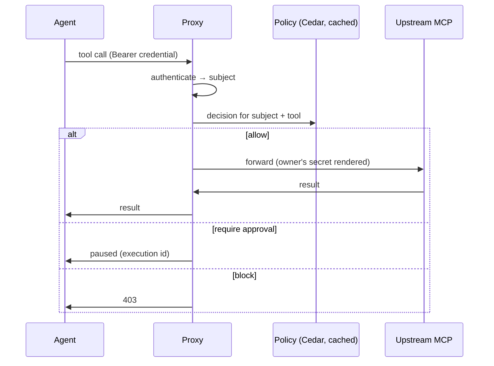

# The MCP Proxy

The proxy is MCPHub's data plane. Every tool call from an agent flows through it. It exposes
two kinds of endpoint and does the same work on each request: authenticate, authorize, render
the upstream credential, route, and (if needed) pause for approval.

## Endpoints

- **Per-connector URL** — every [`Connector`](crds.md#mcpconnector) is reachable at
  `/mcp/<name>` (e.g. `/mcp/grafana-read`, `/mcp/grafana-write`). The client sees that
  connector's exposed, credentialed tool set. Several connectors can front the same provider
  with different credentials and scopes.

Agents point an MCP client **directly** at a `/mcp/...` URL over Streamable
HTTP. For clients that can only launch a stdio command, the CLI's MCP server
(`mcphubctl mcp serve --transport stdio`) presents these endpoints locally and forwards to the
proxy.

## Per-request flow

1. **Authenticate** the caller (OIDC token, tokenless-minted credential, or service token)
   to a subject. See [Authentication](authentication.md).
2. **Authorize** against the in-memory Cedar policy. See [Authorization](authorization.md).
3. **Render the upstream credential** in-cluster and inject it into the upstream MCP. The
   caller never sees it.
4. **Route** the (possibly renamed) tool to the correct upstream MCP and forward.
5. **Pause** if the tool requires approval, returning an execution id; resume on approval.

## Tool naming

- Per-connector: tools appear with the connector's `exposePrefix` (e.g. `github_`).

## Discovery

The proxy also exposes a discovery surface so agents can find tools by intent at runtime
(backed by the unified catalog). The same search is available in the [Web UI](web-ui.md) and
[CLI](cli.md).

## Comparison with a direct MCP connection

| | Direct MCP | Through MCPHub |
|--|-----------|----------------|
| Config | Per server, in client | One URL (per connector) |
| Auth | Per server, often secrets in client config | Central OIDC / tokenless / token |
| Authorization | By the server, if any | Central policy, per tool |
| Secrets | Often client-side | Owned by the connector, rendered in-cluster |
| Approvals | None | Human-in-the-loop on sensitive tools |
| Aggregation | One server | Per-connector, centrally governed |
