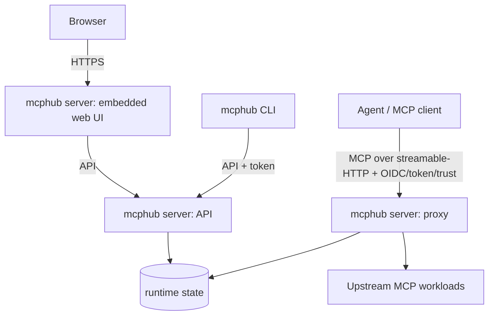
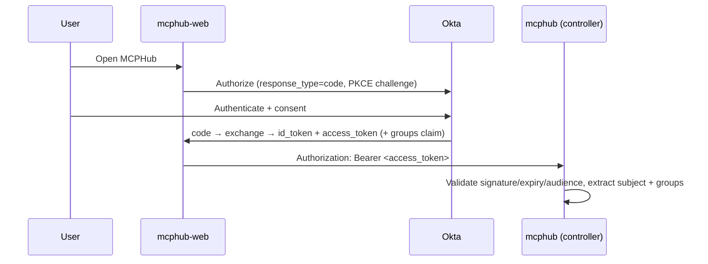
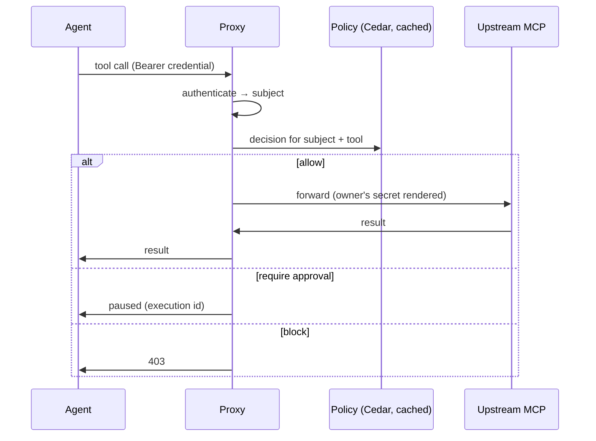
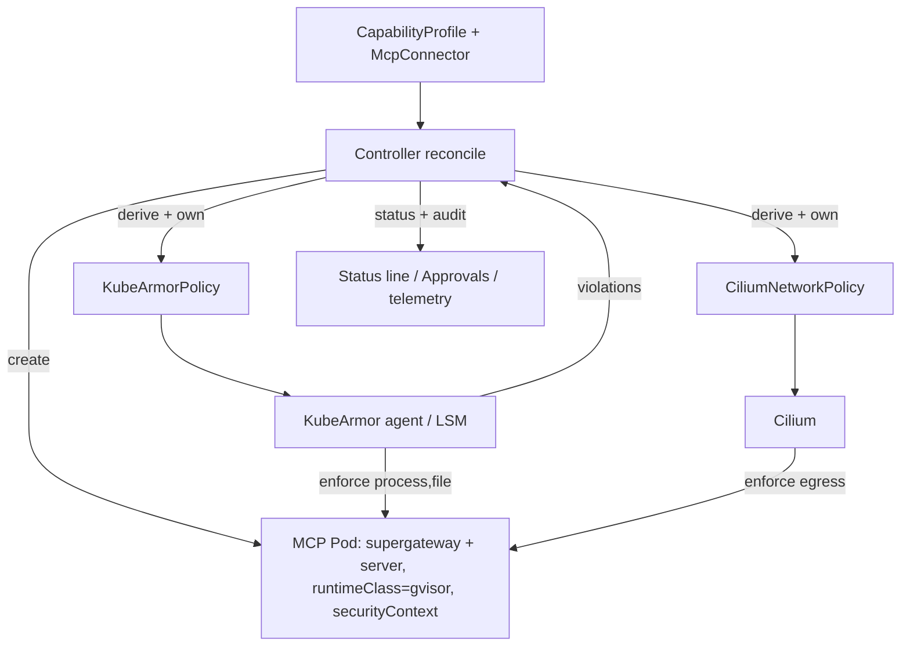
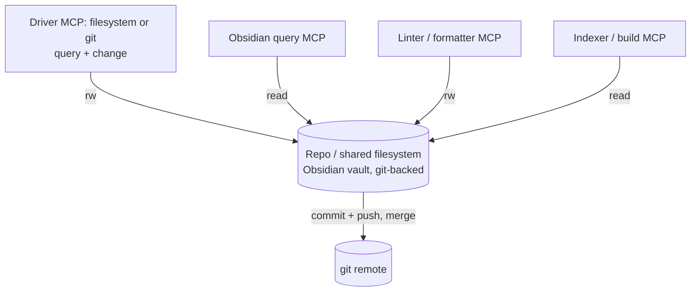

# MCPHub — Core Requirements

Durable, must-not-forget requirements that shape the architecture and authorization model.

## R1 — Scales from one person to a whole team

The same model must work for a single solo user and for an entire team, with no fork in
behavior. Solo usage is just the degenerate case (one subject, no shared groups). Adding a
team should not require a different product, a different deployment, or a rewrite of how
authorization works.

Implications:
- The pluggable storage backends cover the range: SQLite/local for one person, Postgres or
  Kubernetes/etcd for a team.
- The authorization model (subjects = user / group / email-domain / service account / token)
  must read naturally for one user and for many. Groups are optional, not mandatory.
- Sharing is additive: a solo setup becomes a team setup by sharing an existing connector,
  not by reconfiguring it.

## R2 — Set up a credentialed MCP and share it with an IdP team (Okta)

The headline use case:

> As the owner, I configure an MCP that needs credentials (for example **Grafana**, with an
> API token or service-account credential), and I **share it with the members of a team
> defined in my identity provider (Okta)** — without ever exposing the underlying
> credential to those members.

Requirements this implies:
- **Credential ownership stays with the owner.** The Grafana credential is read by the
  connector from its `mcphub-grafana` Secret (rendered in-cluster / in the secret store),
  never handed to the people it's shared with. Shared users call the connector through the
  proxy; the proxy injects the owner's credential. Members never see or hold it.
- **Sharing targets an IdP group, not individuals.** I grant access to the Okta team/group
  (e.g. `grafana-viewers@example.com` or an Okta group id), and membership is resolved from
  the OIDC `groups` claim at request time. People joining/leaving the Okta team gain/lose
  access automatically, with no policy edit.
- **Identity provider is pluggable OIDC.** Google and **Okta** must both be supported as
  OAuth2/OIDC providers; group/team membership comes from the provider's claims. (The
  earlier "Google-only" sketch is superseded: it is OIDC, with Okta as a first-class
  provider for team identity and groups.)
- **Granular sharing.** Sharing can be the whole connector or a subset of its tools —
  scoped to the group, and optionally gated by approval for sensitive tools. It is
  authored in a [`Policy`](../_all.md#policy) (connectors carry no access of their own). See
  [Authorization](../_all.md#authorization).

### Example shape

The owner's credentialed connector plus a `Policy` that shares it with an Okta team —
the connector defines only reachability and tools; sharing lives in the Policy:

```yaml
apiVersion: mcphub.io/v1alpha1
kind: McpConnector
metadata:
  name: grafana
spec:
  runtime:
    remote:
      url: https://grafana.example.com/mcp
  transport: streamable-http
  tools:
    exposePrefix: "grafana_"
  # credential: the mcphub-grafana Secret, injected by the proxy, never exposed
---
apiVersion: mcphub.io/v1alpha1
kind: Policy
metadata: { name: grafana-observability }
spec:
  rules:                               # share with the Okta team — members never see the credential
    - subjects:
        - { kind: Group, provider: okta, match: observability }   # resolved from the OIDC groups claim at request time
      resource:
        connector: grafana
        tools: ["grafana_get_*", "grafana_search_*", "grafana_list_*"]
      effect: allow
```

In Cedar terms this becomes a `permit(principal in Group::"okta:observability", action ==
Action::"call", resource in Connector::"grafana")` with the owner's credential resolved by the
proxy at call time. See [Authentication](../_all.md#authentication) and [Authorization](../_all.md#authorization).


# Architecture

MCPHub is a Kubernetes control plane for MCP servers. It ships as **self-contained Go
binaries** (no build step, no repo required) and a set of Custom Resource Definitions (CRDs).
Configuration is **not** a single YAML file — every object is modeled as a CRD, and the
desired state is persisted in a **pluggable backing store** (Kubernetes/etcd, Postgres, or
SQLite).

The MCP surface agents connect to **is the proxy itself**: it speaks MCP over
streamable-HTTP, so any MCP client points straight at a connector URL. There is no
separate agent-side package to install.

## Components at a glance

| Component | Language | Role |
|-----------|----------|------|
| `mcphub` (server) | Go | Controller + management API + MCP proxy + **embedded web UI**. One self-contained binary. |
| `mcphub` (CLI) | Go | Operator/dev CLI: manage connectors/policies/tokens, discovery, resume |

The server is a single static binary (also shipped as a container image). The web UI is
**embedded** into it, so a solo user runs one binary and gets the API, proxy, and UI. Larger
deployments can optionally run the UI as a separate front tier, but nothing requires it.

## Binaries

### `mcphub` server (controller + API + proxy + UI)

One self-contained process, multiple responsibilities:

- **Controller.** Watches `McpConnector`, `Policy`, `Token`, and
  `ServiceAccount` objects. Reconciles them into runtime state: spawns/tears down MCP
  workloads, resolves and renders referenced secrets, keeps the proxy routing table current.
  On the Kubernetes backend it **installs its own CRDs** on first run (or `mcphub install`),
  so there is no `kubectl apply` of a repo manifest required.
- **API.** REST/JSON used by the web UI, CLI, and automation. CRUD over all objects, tool
  discovery, execution control (pause/resume), token/identity management.
- **MCP proxy.** The data plane and the MCP surface. Each `Connector` is reachable at
  its own URL. The proxy authenticates the
  caller, applies policy, renders the connector's secret, and forwards the call — speaking
  MCP over streamable-HTTP directly to agents.
- **Web UI.** The Vite/React UI is **embedded** in the binary and served by it (can be
  disabled or fronted separately).

### `mcphub` CLI

A standalone client over the API (authenticating with an OIDC token or service token). It
never touches the store directly, so the same validation, policy, and audit apply. The CLI also
**embeds an MCP server** that exposes CLI operations as tools for programmatic access by
AI agents. See [CLI](../_all.md#cli).

### The MCP surface (proxy direct, or the CLI's MCP server)

Agents connect **directly to the proxy** over streamable-HTTP at a connector URL
(e.g. `/mcp/grafana-read`), presenting their token. There is no separate
npm package or sidecar to install.

For clients that can only launch a local **stdio** command (Claude Code, Cursor, etc.), the
`mcphub` **CLI ships its own MCP server**: running `mcphub mcp serve` exposes an MCP endpoint
locally that bridges to the hub (carrying your token, honoring policy and approvals). So the
stdio bridge is just the CLI you already have — not a distinct component. See [CLI](../_all.md#cli).

## State model

Every object — `McpConnector`, `Policy`, `Token`, `ServiceAccount` — is defined as a
CRD (schema, validation, versioning). Two layers of state:

1. **Desired state + audit — the configured store.** CRD objects (created via `kubectl`,
   GitOps, the API, or the web UI) and the **audit/event records** live in the **same** store.
   Like Teleport's Auth Service, the controller is the authority: every write goes through it
   into the configured backend, which is the single source of truth. **The UI and the CRD
   create each other:** anything created in the UI is written as a CRD object, and any CRD
   applied out-of-band appears in the UI — two faces of the same object, not a copy. Unlike
   Teleport, there is **no separate events database**; config and audit share one store (see
   [Storage backends](../_all.md#storage-backends)).
2. **Runtime state — controller store.** Resolved routing tables, rendered (in-memory)
   secrets, live health, cached permissions, in-flight/paused executions. Rebuilt by
   reconciliation; never checked into Git.

See [Storage backends](../_all.md#storage-backends) for how desired state is persisted (Kubernetes/etcd,
Postgres, or SQLite) without changing what the objects are.

## Runtime backends (where MCP servers run)

The controller reconciles each MCP into a real running workload. The runtime mirrors the
environment:

- **Local / single host:** MCP servers run as **Docker containers** (Podman works too). The
  controller starts/stops containers, mounts volumes, and applies the sandbox/egress config
  directly to them. This is the mode for a solo user on the SQLite/Postgres backends — no
  cluster needed.
- **Kubernetes:** MCP servers run as **Pods**, driven by the `McpConnector` CRD.
  The controller creates the Pods (with `runtimeClass`, securityContext, NetworkPolicy, and
  KubeArmor policy) and reconciles them like any operator.

Either way the model is identical — the same objects, the same proxy, the same isolation
knobs (see [Runtime & Isolation](#runtime--isolation)); only the thing that runs the
container differs (Docker engine vs the kube scheduler).

## Everything is API-driven

There is one **controller** exposing one **API**, and every surface is a client of it:

- the **web UI** is a client (it calls the API),
- the **CLI** ([`mcphub`](../_all.md#cli)) is a client,
- your own automation/CI is a client,
- on Kubernetes, `kubectl`/GitOps is an additional path that writes the same CRD objects.

No surface has a private side door: creating an MCP, minting a token, or editing a policy is
the same API call (and the same resulting object) regardless of who initiates it, so
validation, policy, and audit are uniform. See [API](../_all.md#api).

## Request paths



- **Management:** Browser → embedded web UI → API.
- **Automation:** CLI/CI → API (service token / tokenless).
- **Tool execution:** Agent → proxy (direct streamable-HTTP) → upstream MCP.

## Tech stack

- **Server (controller/API/proxy):** Go, controller-runtime; static self-contained binary
  and container image; web UI embedded.
- **CLI:** Go.
- **MCP surface:** the proxy speaks MCP over streamable-HTTP; no separate package.
- **Web:** Vite + React (TypeScript), built and embedded into the server binary.
- **Auth:** OIDC (Google, Okta) for users; tokenless trust + short-lived tokens for machines.
- **Authorization:** `Policy` compiled to Cedar, evaluated in-process.
- **Persistence:** CRD-modeled desired state in a pluggable backend; controller store for
  runtime state.


# Project Structure

How the MCPHub codebase is laid out, and the one rule that keeps it honest:
**packages only call down — never up, never sideways.**

This page is organized like every design page in these docs:

- **Spec** — what the structure must guarantee (the rules).
- **Design** — how the packages are arranged to meet them.
- **Usage** — how you work within the layout day to day.

---

## Spec

The structure exists to enforce these invariants. They are not style preferences — a build
that violates them should fail.

1. **Layered, acyclic dependencies.** Packages are assigned a layer. A package may import
   only packages in a **lower** layer. No upward imports, no sibling imports inside the same
   layer, no cycles.
2. **The domain has no infrastructure.** The core (`domain`) imports nothing from
   Kubernetes, the store, the HTTP stack, the proxy, or any vendor SDK. It is pure Go types
   and interfaces.
3. **Dependencies point inward via interfaces.** When a lower layer needs behavior that
   lives higher up, it declares an **interface** it owns; the higher layer implements it.
   This is the only way control flows "up" — through an abstraction the callee defines.
4. **One composition root.** Concrete implementations are wired together in exactly one
   place (`cmd/`), using [Uber FX](#dependency-injection--uber-fx). No package
   constructs its own dependencies from global state.
5. **Secrets never cross a boundary they shouldn't.** No credential value appears in a type
   that leaves the controller (API responses, logs, status). The structure makes this
   reviewable: only `secret` and `proxy` touch rendered secrets.

### Success criteria

- `go list` import graph is acyclic (enforced in CI).
- `domain` imports zero third-party/infra packages (enforced by an import-lint allowlist).
- Every concrete dependency is provided in `cmd/`, not `init()` or package-level singletons.

---

## Design

### The dependency rule

> A package may depend only on packages **below** it. Lower layers know nothing about higher
> layers except through interfaces the lower layer defines.

Reading the diagram top-to-bottom, every arrow points **down**:

```
                 cmd/            ← composition root (FX wiring, main)
                   │
        ┌──────────┼───────────┬──────────────┐
        ▼          ▼           ▼              ▼
      api        proxy      controller       cli      ← delivery / adapters
        └──────────┴───────────┴──────────────┘
                          │
            ┌─────────────┼──────────────┐
            ▼             ▼              ▼
         store        runtime         secret          ← infrastructure
            └─────────────┴──────────────┘
                          │
                          ▼
                       domain                          ← core (no imports out)
```

- **`domain` (bottom).** Types and rules: `Connector` (`McpConnector`, `OpenApiConnector`,
  `GraphqlConnector`), `Policy`,
  `Token`, `ServiceAccount`, `Subject`, authorization decisions. Also the **port
  interfaces** the upper layers must satisfy (`Store`, `Runtime`, `SecretRenderer`,
  `IdentityVerifier`). Imports nothing outward.
- **Infrastructure (`store`, `runtime`, `secret`).** Concrete implementations of domain
  ports. `store` persists CRD objects (etcd/Postgres/SQLite — see
  [Storage backends](../_all.md#storage-backends)). `runtime` starts/stops MCP workloads (Docker or Pods —
  see [Runtime & Isolation](#runtime--isolation)). `secret` resolves and renders
  credentials. Each imports `domain` only.
- **Delivery / adapters (`api`, `proxy`, `controller`, `cli`).** Translate the outside world
  into domain calls. `api` is REST/JSON; `proxy` is the MCP data plane; `controller`
  reconciles CRDs ([Kubebuilder](#operator-framework--kubebuilder)); `cli` is
  the client + embedded MCP server. They import `domain` and the infrastructure ports — never
  each other.
- **`cmd/` (top).** `main` per binary. Builds the FX graph: chooses which `Store`/`Runtime`
  implementation to provide, wires `api`/`proxy`/`controller`, starts the process. This is
  the **only** layer allowed to know every concrete type.

### How "up" calls work (without breaking the rule)

The controller needs to react to store changes; the proxy needs an authorization decision.
Neither imports the layer that drives it. Instead, the **lower** layer owns the interface:

```go
// package domain — the port lives with the core, not with the caller
type Authorizer interface {
    Decide(ctx context.Context, sub Subject, req ToolCall) Decision
}
```

`proxy` depends on `domain.Authorizer`; the concrete authorizer is implemented in a lower
layer and **provided in `cmd/`**. Control appears to flow up; the *import* still points down.
This is the inversion that keeps the graph acyclic.

### Proposed package tree

```
mcphub/
├── cmd/
│   ├── mcphub/            # server binary: controller + api + proxy + ui
│   └── mcphubctl/         # cli binary (also `mcp serve` bridge)
├── domain/               # core types + port interfaces (no outward imports)
│   ├── connector.go
│   ├── policy.go
│   ├── identity.go       # Subject, Token, ServiceAccount
│   └── ports.go          # Store, Runtime, SecretRenderer, Authorizer, IdentityVerifier
├── store/                # domain.Store impls: etcd, postgres, sqlite
├── runtime/              # domain.Runtime impls: docker, kubernetes
├── secret/               # domain.SecretRenderer impl
├── auth/                 # identity verifiers (OIDC/Okta, K8s SA, SPIFFE) + token minting
├── controller/           # Kubebuilder reconcilers
├── api/                  # REST handlers
├── proxy/                # MCP streamable-HTTP data plane
├── cli/                  # CLI commands + embedded MCP server
└── web/                  # embedded Vite/React assets + thin Go server
```

`auth` sits in the infrastructure layer (it implements `domain.IdentityVerifier`); `api`,
`proxy`, and `controller` consume it, never the reverse.

---

## Usage

### Adding a feature — pick the layer first

1. **New rule or object?** Add the type/interface to `domain`. Stop and check nothing in
   `domain` now imports outward.
2. **New backend or adapter?** Implement an existing `domain` port in `store`/`runtime`/
   `secret`/`auth`. Provide it in `cmd/`.
3. **New endpoint or tool surface?** Add it in `api`/`proxy`/`cli`, calling **down** into
   domain ports. Do not reach into another delivery package.
4. **Wiring?** Register providers in `cmd/`. If you find yourself constructing a dependency
   anywhere else, move it up to the composition root.

### What the rule forbids (and the fix)

| Smell | Why it's wrong | Fix |
|-------|----------------|-----|
| `proxy` imports `api` | sideways | extract the shared type into `domain` |
| `store` imports `controller` | upward | controller depends on `domain.Store`; provide impl in `cmd/` |
| `domain` imports `k8s.io/...` | core touches infra | move the K8s type into `store`/`runtime`; keep `domain` pure |
| package-level `var db = newPostgres()` | hidden wiring | construct in `cmd/` and inject via FX |

### Checking it

```bash
# fails if the import graph has a cycle
go list -deps ./... >/dev/null

# fails if domain imports anything outside the stdlib + own module
go list -f '{{.ImportPath}} {{join .Imports " "}}' ./domain/... | grep -E 'k8s\.io|net/http|database/sql' && exit 1 || true
```

Both run in CI. A red build here means a layer was crossed — fix the direction, don't add a
suppression.

> **ponytail:** the import-lint above is a grep, not a custom analyzer. If the allowlist
> grows unwieldy, swap in `go-arch-lint` or a `depguard` config — not before.


# Technologies

The technology pool MCPHub is built from, why each is in, and how it shows up at runtime.
Organized like the other design pages:

- **Spec** — what we need from the stack (the constraints a choice must satisfy).
- **Design** — the chosen technologies and how they fit the [package layers](#project-structure).
- **Usage** — concrete flows: how a user logs in with Okta, how a service account uses a token.

---

## Spec

Constraints every technology choice is measured against:

1. **Single self-contained Go binary.** The server (controller + API + proxy + embedded UI)
   ships as one static binary and a container image. No runtime build step, no repo required.
2. **Same model solo → team.** Must run on SQLite for one person and Kubernetes/Postgres for
   a team without changing the object model (see [Storage backends](../_all.md#storage-backends)).
3. **CRDs are the source of truth.** Objects are Kubernetes custom resources under
   `mcphub.io/v1alpha1`; the operator framework must own schema, validation, and
   reconciliation.
4. **Wiring at one composition root.** Dependencies are injected, not constructed ad hoc, to
   keep the [call-down-only rule](#the-dependency-rule) enforceable.
5. **Short-lived, tokenless-first identity.** Auth tech must support OIDC (humans) and
   trust-based machine identity (K8s SA, SPIFFE, cloud), with fine-grained tokens only as a
   fallback (see [Authentication](../_all.md#authentication)).
6. **MCP over streamable-HTTP.** The proxy speaks MCP over streamable-HTTP; no SSE.

---

## Design

### The pool

| Area | Technology | Layer | Why |
|------|-----------|-------|-----|
| Language | **Go 1.24+** | all | one static binary, strong K8s ecosystem |
| Dependency injection | **Uber FX** | `cmd/` | wires the composition root; lifecycle hooks for start/stop |
| Operator framework | **Kubebuilder / controller-runtime** | `controller` | CRD scaffolding, reconcilers, manager |
| API surface | **net/http (std) + chi-style routing** | `api` | thin REST/JSON, no heavy framework |
| MCP proxy | **streamable-HTTP MCP** | `proxy` | the data plane and MCP surface |
| Persistence | **etcd (via K8s) / Postgres / SQLite** | `store` | pluggable backend, same objects |
| Runtime | **Docker/Podman or Kubernetes Pods** | `runtime` | local containers or cluster Pods |
| Sandbox/egress | **runtimeClass, NetworkPolicy, KubeArmor** | `runtime` | isolation knobs |
| Identity | **OIDC (Google, Okta), K8s TokenReview, SPIFFE** | `auth` | tokenless-first machine + human auth |
| CLI | **Cobra** | `cli` | commands + embedded `mcp serve` bridge |
| UI | **Vite + React, embedded** | `web` | click-driven, no YAML, served by the binary |
| Observability | **Prometheus client + structured logs** | cross | `/metrics`, leveled logging |

### Dependency injection — Uber FX

FX is the wiring for the [composition root](#cmd-top). Each binary's
`main` builds an `fx.App` from provider functions; no package constructs its own
dependencies. FX's `OnStart`/`OnStop` hooks own process lifecycle so the HTTP server, the
controller manager, and runtime backends start and drain in dependency order.

```go
func main() {
    fx.New(
        // pick the infrastructure impls here — the ONLY place that knows concrete types
        fx.Provide(store.NewFromConfig),      // returns domain.Store (sqlite|postgres|etcd)
        fx.Provide(runtime.NewFromConfig),    // returns domain.Runtime (docker|kubernetes)
        fx.Provide(auth.NewVerifier),         // returns domain.IdentityVerifier
        fx.Provide(secret.NewRenderer),
        fx.Provide(proxy.New, api.New, controller.NewManager),
        fx.Invoke(func(*proxy.Proxy, *api.Server, controller.Manager) {}),
    ).Run()
}
```

Why FX over hand-wiring: the graph is large (store × runtime × auth × proxy × controller) and
the start/stop ordering matters (drain the proxy before stopping runtimes). FX makes the
edges explicit and the lifecycle declarative. It lives **only** in `cmd/`; no domain or
delivery package imports `fx`.

> **ponytail:** FX earns its keep at this graph size and lifecycle ordering. For a two-
> dependency tool we'd hand-wire and skip it.

### Operator framework — Kubebuilder

The `controller` package is a Kubebuilder project: CRD types are tagged Go structs,
controller-runtime provides the manager, caches, and reconcile loop. On the Kubernetes
backend the controller **installs its own CRDs** on first run, so there's no `kubectl apply`
of a repo manifest.

The same CRD *types* are reused on Postgres/SQLite — the store persists them as rows instead
of going through the API server, but the schema and validation are identical (see
[CRDs](../_all.md#custom-resources-crds) and [Storage backends](../_all.md#storage-backends)). Kubebuilder is confined to
`controller`; the rest of the code depends on `domain` types, not on controller-runtime.

---

## Usage

How the auth technologies actually behave, end to end.

### A user connects with Okta (OIDC, OAuth 2.0 authorization-code + PKCE)

Humans never hold a long-lived secret. Login is OIDC against Okta:



1. **Admin → Identity Providers** in the UI registers Okta: issuer URL, client ID/secret,
   and the `groups` claim mapping. Okta is a first-class provider alongside Google.
2. The browser runs the **authorization-code flow with PKCE**; the UI only ever holds a
   short-lived access token, refreshed by Okta.
3. The controller validates the token against Okta's published keys and extracts the
   **subject**, email, and **groups**.
4. **Groups drive sharing.** A policy granted to an Okta group resolves membership from the
   claim at request time — joiners/leavers gain/lose access with no policy edit. See
   [Authentication](../_all.md#authentication) and [Authorization](../_all.md#authorization).

### A service account uses a token (machine identity)

Machines authenticate via a [`ServiceAccount`](../_all.md#serviceaccount). Tokenless trust is
preferred; a fine-grained token is the fallback.

**Tier 0 — tokenless (preferred).** The ServiceAccount carries a *trust rule*, not a secret.
At call time the workload presents a platform-signed document and MCPHub mints a short-lived
(~1h, non-renewable) credential:

- **Kubernetes ServiceAccount token** — an audience-bound projected token, validated via the
  cluster OIDC issuer / `TokenReview`.
- **OIDC JWT** (e.g. GitHub Actions) — match `iss`/`aud`/`sub` against the issuer's keys.
- **SPIFFE / SVID** — verify the `spiffe://` identity against the trust bundle.
- **Cloud instance identity** — AWS/GCP/Azure attestation.

**Fallback — fine-grained token.** When tokenless isn't possible, mint a GitHub-PAT-style
token bound to a subject and scoped to resources × tools × effect × expiry. The secret is
shown **once** at creation and stored only as a hash; it's revocable.

All paths resolve to one bearer credential on the proxy/API:

```
Authorization: Bearer <oidc-access-token | minted-tokenless-credential | mh_svc_token>
```

The proxy authenticates, resolves the subject, and hands off to
[Authorization](../_all.md#authorization). See [Tokens & Identity](../_all.md#tokens--identity) for the
full model.


# CRD Lifecycle

How MCPHub's `mcphub.io/v1alpha1` CRDs are **created** (schema authored), **delivered**
(installed), and **updated** (evolved) — without breaking the "one binary, any backend"
promise. For the schemas themselves, see [Custom Resources (CRDs)](../_all.md#custom-resources-crds).

This page follows the standard design-page shape: **Spec** (the rules), **Design** (how we
meet them), **Usage** (day to day).

---

## Spec

1. **The Go type is the source of truth.** CRD YAML is generated, never hand-written. Generated
   output and the types may not drift.
2. **Validation runs on every backend.** Rules must hold on Kubernetes *and* Postgres/SQLite.
   A check that only an apiserver enforces is not enough.
3. **Delivery is zero-dependency by default.** A fresh install needs no extra CLI, no GitOps
   tooling, no webhook cert plumbing.
4. **Schema evolution never loses data.** Stored objects survive an upgrade.

### Success criteria

- `make manifests && git diff --exit-code` is clean in CI (no drift).
- The control plane starts and serves CRs on all three backends with identical validation.
- A version bump (`v1alpha1` → `v1beta1`) leaves existing objects readable.

---

## Design

### Creation — schema authoring

Go types carry `+kubebuilder` markers; `controller-gen` generates the CRD YAML
(`config/crd/bases`) and deepcopy code. Validation and defaulting are expressed **in the
schema** wherever possible — `x-kubernetes-validations` (CEL) for rules, `default:` for
defaults (e.g. `scaling.replicas: 1`).

Anything CEL can't express — cross-object lookups, rules that consult the store — lives in
`domain`/`store` validation, **not** a webhook. This is deliberate: webhooks are a
Kubernetes-apiserver-only mechanism, so on the Postgres/SQLite backends there is no apiserver
to call them. Putting the logic in code is the only way it runs on every backend — which makes
an admission webhook largely redundant with code you must write anyway.

### Delivery — install

`kustomize` bundles CRDs + RBAC + Deployment into **one versioned release manifest**
(`mcphub.yaml`) — the same pattern Cluster API uses for its `components.yaml`. Two install
paths consume it:

- **Self-install (default, k8s backend).** The controller embeds the generated CRDs and applies
  them with **server-side apply** on boot, before starting its informers. Zero external
  dependency. The controller's RBAC needs `apiextensions` `create/update/patch` — **not**
  `delete` (dropping a CRD would delete every stored connector/policy).
- **GitOps / declarative.** Users apply the generated bundle (or the chart's CRDs) themselves.
  For teams that want cluster state fully declared in Git and `crds.install=false` to keep the
  controller out of the apiserver's schema.

On **Postgres/SQLite there is no CRD install step at all** — the schema is compiled into the
binary; the "CRD" is a code type backed by a table.

### Update — evolution

- **Additive change** (new optional field): regenerate, re-apply via server-side apply.
  Backward-compatible, no webhook.
- **Breaking change / new version:** introduce `v1beta1`, mark it the storage version, and add
  **hub-and-spoke conversion** — a conversion webhook on the Kubernetes backend, plain Go
  conversion functions in `store` everywhere else. This is the one place a webhook is genuinely
  required, and only once two versions are served simultaneously.

A CI drift gate (`make manifests && git diff --exit-code`) keeps the generated YAML in lockstep
with the Go types, so the embedded CRDs can never rot.

### What we deliberately do *not* build

Cluster API ships a dedicated CLI (`clusterctl`) and an inter-provider "API contract" because
it orchestrates many independent providers and bootstraps workload clusters from a management
cluster. MCPHub is a single control plane, so neither applies — `mcphub install` / self-install
is the right-sized equivalent. Argo CD's pure-declarative model (no self-install, controller
has zero CRD permissions) fits a Kubernetes-only tool; MCPHub also runs off-cluster, so
self-install is the better default.

> **ponytail:** webhooks stay out of the Helm chart until a real `v1beta1` exists. Everything
> before that is CEL-in-schema plus in-code validation, delivered as a generated bundle and
> self-installed.

---

## Usage

### Changing a schema

1. Edit the Go type and its `+kubebuilder` markers.
2. `make manifests` — regenerates `config/crd/bases` and the embedded copy.
3. Add/extend validation: CEL in the schema for simple rules; `domain`/`store` for the rest.
4. Commit the regenerated YAML. CI fails if you forgot (`git diff --exit-code`).

### Installing

```bash
# Self-install (default): just run the controller; it applies its embedded CRDs.
helm install mcphub ./charts/mcphub -n mcphub --create-namespace

# GitOps: let the chart manage CRDs declaratively, controller stays out of the schema.
helm install mcphub ./charts/mcphub --set crds.install=true --set crds.keep=true
# (or apply the generated bundle: kubectl apply -f mcphub.yaml)
```

> The chart currently ships **open-schema** CRDs (`x-kubernetes-preserve-unknown-fields`) as a
> placeholder until `controller-gen` exists in the repo — the same shortcut Argo CD's
> `Application` CRD ships in production. Replace with generated structural schemas once the Go
> types land, then flip `crds.install=false` to make self-install the default.


# Connector Extensibility (design note)

> Design decision for how MCPHub supports new and provider-specific connectors. Captures the
> options considered and the chosen path. See [Spec Connectors](../_all.md#spec-connectors-openapi--graphql) for the
> mechanics this builds on.

## The question

How do we support "special" connectors — Google, AWS, a provider with an odd auth or
pagination shape — and new source types over time? The tempting answers are a plugin system,
WASM, an embedded sublanguage, or runtime-loaded code. Most of them are the wrong tool, and
the reason is that **"special" is mostly not code.**

## Decompose "special" first

Looking at what real providers actually need (Google being the worked example), the variation
splits into four needs, and only one of them wants arbitrary code:

| Need | Example | Right mechanism |
|------|---------|-----------------|
| Auth shape | Google OAuth2 scopes/audience | **config / data** (`auth` block + `OAuthApp`) |
| Curated catalog & UX | the Google service list, icons, scopes | **data** (presets) |
| Field / argument / error / pagination mapping | rename a field, page results, map errors | **embedded expression language** |
| New spec format or wire protocol | Google Discovery → OpenAPI, gRPC reflection | **code (a built-in adapter)** |

The first two are data. The third is bounded expression evaluation. Only the fourth is code,
and its cardinality is low (a handful of spec formats over the life of the project).

## Options considered

- **Hardcode — built-in adapters behind an interface.** A small Go interface
  (`SpecAdapter: source → tools`, an implementation of the connector's `ToolProducer` seam)
  with trusted in-tree implementations (OpenAPI, GraphQL, Google Discovery, later gRPC). A new
  format is a PR + release. Type-safe, no sandbox, no attack surface. This is effectively what
  the reference system (executor) ships. **Chosen baseline.**
- **Embedded expression language (CEL).** For the config-level transforms — credential
  templating, argument/field mapping, `when` conditions, pagination rules. We already use this
  shape (`{{secret:…}}`, Cedar `when`). CEL is non-Turing-complete, so it is safe to evaluate
  without a sandbox. (Starlark is the fallback if real procedural logic is ever needed.)
  **Chosen for transforms.** It cannot implement a new wire protocol — that stays code.
- **WASM.** Genuinely sandboxed, hot-loadable, language-agnostic — the right tool *only* if we
  expect many **untrusted third-party** connector binaries. For converting a Discovery
  document it is large overkill (component-model interface, debugging, immature Go host
  story). **Deferred.**
- **Out-of-process plugins (gRPC, HashiCorp go-plugin / Terraform-provider style).** Robust
  and isolated, but in Kubernetes each plugin becomes another container/sidecar with lifecycle
  and distribution cost. Justified only when a third-party provider ecosystem must extend the
  binary without forking it. **Deferred.**
- **Go `plugin` package / runtime-loaded ("JIT") code.** Fragile (version-locked, no unload)
  and pure attack surface for no benefit here. **Rejected.**

## Decision

For v1, do **not** build a general plugin/WASM/JIT system. Instead:

1. **Push "special" into data** — a presets/catalog surface (service lists, scopes, icons)
   that needs zero code, the way Google is handled.
2. **Hardcode the few spec adapters** as Go implementations behind the connector's
   `ToolProducer`/`SpecAdapter` interface. Google is an `OpenApiConnector` + the Discovery
   adapter + a preset — **not** a new connector kind.
3. **Add one embedded expression language (CEL)** for credential/field/condition transforms,
   so the config layer is expressive without code.

Because connectors are composed from interfaces (`ToolProducer`, `Invoker`, `Runtime`,
`Credentials`), a WASM or gRPC-plugin backend is an **additive future** — a new implementation
of one interface, not a remodel. We keep that seam clean now and ship hardcoded adapters.

## Revisit triggers

Reconsider WASM or out-of-process plugins only when one of these is true:

- Third parties need to ship connector logic **without forking** the controller binary.
- Users need to run **untrusted** transform/adapter code (sandboxing becomes a requirement,
  not a nicety).
- The set of spec adapters grows past what is comfortable to maintain in-tree.

Until then: hardcode + data + CEL, and keep the interface seam. YAGNI.


# The MCP Proxy

The proxy is MCPHub's data plane. Every tool call from an agent flows through it. It exposes
two kinds of endpoint and does the same work on each request: authenticate, authorize, render
the upstream credential, route, and (if needed) pause for approval.

## Endpoints

- **Per-connector URL** — every [`Connector`](../_all.md#mcpconnector) is reachable at
  `/mcp/<name>` (e.g. `/mcp/grafana-read`, `/mcp/grafana-write`). The client sees that
  connector's exposed, credentialed tool set. Several connectors can front the same provider
  with different credentials and scopes.

Agents point an MCP client **directly** at a `/mcp/...` URL over Streamable
HTTP. For clients that can only launch a stdio command, the CLI's MCP server
(`mcphub mcp serve --transport stdio`) presents these endpoints locally and forwards to the
proxy.

## Per-request flow



1. **Authenticate** the caller (OIDC token, tokenless-minted credential, or service token)
   to a subject. See [Authentication](../_all.md#authentication).
2. **Authorize** against the in-memory Cedar policy. See [Authorization](../_all.md#authorization).
3. **Render the upstream credential** in-cluster and inject it into the upstream MCP. The
   caller never sees it.
4. **Route** the (possibly renamed) tool to the correct upstream MCP and forward.
5. **Pause** if the tool requires approval, returning an execution id; resume on approval.

## Tool naming

- Per-connector: tools appear with the connector's `exposePrefix` (e.g. `github_`).

## Discovery

The proxy also exposes a discovery surface so agents can find tools by intent at runtime
(backed by the unified catalog). The same search is available in the [Web UI](../_all.md#web-ui) and
[CLI](../_all.md#cli).

## Comparison with a direct MCP connection

| | Direct MCP | Through MCPHub |
|--|-----------|----------------|
| Config | Per server, in client | One URL (per connector) |
| Auth | Per server, often secrets in client config | Central OIDC / tokenless / token |
| Authorization | By the server, if any | Central policy, per tool |
| Secrets | Often client-side | Owned by the connector, rendered in-cluster |
| Approvals | None | Human-in-the-loop on sensitive tools |
| Aggregation | One server | Per-connector, centrally governed |


# Runtime & Isolation

How MCP servers are run, transported, and sandboxed. Two principles:

1. **Streamable HTTP everywhere, no SSE.** Every MCP is reached over the MCP **Streamable
   HTTP** transport. SSE is not used.
2. **Every MCP runs in a tightly jailed container** whose network and filesystem access is
   controlled by config. An MCP is treated as untrusted code.

## Transport: Streamable HTTP via Supergateway

Many MCP servers only speak **stdio**. To put them on the network as Streamable HTTP without
writing a bridge per server, MCPHub runs each stdio server behind
[**Supergateway**](https://github.com/supercorp-ai/supergateway) inside the same container.

- Supergateway wraps the stdio MCP process and exposes it as **Streamable HTTP** at `/mcp`:
  `supergateway --stdio "<server cmd>" --outputTransport streamableHttp --port 8000`.
- It ships as a container image (`ghcr.io/supercorp-ai/supergateway`, also `:uvx` / `:deno`
  variants), so it drops straight into the MCP pod/container as the entrypoint.
- MCPHub's proxy connects to that `/mcp` endpoint over Streamable HTTP. Servers that are
  already remote Streamable HTTP are used directly; **SSE is never used**.

So a container's shape is: `supergateway (Streamable HTTP :8000) → stdio MCP server`, and the
MCPHub proxy is the only client allowed to reach it.

## Where MCPs run (Docker locally, Pods in Kubernetes)

The isolation tools below apply in both environments; only the thing that launches the
container differs:

- **Local / single host:** MCP servers are **Docker containers** the controller starts and
  stops (gVisor runtime, `--read-only`, `--cap-drop ALL`, seccomp/AppArmor, an egress proxy
  or firewall rules). This is the solo / SQLite-Postgres mode — no cluster.
- **Kubernetes:** MCP servers are **Pods** created from the `McpConnector` CRD
  (`runtimeClass` for gVisor/Kata, `securityContext`, NetworkPolicy/Cilium, KubeArmor
  policy). The controller reconciles them like any operator.

The capability config you write is the same; the controller compiles it to Docker flags
locally or to Pod settings + policy CRDs in Kubernetes.

## Container isolation ("tightly jailed")

MCP code is untrusted, so containers are hardened in layers. All of this is config-driven per
`McpConnector`.

### Sandboxed runtime (kernel isolation)
Run MCP containers under a **sandbox runtime**, selected via a `runtimeClass`:

- **gVisor (`runsc`)** — intercepts syscalls in a user-space kernel; strong isolation with
  low overhead. Good default.
- **Kata Containers** — runs each container in a lightweight **microVM** (hardware
  virtualization, e.g. Firecracker/QEMU); strongest isolation, more overhead.

On a non-Kubernetes host, the equivalent is **Podman/Docker + gVisor**, or a process jail
like **nsjail** / **bubblewrap** for stdio servers.

### Pod/container hardening (always on)
- run as **non-root** (`runAsNonRoot`, a high UID),
- **read-only root filesystem**, writable only on explicit mounts,
- **drop ALL Linux capabilities**, `allowPrivilegeEscalation: false`, `no-new-privileges`,
- **seccomp** `RuntimeDefault` (or a tighter custom profile),
- **AppArmor**/**SELinux** profile,
- **resource limits** (CPU/memory/pids) via cgroups,
- no service-account token mounted; no host network/PID/IPC.

### Network egress control (what it can reach)
Default **deny all egress**, then allowlist per MCP. **We standardize on Cilium to start**,
with fallbacks where it isn't present:

- **Cilium (default)** — **FQDN/L7 egress policy**, e.g. allow only `grafana.example.com:443`.
  Profiles are written as domains, so an FQDN-aware layer is what enforces them faithfully.
- **Kubernetes NetworkPolicy** (fallback) — egress to resolved CIDRs/ports; coarser, no
  domain awareness.
- **Egress proxy** (Envoy/Squid) — domain allowlist off-cluster or where no CNI policy.

Ingress is locked down to just the MCPHub proxy. How a profile chooses among these (and what
the status reports) is the [Capability Enforcement design](#capability-enforcement-design).

### Filesystem access (what it can see/write)
- Read-only root; only declared mounts are present.
- Repo mounts attach a [Repo](#repository-server-obsidian-vault-as-a-structured-api--design-note) (design note) volume as `read` or
  `read-write`; that is the only way an MCP touches shared files. (See the Repository Server
  note, see [Repository Server](#repository-server-obsidian-vault-as-a-structured-api--design-note).)

## Config knobs (per MCP)

Surfaced on the `McpConnector` spec (set via the UI, no YAML required):

- `runtime.sandbox`: `gvisor | kata | none` (maps to a `runtimeClass`).
- `runtime.egress`: `deny` (default) + `allow: [host:port, CIDR]` (compiled to NetworkPolicy
  / Cilium FQDN / proxy allowlist).
- `runtime.filesystem`: read-only root + `mounts` (incl. Repo mounts with `read`/`read-write`).
- `runtime.resources`: CPU / memory / pids limits.
- `runtime.capabilities`: dropped by default; nothing added unless explicitly listed.

## What tools we use (summary)

- **Transport bridge:** Supergateway (stdio → Streamable HTTP, no SSE).
- **Sandbox runtime:** gVisor (default) or Kata Containers; nsjail/bubblewrap off-cluster.
- **Hardening:** Kubernetes `securityContext` (non-root, read-only rootfs, drop caps,
  no-new-privileges), seccomp, AppArmor/SELinux, cgroup limits.
- **Network control:** NetworkPolicy, or Cilium FQDN/L7 policy, or an egress proxy.
- **Filesystem control:** read-only rootfs + explicit (incl. Repo) mounts.


# Capability Enforcement (Design)

Architectural design for how a [Capability Profile](../_all.md#sandbox--access-capability-profiles) — the user's
plain-language intent — becomes real enforcement on whatever the cluster provides. This is
the **container capability plane**, distinct from request authorization (`Policy`).

## Goals

- Users author **intent once**, in a stable, cluster-agnostic vocabulary.
- The controller **compiles** that intent to the strongest enforcement the cluster offers.
- **Graceful degradation** with honest status — never a silent gap.
- **No new control-plane surface**: it's another thing the controller reconciles and reads
  alerts from.

## Two layers

```
CapabilityProfile (intent)  ──compile──▶  enforcer-native objects (per cluster)
   what it may reach/touch/run               CiliumNetworkPolicy, KubeArmorPolicy,
   sandbox level, enforce posture            RuntimeClass + securityContext, ...
```

The profile never names an enforcer. The controller owns the mapping.

## Enforcement planes and the v1 provider set

A profile has a few clause types; each routes to a provider. **For starters we standardize
on Cilium for the network plane**, KubeArmor for process/file, and gVisor for the sandbox:

| Clause | v1 provider | Fallback chain |
|--------|-------------|----------------|
| Network (`can reach`) | **Cilium** (FQDN/L7 egress) | plain NetworkPolicy by resolved CIDR → egress proxy → unenforced |
| Process / file / capabilities (`can run`, `can touch`) | **KubeArmor** (LSM, Block) | generated AppArmor/seccomp (coarser) → audit-only |
| Sandbox | **gVisor** RuntimeClass | Kata → none (rely on other planes) |
| Pod hardening (always) | Kubernetes `securityContext` | n/a (baseline) |

Cilium-first matters because the network clause is written as **domains**
(`grafana.example.com:443`), and only an FQDN-aware layer can enforce that faithfully;
without it the controller must resolve to IPs/CIDRs and the fidelity drops (surfaced in
status).

## Capability detection

On startup and on a watch, the controller probes the cluster and builds a capability matrix:

- Cilium present (CRDs/CNI) and FQDN policy supported?
- KubeArmor DaemonSet present; per-node LSM (BPF-LSM/AppArmor) = enforce vs audit-only?
- `RuntimeClass`es for gVisor / Kata registered?
- seccomp/AppArmor availability; Kyverno for admission.

This matrix is what every profile is compiled against. It is also re-evaluated as the
cluster changes (installing Cilium later lights up FQDN enforcement for existing profiles).

## Compilation & the reconcile loop

The capability work hangs off the normal MCP reconcile — the controller already creates the
workload; it adds derived enforcement objects:



- Derived objects (`CiliumNetworkPolicy`, `KubeArmorPolicy`) are **controller-owned children**
  (ownerReferences), selected onto the pod by label, updated on profile change, GC'd with the
  McpConnector.
- On the **local/Docker backend**, the same profile compiles to Docker flags
  (`--cap-drop`, `--read-only`, seccomp, gVisor runtime) plus KubeArmor systemd-mode rules and
  egress proxy/firewall rules — same intent, different emitted artifacts.

## Fail-open vs fail-closed

The profile's `enforce` field decides behavior when the matrix can't satisfy a clause:

- **`require`** → fail closed: the MCP is not started (or is quarantined) if any clause can't
  be truly enforced. For credentialed/sensitive MCPs.
- **`best-effort`** → run, and record per-clause enforcement strength in `status` and audit.

Either way, `status.enforcement` reports, per clause, one of `enforced | degraded | audit |
unenforced`, plus which provider satisfied it. That is what the user-facing status line
summarizes in plain language.

## Status model (what the controller writes)

```yaml
status:
  posture: require
  planes:
    network:   { state: enforced,  by: cilium }
    process:   { state: enforced,  by: kubearmor }
    file:      { state: enforced,  by: kubearmor }
    sandbox:   { state: enforced,  by: gvisor }
  derived:
    ciliumNetworkPolicy: grafana-jail-net
    kubeArmorPolicy:     grafana-jail-ka
```

If, say, Cilium were absent under `best-effort`, `network` would read
`{ state: degraded, by: networkpolicy, note: "domain allowlist resolved to IPs" }` and the UI
status line would show "Network limited to IPs."

## Extensibility

Providers are a plug point. A new enforcer (a different runtime, a custom admission/policy
engine, a future network layer) registers a `clause → provider` mapping with a capability
probe and a compiler. Existing profiles automatically use it where it's the strongest match —
no change to the profile vocabulary users write.

## Boundaries

- This plane governs **what the container may do**. Who may call which tool is
  [Authorization](../_all.md#authorization) (`Policy` → Cedar/OPA), enforced in the proxy.
- It complements, not replaces, the kernel sandbox: gVisor/Kata is the boundary the container
  runs inside; KubeArmor/Cilium constrain behavior within it.
- See [Runtime & Isolation](#runtime--isolation) for the broader runtime picture and the
  transport (Supergateway, Streamable HTTP only).


# Roadmap

A phased plan. Phases 1-3 establish the Kubernetes-native proxy; phases 4-5 add the
catalog, approvals, and the UI. Pre-1.0: APIs and CRD schemas may change.

## Phase 1 — Controller + per-MCP proxy
The end-to-end goal: **register an MCP, attach it to an agent, and let the agent call its
tools using the connector's credentials** — no credential ever exposed to the caller.

- `McpConnector` CRD and reconciler (container + remote runtimes).
- State-backed routing (no single config file).
- Proxy with per-MCP URLs and tool prefixing/allow-deny.
- Credential rendered from the connector's Secret into the upstream call at request time.
- **Done when:** applying an `McpConnector` spawns/connects the server and proxies its tools at
  `/mcp/<name>` with the configured prefix, and an agent calls those tools using the
  connector's stored credential.

## Phase 1.1 — Spec connectors (integrations)
Same end-to-end goal as Phase 1, but for **spec connectors** (`OpenApiConnector` /
`GraphqlConnector`) that compile tools from a spec and run in-process. **Google is the proof
of concept:** an `OpenApiConnector` fed by Google's API Discovery documents, authenticated via
an `OAuthApp`.

- Spec fetch → compile → serve at `/mcp/<name>`, identical to an MCP connector downstream.
- `OAuthApp` + minted token rendered into the call; multiple accounts = multiple connectors.
- **Done when:** a Google `OpenApiConnector` is registered, attached to an agent, and the agent
  calls a Gmail/Calendar tool using the OAuth credential. See
  [Spec Connectors](../_all.md#spec-connectors-openapi--graphql).

## Phase 2 — Storage backends & authentication
- Pluggable store: Kubernetes/etcd, Postgres, SQLite (same CRD types).
- Secret rendering from references (in-cluster only).
- OIDC login (Google, Okta); service tokens.
- **Done when:** the same objects work on all three backends; upstream credentials never
  leak; a user logs in via OIDC and a CI token authenticates.

## Phase 3 — Authorization
- `Policy` CRD compiled to Cedar, evaluated in-process.
- Watched, cached policies; additive, most-restrictive-wins; allow/ask/block.
- **Done when:** two subjects see different allowed tools; policy edits take effect live.

## Phase 4 — Tokenless identity & catalog
- Tokenless trust: OIDC JWT, Kubernetes ServiceAccount, SPIFFE, cloud identity.
- Fine-grained tokens with tags as the sharing primitive; org max-lifetime.
- Unified tool catalog; source auto-detection; intent search.
- **Done when:** a workload (e.g. Hermes) calls tools with no stored secret; adding a source
  auto-detects transport and indexes tools.

## Phase 5 — Approvals & web UI
- Pause/resume executions (human-in-the-loop) for sensitive tools.
- Click-driven Vite/React UI: catalog, policy builder, token/identity
  builder, approvals inbox, identity-provider and storage admin.
- CLI with embedded MCP server for programmatic AI agent access.
- **Done when:** a sensitive call pauses and waits for approval; the full lifecycle (add
  source → policy → call → approve) is doable from the UI; AI agents can connect
  to the CLI's MCP server to perform operations programmatically.

## Beyond
- Workflows, per-execution scratch storage, richer audit/usage analytics, and additional
  trust types as needed. See the design notes ([requirements](#mcphub--core-requirements),
  [repository server](#repository-server-obsidian-vault-as-a-structured-api--design-note), [token & identity](#token--identity--reference-and-ideas)).


# Contributing

Thanks for your interest in MCPHub. This document covers how to get set up, the conventions
we follow, and how to propose changes.

## Repository layout

- `mcphub-controller` — Go: controller (Kubebuilder), API, and MCP proxy.
- `mcphub-web` — Go server serving the Vite/React UI.
- `mcphub` — Go CLI.
- `mcphub` CLI — Go; also ships an embedded **MCP server** (`mcphub mcp serve`) as the local
  stdio bridge for clients that launch a command.
- `docs/` — these docs, plus the design/research notes (requirements, repository-server,
  token-identity-reference, executor-feature-spec, prior-art) and the UI mockup
  (`mockup.html`).

## Development setup

- Go 1.24+ for the controller/CLI/web.
- Node 20+ for the web UI build.
- For the Kubernetes backend: a local cluster (kind/minikube) and `kubectl`.
- For local iteration without a cluster: run the controller with `--store=sqlite`.

Build, run, and test commands live in the `Makefile` / package scripts; run `make help`.

## Conventions

- **Keep the planes separate.** Authorization, secret rendering, and routing live in the Go
  controller. `mcphub-web` and the CLI's MCP bridge are thin and hold no secrets.
- **CRDs are the source of truth.** UI and CLI actions must go through the API and result in
  CRD objects; do not add side channels that bypass reconciliation.
- **No YAML in the UI.** The interface is click-driven; it translates to resources.
- **Short-lived by default.** Prefer tokenless trust; never introduce long-lived shared
  secrets.
- **Secrets never leak.** No credential value in responses, status, logs, or UI.

## Proposing changes

1. Open an issue describing the problem and approach (link any relevant design note in
   `docs/`).
2. For non-trivial design, add or update a design note in `docs/` and reference it.
3. Keep PRs focused; include tests for behavior changes.
4. Update the relevant page in `docs/` when you change user-visible behavior.

## Commit & PR hygiene

- Clear, descriptive commits; reference issues.
- CI must pass (build, lint, type-check, tests) before review.

## Security disclosures

Please report vulnerabilities privately (see the repository's security policy) rather than
opening a public issue. We aim to acknowledge promptly and coordinate a fix and disclosure.

## License

By contributing you agree your contributions are licensed under the Apache License 2.0.


# Repository Server (Obsidian vault as a structured API) — Design Note

Status: idea / exploration. Captured so it is not lost; not yet committed to the roadmap.

## The idea

Share a repository — concretely an **Obsidian vault** (a folder of Markdown with frontmatter,
`#tags`, and `[[wikilinks]]`, usually backed by git) — so that it can be:

1. **Queried in a structured manner, like an API** — not raw file reads, but structured
   access to notes, frontmatter properties, tags, links/backlinks, headings, tasks, embeds.
2. **Written back / pushed**, in a way that **handles multiple concurrent writes** safely.

## Model: Repo as a shared filesystem with attachable MCPs

The shape we are going with:

1. **Add a Repo.** A `Repo` is a first-class resource backed by a git remote or a directory
   — effectively a **shared filesystem volume** that MCPHub manages (clone/pull/commit/push,
   credential for push, sync schedule/webhook).
2. **It comes with a driver MCP.** Adding a Repo auto-provisions a **filesystem MCP** or a
   **git MCP** bound to that volume, so you can query and change the repo immediately
   (read files, write files, search, git ops). This driver is just the first MCP attached to
   the Repo.
3. **Attach other MCPs to the same filesystem.** Any other MCP can be **attached** to the
   Repo's volume, each with an **access mode**: `read` (read-only mount) or `read-write`.
   Examples: attach the Obsidian structured-query MCP (read), a linter/formatter MCP (rw), a
   build/indexer MCP (read), an LLM-notes MCP (rw). They all operate on one shared
   filesystem.

So the Repo is the unit of sharing and the source of truth; MCPs are lenses/tools over it,
each scoped to read or read-write. Multi-write coordination lives at the Repo layer because
now several MCPs (plus the driver) may write the same files.



## Two problems, separately

### A. Structured read/query

Parse Markdown into a queryable model and index it:

- **Note**: path, title, body, content hash, last-modified, current revision (git SHA).
- **Frontmatter**: typed YAML properties (Obsidian "properties").
- **Tags**: `#tag` and frontmatter `tags:`.
- **Links**: `[[wikilink]]`, embeds `![[..]]`, markdown links → forward links + **backlinks**.
- **Headings / sections**: for section-level addressing.
- **Tasks**: `- [ ]` / `- [x]` with optional metadata.

Query surface options:

- **MCP tools** (fits MCPHub best): `vault_search(query)`, `vault_get_note(path)`,
  `vault_by_tag(tag)`, `vault_backlinks(path)`, `vault_query({frontmatter, tag, link})`,
  `vault_list_tasks(filter)`.
- **REST/GraphQL** for non-agent consumers.
- Index store: **SQLite** (notes/frontmatter/tags/links tables) — aligns with the existing
  pluggable-storage story and keeps it embeddable. A Dataview-like query maps onto SQL.

The index is derived/rebuildable from the repo; the repo (git) stays the source of truth.

### B. Write / push with multiple writers

The hard part. The vault is the source of truth (git); writes become commits/pushes. Options
for concurrency, roughly increasing in power and cost:

1. **Optimistic concurrency (base-revision / ETag)** — *recommended starting point.*
   Every read returns the note's revision (git SHA or content hash). A write must supply the
   base revision it edited. The server attempts a 3-way merge against the current HEAD:
   - non-overlapping changes → auto-merge and commit;
   - true conflict → reject with a structured conflict (like HTTP 409 + the diff), client
     retries on the new base. This is exactly how the GitHub Contents API uses `sha`.
   Cheap, stateless, git-native. Good enough for "a few writers, occasional overlap."

2. **Structured patch operations** — *strong complement to (1).*
   Instead of "replace whole file", expose semantic ops: `setFrontmatter(key,val)`,
   `appendToSection(heading, text)`, `toggleTask(id)`, `addTag`, `insertAfter(anchor)`.
   These are far more likely to merge cleanly (two writers touching different sections/keys
   don't conflict), and they read well as MCP tools. Conflicts shrink to genuinely
   overlapping edits.

3. **Per-note lease/lock** — serialize writers on a single note for a short TTL. Simple
   mental model, but blocks concurrency and needs lease expiry/stealing. Useful as an option
   for "I'm doing a big edit, hold the note."

4. **CRDT / OT (Yjs, Automerge)** — character/structure-level merge, real-time multi-writer,
   eventual consistency, offline-friendly. Best experience for live collaboration, but it is
   a different storage model (CRDT doc, not plain files), needs reconciliation back to
   Markdown/git, and is the heaviest to build. Reserve for a later "live collab" phase.

**Recommendation:** git as source of truth + **optimistic concurrency (1)** + **structured
patch ops (2)**. That covers "handle multiple writes" for agents and small teams without a
new storage substrate. Add per-note leases (3) as an option, and consider CRDT (4) only if
real-time co-editing becomes a goal.

## How it maps to MCPHub

- A new kind **`Repo`**: a git remote or directory + push credential reference + sync policy.
  It is the shared filesystem volume and the unit of sharing/authorization.
- Adding a `Repo` auto-creates its **driver MCP** (`runtime: filesystem | git`) mounted
  read-write on the volume. This is a normal `McpConnector` whose backing store is the Repo volume.
- Other MCPs **attach** via a mount declaration, e.g. on the `McpConnector` spec:
  `repoMounts: [{ repo: vault, mode: read|read-write, path: /vault }]`. The controller mounts
  the Repo volume into that MCP's runtime at `path` with the requested mode.
- Everything inherits MCPHub auth/policy/approval: per-tool policy still applies (e.g.
  read tools allowed, write tools require approval), and a Repo is shared to a group exactly
  like Grafana (R2) — attaching a read-only MCP to a vault shared with an Okta team is the
  natural "let the team query my notes" flow.
- A **Repository Server** component owns the volume: parsing/indexing (SQLite) for the
  structured-query MCP, plus the write/merge engine that all read-write attachers go through.

## Concurrency across attached MCPs

Because multiple read-write MCPs (plus the driver) can touch the same files, writes are
mediated by the Repo layer rather than letting each MCP scribble on a raw shared mount:

- **read** mounts get a consistent snapshot/view (no coordination needed).
- **read-write** mounts route writes through the Repo's write engine, which applies the
  optimistic-concurrency + structured-patch model below and commits to git.

This avoids the classic problem of many containers fighting over one RWX POSIX volume: the
filesystem view can be shared, but durable writes funnel through one coordinator.

## Open questions

1. **Shared filesystem realization:** one coordinator-owned volume with mediated writes
   (recommended), a real RWX volume (NFS/CSI) shared across MCP pods, or per-MCP clones that
   sync back? Mediated writes avoid POSIX write races.
2. **Driver default:** filesystem MCP or git MCP as the default driver — or both, selectable
   per Repo?
3. **Mount semantics:** does `read` mean a live read-only mount, a periodic snapshot, or a
   query-only API (no raw FS)? Does `read-write` get a real mount or only the write tools?
4. **Write granularity & conflicts:** whole-file vs structured patch ops; auto-merge vs
   surface conflict; approval-gate writes from attached MCPs?
5. **Scope:** Obsidian-specific profile first, or a general Markdown/code repo server with
   Obsidian as profile #1?
6. **Real-time:** is concurrent *live* editing a goal (→ CRDT) or is merge-or-reject enough
   (→ optimistic + patches)?


# Prior Art & Inspirations

MCPHub draws directly from two projects and sits alongside a broader set of MCP
gateway/security efforts.

## Primary inspirations

- [nsxbet/mcp-shield](https://github.com/nsxbet/mcp-shield) — the proxy + Kubernetes
  controller foundation, tool prefixing, and Kubernetes-native RBAC model. MCPHub keeps
  this skeleton but replaces the single config file with state-backed `Connector` resources,
  swaps the CLI-minted JWT for OAuth2 + service tokens.
- [RhysSullivan/executor](https://github.com/RhysSullivan/executor)
  ([DeepWiki](https://deepwiki.com/RhysSullivan/executor)) — the unified tool catalog,
  source auto-detection, intent-based discovery, and pause/resume (human-in-the-loop)
  execution model. MCPHub adapts these to a Kubernetes-native, multi-tenant control plane.

## Related work

- [MetaMCP](https://metamcp.com/) — unified middleware to manage multiple MCPs
  ([metatool-app](https://github.com/metatool-ai/metatool-app),
  [mcp-server-metamcp](https://github.com/metatool-ai/mcp-server-metamcp)).
- [Smithery](https://smithery.ai/docs) — MCP registry/hosting.
- [nshkrdotcom/GUARDRAIL](https://github.com/nshkrdotcom/GUARDRAIL) — gateway for unified
  access, resource delegation, and risk limits.
- [eqtylab/mcp-guardian](https://github.com/eqtylab/mcp-guardian) — manage / proxy /
  secure MCP servers.
- [Teleport MCP access RFD](https://github.com/gravitational/teleport/blob/master/rfd/0209-mcp-access.md)
  — access-control design for MCP.

## How MCPHub differs

| Dimension | MCP Shield | Executor | MCPHub |
|-----------|-----------|----------|--------|
| Config source | Single YAML file | Local store | State-backed `Connector` CRDs |
| Auth | CLI JWT via SSO | Shared local creds/OAuth | OAuth2 + service tokens |
| Authorization | `MCPPermission` CRDs | Policies | `Policy` CRDs |
| Aggregation | One proxy endpoint | One catalog | Per-MCP URLs |
| Secrets | Env from config | Keychain | `Connector` `secretKeyRef`, rendered in-cluster |
| Approvals | — | Pause/resume | Pause/resume on sensitive tools |
| UI | Roadmap | React dashboard | Vite/React (`mcphub-web`) |
| Runtime | K8s containers | QuickJS sandbox | K8s containers + remote MCPs |


# Token & Identity — Reference and Ideas

Research notes plus design ideas for MCPHub's token generation and (ideally tokenless)
authentication. This is a reference + scratchpad, not a final design. It pulls from
Tailscale OAuth clients, Teleport's certificate/tokenless model, and GitHub fine-grained
tokens, then sketches how MCPHub could combine them.

Driving requirements (see [requirements.md](#mcphub--core-requirements)):
- **R1** — works for one person and a whole team.
- **R2** — set up a credentialed MCP (e.g. Grafana) and share it with an Okta team, without
  exposing the credential.
- **Goal** — use this with **Hermes** (see "Hermes" note below); prefer a **service account
  + trusted relationship** over a copied secret. A token, when used, should be at least as
  granular as a **GitHub fine-grained token**.

---

## 1. Tailscale OAuth clients (token generation model)

What to copy: the **OAuth 2.0 client-credentials → short-lived scoped token** flow, plus
**tags** as the unit of least privilege.

- An **OAuth client** = client ID + long-lived secret, **owned by the tailnet (org), not a
  user** — it keeps working when its creator leaves. (Good for team/R1.)
- The client exchanges its credentials at a token endpoint
  (`POST /api/v2/oauth/token`) for an **access token that expires in exactly 1 hour**.
  **No refresh token** — you just re-request before expiry. Tokens are bearer tokens.
- **Scopes are fine-grained and per-resource with read/write variants**
  (`devices:core:read` vs `devices:core`, `auth_keys`, `dns`, `routes`, ...). Each scope
  maps to an explicit allowlist of API endpoints. A token request can **narrow** to a
  subset of the client's scopes (and tags) at mint time.
- **Tags** are the authorization handle: a client scoped to `auth_keys`/`devices:core`
  must select tags; anything it provisions **assumes that tag's identity**, and ACL rules
  are keyed on the tag. `tagOwners` lets a parent tag own children so one client can manage
  many tags.
- The client secret can itself act as an auth key to provision **ephemeral** nodes
  (auto-removed when offline), **reusable**, **one-off**, or **pre-approved** keys.
- Security: revoking the client **immediately revokes all tokens it issued**; mint events
  are audit-logged with the client ID as actor. Only long-lived secret is the client
  secret (and even that can be replaced by federated OIDC workload identity).

**MCPHub takeaway:** the *issuance* path can mirror this — an org-owned client/service
account mints short-lived (≈1h) bearer tokens, scoped down at mint time, with **tags** as
the sharing primitive that maps cleanly onto our existing MCP tags.

---

## 2. Teleport (the tokenless / trusted-relationship model)

What to copy: **no shared secret to leak**. Identity is proven via a trusted third party,
and access is a **short-lived certificate**, not a stored token.

- Core model: a built-in **CA issues short-lived X.509 / SSH certs** (default user TTL
  ~12h, services renew much faster). **Expiry is the revocation mechanism**; for instant
  cutoff there is **session/identity locking**.
- **Machine ID / `tbot`**: a renewal bot runs next to a service and continuously fetches
  fresh short-lived certs (minutes-scale). The workload never holds a long-lived credential.
- **Join methods** are the key idea, split into:
  - **Secret-based** (a static join token) — discouraged, "prone to exfiltration."
  - **Delegated / tokenless** — the instance proves identity via its platform's
    attestation, so **the token name is not a secret**:
    - **AWS IAM**: instance signs an STS request; rule allows only a given account/ARN.
    - **GitHub/GitLab/CircleCI**: the platform's **OIDC token** is verified against the
      provider's JWKS; allow-rules match `repository`, `sub`, `ref`.
    - **Kubernetes**: validates a ServiceAccount token via TokenReview / OIDC discovery.
    - **TPM**: hardware Endorsement Key — no shared secret at all.
  - Most delegated methods issue **non-renewable** certs (re-attest each time) — ideal for
    ephemeral CI/agents.
- **Workload Identity / SPIFFE**: issues `spiffe://<trust-domain>/<path>` IDs as **SVIDs**
  (X.509 or JWT); trust domain = the cluster's root of trust; SVIDs verified against the
  trust bundle; issued over a local Workload API after attestation.

**MCPHub takeaway:** the *strong* path is tokenless. A caller (Hermes, a CI agent, a
teammate's tool) presents a **platform-signed document** (OIDC JWT, K8s SA token, cloud
instance identity) that MCPHub validates against a configured **trust rule**, then issues a
**short-lived credential** for the proxy. No secret is stored on the client.

---

## 3. GitHub fine-grained tokens (the granularity bar)

What to copy: the **shape** of a token = `(resources) × (permissions × level) × expiry ×
owner`.

- Fine-grained PATs replace broad scopes with **50+ granular permissions**, each set to
  **none / read / write** (a few support **admin**); levels are hierarchical (write ⊇ read).
- **Per-resource selection**: confined to one owner; narrowed to all / selected / public
  repos. (One org per token.)
- **Expiration is first-class** (UI requires it; orgs can enforce a max lifetime).
- **Org approval policy**: tokens targeting an org can be created `pending` and only read
  public data until an admin approves; org owners can block fine-grained PATs entirely.
- A token never exceeds the issuing user's own access.

**MCPHub takeaway:** when a token *is* used, its grant must be expressible at this level:
specific MCPs/tags **×** specific tools **×** read/call/approve **×** expiry **×**
owner — which is exactly what the granular-token builder in the mockup and `Policy`
already aim at. Add **org approval** for sensitive grants and an **enforceable max
lifetime**.

---

## 4. The unifying principle

GitHub OIDC, SPIFFE/SPIRE, and Kubernetes bound tokens all converge on the principle stated
in [Tokens & Identity → Principle](../_all.md#principle) — short-lived,
audience-scoped, auto-rotated identity backed by a pre-established trust relationship, not a
copied shared secret. How each system realizes it:

- **OIDC federation**: workload presents a JWT; verifier pre-registers (issuer, audience,
  subject-match) and validates the signature via the issuer's JWKS.
- **SPIFFE/SPIRE**: workload calls the Workload API with **no secret and without even
  knowing its own ID**, gets an SVID after attestation; X.509-SVIDs preferred over JWT
  (replay risk).
- **Kubernetes TokenRequest**: audience-bound, time-bound projected SA tokens, auto-rotated
  by the kubelet, validated against the cluster OIDC issuer.

---

## 5. Synthesis → the shipped design

The tiered model these notes converge on (Tier 0 tokenless service account + trusted
relationship, Tier 1 fine-grained token fallback, tags as the sharing primitive, and the
Grafana → Okta R2 flow) is the canonical design. It is documented in
[Tokens & Identity](../_all.md#tokens--identity) and is not repeated here.

---

## Hermes — needs confirmation

"Use this with Hermes" is recorded as a goal, but I have **not confirmed which Hermes** is
meant (your own service/agent, a messaging gateway, an internal scheduler, etc.). The Tier-0
tokenless design above assumes Hermes is a **machine/workload that can carry a platform
identity** (OIDC/JWT, K8s SA, SPIFFE, or cloud instance identity) — which is what makes the
trusted-relationship, no-secret path work. If Hermes is something else (e.g. an end-user
chat surface), the integration shifts toward user OIDC + short-lived tokens instead. Please
confirm what Hermes is so this section can be made concrete.

---

## Open questions
1. Tokenless first, or fine-grained tokens first to ship? (Tier 0 vs Tier 1 priority.)
2. Short-lived **bearer tokens** (simpler) vs **mTLS certs** (Teleport-grade, more infra)?
3. Which trust relationships to support at launch: OIDC JWT, K8s SA token, SPIFFE, cloud
   instance identity?
4. Standard TTL and whether any long-lived token is ever allowed (with org max-lifetime).

