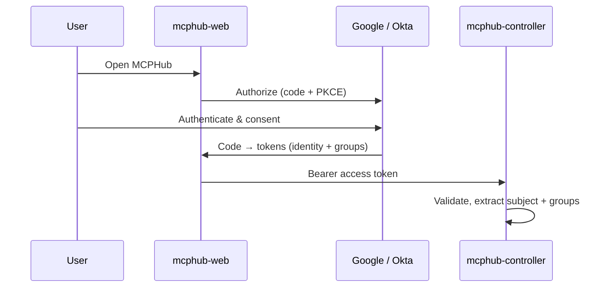

# Authentication

MCPHub separates **humans** (interactive OIDC) from **machines** (tokenless trust, or
short-lived tokens). Identity is always resolved to a **subject** that authorization acts on.

## Humans — OIDC (Google & Okta)

User login is OIDC (OpenID Connect), authorization-code flow with PKCE. Providers are
pluggable; **Google** and **Okta** are first-class.



- The web UI holds only a short-lived access token, never a long-lived secret.
- The controller validates the token (signature, expiry, audience) and extracts identity
  (subject, email) and **groups** from the provider's `groups` claim.
- **Groups drive sharing.** Granting a policy to an Okta group means membership is resolved
  from the claim at request time — joiners/leavers gain/lose access with no policy edit.
  This is the basis of the [share-with-a-team](getting-started.md#3-share-it-with-an-okta-team)
  flow.

Configure providers under **Admin → Identity Providers** in the UI.

## Machines — tokenless trust (preferred)

Machines (CI, agents, Hermes) should authenticate via a **trusted relationship** instead of
a stored secret. The workload presents a platform-signed document; MCPHub validates it
against a configured trust rule and mints a short-lived credential. Nothing to leak.

Supported trust types:

- **OIDC JWT** (e.g. GitHub Actions): validate `iss`, `aud`, and a `sub` match against the
  issuer's published keys.
- **Kubernetes ServiceAccount token:** audience-bound projected token validated via the
  cluster's OIDC issuer / TokenReview.
- **SPIFFE / SVID:** a `spiffe://trust-domain/path` identity verified against the trust
  bundle.
- **Cloud instance identity:** AWS IAM, GCP, or Azure attestation.

See [Tokens & Identity](tokens-and-identity.md) for the full model and examples.

## Machines — fine-grained tokens (fallback)

When tokenless is not possible, mint a fine-grained, short-lived token (GitHub-PAT-style)
bound to a subject and scoped to resources × tools × level × expiry. See
[Tokens & Identity](tokens-and-identity.md).

## Presenting credentials to the proxy

All three resolve to a bearer credential on the proxy/API:

```
Authorization: Bearer <oidc-access-token | minted-tokenless-credential | mh_svc_token>
```

The proxy authenticates, resolves the subject, then hands off to
[Authorization](authorization.md).

## Where credentials live

- **Human OIDC tokens:** in the browser session, short-lived, refreshed by the IdP.
- **Tokenless:** no stored secret anywhere; a credential is minted per call (~1h).
- **Service tokens:** secret shown once at creation, stored only as a hash; revocable.
- **Upstream MCP credentials** (the secrets MCPs need) are owned by the MCP and never
  exposed to callers. See [Security](security.md).
