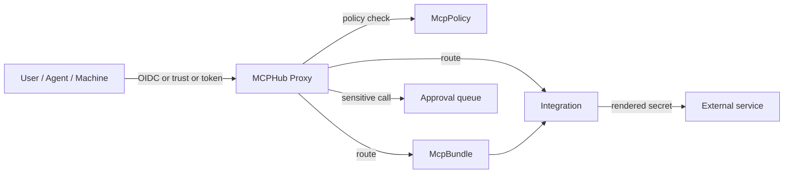

# Concepts

MCPHub has a small set of concepts. Everything in the web UI maps to one of these, and each
is stored as a Kubernetes custom resource (see [CRDs](crds.md)) — but you never have to
write YAML; the UI and CLI translate clicks into resources.

## Integration

An **integration** is an upstream tool provider definition: how to reach it and where its
tool catalog comes from. There are three `kind`s:

- **`mcp`** — a Model Context Protocol server, run as a **container** (e.g.
  `ghcr.io/github/github-mcp-server`) or reached **remote** over MCP **Streamable HTTP**.
  Stdio-only servers are wrapped with [Supergateway](runtime-isolation.md) and exposed over
  Streamable HTTP too — SSE is not used. Every MCP runs in a tightly jailed container.
- **`openapi`** — an OpenAPI/REST service, or a **bundle** of several (e.g. Google = Gmail +
  Calendar + Drive + Docs). Tools are compiled from the spec.
- **`graphql`** — a GraphQL endpoint; tools are compiled from introspection.

For `openapi`/`graphql` the spec is fetched, hashed, and rebuilt into tools on demand;
connections, credentials, and policies survive a rebuild. The UI seeds new integrations from
a **preset catalog** (Google, Stripe, GitHub REST, Vercel, …) or from a pasted URL it
auto-detects. An integration on its own describes the provider and its tools; it is not a
live, credentialed connection. To actually call tools you use a **connection** (below).
Backed by the [`Integration`](crds.md#integration) resource.

## Connection

A **connection** is a named, **credentialed** instance of an integration. One integration can
have many connections — the same provider authenticated with different credentials (or
different accounts) and scoped to different tools. Each connection has its own credential,
its own exposed tool set, and (for MCP kinds) its own proxied URL.

The motivating case: from one `grafana` MCP integration you create two connections —

- **`grafana-read`** → a read-only token, exposes `get_* / search_* / list_*`,
- **`grafana-write`** → an admin token, exposes everything, with write tools approval-gated.

Agents point at `/mcp/grafana-read` or `/mcp/grafana-write`; each is independently shared and
governed. A connection carries **either** an api-key/header credential (resolved from a
Secrets provider) **or** an OAuth grant minted via a reusable **OAuth app** (below). For the
simple solo case, an integration can carry one inline default connection, so a
single-credential setup stays a single object. Backed by the
[`Connection`](crds.md#connection) resource.

> This is the integration-vs-connection split Executor popularized: the **integration** is
> the catalog/definition, the **connection** is the credentialed, shareable instance.

## OAuth app

An **OAuth app** is a registered, reusable OAuth client. Register a provider (e.g. Google)
once, then connect many accounts against it — each `Connection` references the app and
requests its own scopes. The client secret and minted tokens live in a Secrets provider,
never inline. Backed by the [`OAuthApp`](crds.md#oauthapp) resource.

## Tool

A **tool** is a single callable exposed by an integration (e.g.
`github_create_pull_request`). Tools have input/output JSON schemas and can be flagged
sensitive (requiring approval). MCPHub indexes every tool from every integration into one
searchable **catalog**.

## Bundle

A **bundle** composes a curated set of tools from one or more integrations behind a single
endpoint (e.g. `/bundle/devtools`), optionally renaming tools and flagging which need
approval. A bundle is its own authorization boundary: grant a team the bundle without
granting the underlying integrations. Backed by the [`McpBundle`](crds.md#mcpbundle)
resource. See [Bundles](bundles.md).

## Tag

A **tag** is a label on an integration (e.g. `code`, `infra`, `sensitive`). Tags are a
sharing and policy primitive: grant access by tag and any new integration carrying that tag
is automatically included. Tags also drive default approval behavior (e.g. `sensitive`).

## Subject

A **subject** is who or what is making a call:

- a **user** (authenticated via OIDC — Google or Okta),
- a **group** (from the identity provider's `groups` claim),
- a **service account** / **token** (a machine identity).

## Policy

A **policy** maps subjects to what they may do with tools: **allow**, **require approval**,
or **block**. Policy lives at two tiers:

- **Local** — most policy lives **on the connection** (its `access` block): who may use this
  specific MCP and which of its tools. Sharing happens here.
- **Global** — a few org-wide **general** rules ([`McpPolicy`](crds.md#mcppolicy)): guardrails
  and defaults that span everything (e.g. "all `sensitive` tools require approval").

They resolve together: grants are additive, and a global guardrail can only **tighten** a
local grant (force approval / deny), never loosen it. See [Authorization](authorization.md).

## Service account & token

A **service account** is an org-owned machine identity that survives its creator. It
authenticates one of two ways:

- **Tokenless (preferred):** a trusted relationship (OIDC, Kubernetes ServiceAccount,
  SPIFFE, cloud instance identity). No secret is stored; MCPHub mints a short-lived
  credential per call.
- **Fine-grained token:** a GitHub-style token scoped to resources × tools × level × expiry,
  short-lived and re-minted on expiry.

See [Tokens & Identity](tokens-and-identity.md).

## Execution & approval

An **execution** is a single tool call flowing through the proxy. When a tool requires
approval (or needs auth), the execution **pauses** and waits for a human decision, then
resumes. See [Authorization](authorization.md#approvals) and [Web UI](web-ui.md).

## How they fit together

