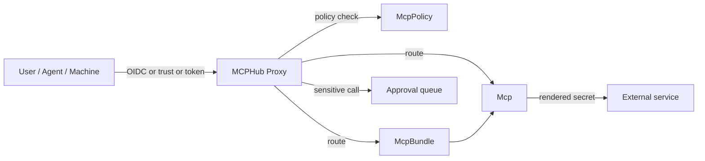

# Concepts

MCPHub has a small set of concepts. Everything in the web UI maps to one of these, and each
is stored as a Kubernetes custom resource (see [CRDs](crds.md)) — but you never have to
write YAML; the UI and CLI translate clicks into resources.

## MCP

An **MCP** is an upstream Model Context Protocol server definition: how to run or reach the
server and what tool catalog it offers. It can be:

- a **container** MCPHub runs (e.g. `ghcr.io/github/github-mcp-server`), or
- a **remote** MCP reached over MCP **Streamable HTTP**.

Stdio-only servers are wrapped with [Supergateway](runtime-isolation.md) and exposed over
Streamable HTTP too — SSE is not used. Every MCP runs in a tightly jailed container; see
[Runtime & Isolation](runtime-isolation.md).

An MCP on its own describes the server and its tools; it is not a live, credentialed
connection. To actually call tools you use a **connection** (below). Backed by the
[`Mcp`](crds.md#mcp) resource.

## Connection

A **connection** is a named, **credentialed** instance of an MCP. One MCP can have many
connections — the same server authenticated with different credentials and scoped to
different tools. Each connection has its own credential, its own exposed tool set, and its
own proxied URL.

The motivating case: from one `grafana` MCP you create two connections —

- **`grafana-read`** → a read-only token, exposes `get_* / search_* / list_*`,
- **`grafana-write`** → an admin token, exposes everything, with write tools approval-gated.

Agents point at `/mcp/grafana-read` or `/mcp/grafana-write`; each is independently shared and
governed. For the simple solo case, an MCP can carry one inline default connection, so a
single-credential setup stays a single object. Backed by the
[`McpConnection`](crds.md#mcpconnection) resource.

> This mirrors the integration-vs-connection split: the **MCP** is the catalog/definition,
> the **connection** is the credentialed, shareable instance.

## Tool

A **tool** is a single callable exposed by an MCP (e.g. `github_create_pull_request`). Tools
have input/output JSON schemas and can be flagged sensitive (requiring approval). MCPHub
indexes every tool from every MCP into one searchable **catalog**.

## Bundle

A **bundle** composes a curated set of tools from one or more MCPs behind a single endpoint
(e.g. `/bundle/devtools`), optionally renaming tools and flagging which need approval. A
bundle is its own authorization boundary: grant a team the bundle without granting the
underlying MCPs. Backed by the [`McpBundle`](crds.md#mcpbundle) resource. See
[Bundles](bundles.md).

## Tag

A **tag** is a label on an MCP (e.g. `code`, `infra`, `sensitive`). Tags are a sharing and
policy primitive: grant access by tag and any new MCP carrying that tag is automatically
included. Tags also drive default approval behavior (e.g. `sensitive`).

## Subject

A **subject** is who or what is making a call:

- a **user** (authenticated via OIDC — Google or Okta),
- a **group** (from the identity provider's `groups` claim),
- a **service account** / **token** (a machine identity).

## Policy

A **policy** maps subjects to what they may do with tools: **allow**, **require approval**,
or **block**. Policies are additive across matches and resolve most-restrictive-wins. Backed
by the [`McpPolicy`](crds.md#mcppolicy) resource. See [Authorization](authorization.md).

## Service account & token

A **service account** is an org-owned machine identity that survives its creator. It
authenticates one of two ways:

- **Tokenless (preferred):** a trusted relationship (OIDC, Kubernetes ServiceAccount,
  SPIFFE, cloud instance identity). No secret is stored; MCPHub mints a short-lived
  credential per call.
- **Fine-grained token:** a GitHub-style token scoped to resources × tools × level × expiry,
  short-lived and re-minted on expiry.

See [Tokens & Identity](tokens-and-identity.md).

## Execution & approval

An **execution** is a single tool call flowing through the proxy. When a tool requires
approval (or needs auth), the execution **pauses** and waits for a human decision, then
resumes. See [Authorization](authorization.md#approvals) and [Web UI](web-ui.md).

## How they fit together

