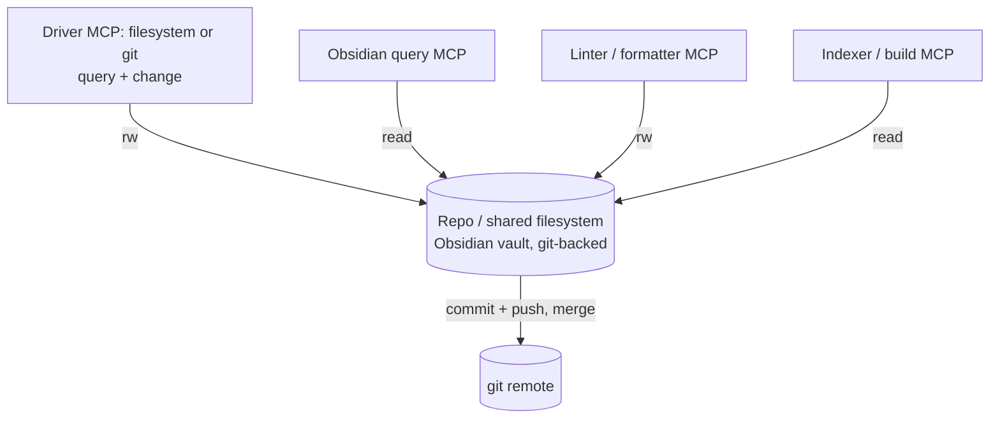

# Repository Server (Obsidian vault as a structured API) — Design Note

Status: idea / exploration. Captured so it is not lost; not yet committed to the roadmap.

## The idea

Share a repository — concretely an **Obsidian vault** (a folder of Markdown with frontmatter,
`#tags`, and `[[wikilinks]]`, usually backed by git) — so that it can be:

1. **Queried in a structured manner, like an API** — not raw file reads, but structured
   access to notes, frontmatter properties, tags, links/backlinks, headings, tasks, embeds.
2. **Written back / pushed**, in a way that **handles multiple concurrent writes** safely.

## Model: Repo as a shared filesystem with attachable MCPs

The shape we are going with:

1. **Add a Repo.** A `Repo` is a first-class resource backed by a git remote or a directory
   — effectively a **shared filesystem volume** that MCPHub manages (clone/pull/commit/push,
   credential for push, sync schedule/webhook).
2. **It comes with a driver MCP.** Adding a Repo auto-provisions a **filesystem MCP** or a
   **git MCP** bound to that volume, so you can query and change the repo immediately
   (read files, write files, search, git ops). This driver is just the first MCP attached to
   the Repo.
3. **Attach other MCPs to the same filesystem.** Any other MCP can be **attached** to the
   Repo's volume, each with an **access mode**: `read` (read-only mount) or `read-write`.
   Examples: attach the Obsidian structured-query MCP (read), a linter/formatter MCP (rw), a
   build/indexer MCP (read), an LLM-notes MCP (rw). They all operate on one shared
   filesystem.

So the Repo is the unit of sharing and the source of truth; MCPs are lenses/tools over it,
each scoped to read or read-write. Multi-write coordination lives at the Repo layer because
now several MCPs (plus the driver) may write the same files.

## Two problems, separately

### A. Structured read/query

Parse Markdown into a queryable model and index it:

- **Note**: path, title, body, content hash, last-modified, current revision (git SHA).
- **Frontmatter**: typed YAML properties (Obsidian "properties").
- **Tags**: `#tag` and frontmatter `tags:`.
- **Links**: `[[wikilink]]`, embeds `![[..]]`, markdown links → forward links + **backlinks**.
- **Headings / sections**: for section-level addressing.
- **Tasks**: `- [ ]` / `- [x]` with optional metadata.

Query surface options:

- **MCP tools** (fits MCPHub best): `vault_search(query)`, `vault_get_note(path)`,
  `vault_by_tag(tag)`, `vault_backlinks(path)`, `vault_query({frontmatter, tag, link})`,
  `vault_list_tasks(filter)`.
- **REST/GraphQL** for non-agent consumers.
- Index store: **SQLite** (notes/frontmatter/tags/links tables) — aligns with the existing
  pluggable-storage story and keeps it embeddable. A Dataview-like query maps onto SQL.

The index is derived/rebuildable from the repo; the repo (git) stays the source of truth.

### B. Write / push with multiple writers

The hard part. The vault is the source of truth (git); writes become commits/pushes. Options
for concurrency, roughly increasing in power and cost:

1. **Optimistic concurrency (base-revision / ETag)** — *recommended starting point.*
   Every read returns the note's revision (git SHA or content hash). A write must supply the
   base revision it edited. The server attempts a 3-way merge against the current HEAD:
   - non-overlapping changes → auto-merge and commit;
   - true conflict → reject with a structured conflict (like HTTP 409 + the diff), client
     retries on the new base. This is exactly how the GitHub Contents API uses `sha`.
   Cheap, stateless, git-native. Good enough for "a few writers, occasional overlap."

2. **Structured patch operations** — *strong complement to (1).*
   Instead of "replace whole file", expose semantic ops: `setFrontmatter(key,val)`,
   `appendToSection(heading, text)`, `toggleTask(id)`, `addTag`, `insertAfter(anchor)`.
   These are far more likely to merge cleanly (two writers touching different sections/keys
   don't conflict), and they read well as MCP tools. Conflicts shrink to genuinely
   overlapping edits.

3. **Per-note lease/lock** — serialize writers on a single note for a short TTL. Simple
   mental model, but blocks concurrency and needs lease expiry/stealing. Useful as an option
   for "I'm doing a big edit, hold the note."

4. **CRDT / OT (Yjs, Automerge)** — character/structure-level merge, real-time multi-writer,
   eventual consistency, offline-friendly. Best experience for live collaboration, but it is
   a different storage model (CRDT doc, not plain files), needs reconciliation back to
   Markdown/git, and is the heaviest to build. Reserve for a later "live collab" phase.

**Recommendation:** git as source of truth + **optimistic concurrency (1)** + **structured
patch ops (2)**. That covers "handle multiple writes" for agents and small teams without a
new storage substrate. Add per-note leases (3) as an option, and consider CRDT (4) only if
real-time co-editing becomes a goal.

## How it maps to MCPHub

- A new kind **`Repo`**: a git remote or directory + push credential reference + sync policy.
  It is the shared filesystem volume and the unit of sharing/authorization.
- Adding a `Repo` auto-creates its **driver MCP** (`runtime: filesystem | git`) mounted
  read-write on the volume. This is a normal `Mcp` whose backing store is the Repo volume.
- Other MCPs **attach** via a mount declaration, e.g. on the `Mcp` spec:
  `repoMounts: [{ repo: vault, mode: read|read-write, path: /vault }]`. The controller mounts
  the Repo volume into that MCP's runtime at `path` with the requested mode.
- Everything inherits MCPHub auth/policy/approval: per-tool policy still applies (e.g.
  read tools allowed, write tools require approval), and a Repo is shared to a group exactly
  like Grafana (R2) — attaching a read-only MCP to a vault shared with an Okta team is the
  natural "let the team query my notes" flow.
- A **Repository Server** component owns the volume: parsing/indexing (SQLite) for the
  structured-query MCP, plus the write/merge engine that all read-write attachers go through.

## Concurrency across attached MCPs

Because multiple read-write MCPs (plus the driver) can touch the same files, writes are
mediated by the Repo layer rather than letting each MCP scribble on a raw shared mount:

- **read** mounts get a consistent snapshot/view (no coordination needed).
- **read-write** mounts route writes through the Repo's write engine, which applies the
  optimistic-concurrency + structured-patch model below and commits to git.

This avoids the classic problem of many containers fighting over one RWX POSIX volume: the
filesystem view can be shared, but durable writes funnel through one coordinator.

## Open questions

1. **Shared filesystem realization:** one coordinator-owned volume with mediated writes
   (recommended), a real RWX volume (NFS/CSI) shared across MCP pods, or per-MCP clones that
   sync back? Mediated writes avoid POSIX write races.
2. **Driver default:** filesystem MCP or git MCP as the default driver — or both, selectable
   per Repo?
3. **Mount semantics:** does `read` mean a live read-only mount, a periodic snapshot, or a
   query-only API (no raw FS)? Does `read-write` get a real mount or only the write tools?
4. **Write granularity & conflicts:** whole-file vs structured patch ops; auto-merge vs
   surface conflict; approval-gate writes from attached MCPs?
5. **Scope:** Obsidian-specific profile first, or a general Markdown/code repo server with
   Obsidian as profile #1?
6. **Real-time:** is concurrent *live* editing a goal (→ CRDT) or is merge-or-reject enough
   (→ optimistic + patches)?
