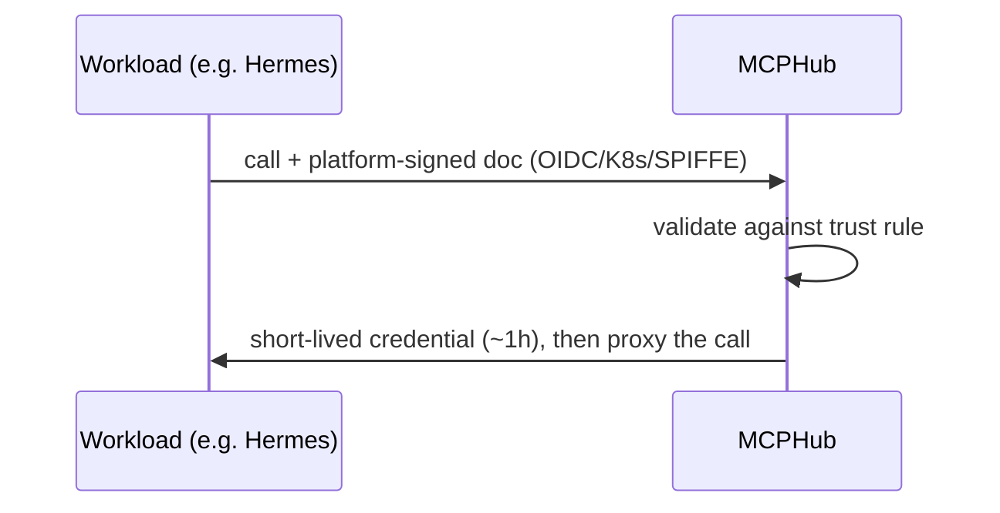

# Tokens & Identity

MCPHub's machine authentication is tiered. **Tokenless** (a trusted relationship) is
preferred; **fine-grained tokens** are the fallback. Both end up as a short-lived credential
the proxy validates, and both resolve to a subject that [Authorization](authorization.md)
acts on.

This design borrows from three systems: Teleport (tokenless, certificate/trust based),
Tailscale (short-lived scoped tokens, tags as the sharing primitive), and GitHub
fine-grained tokens (the granularity bar).

## Principle

> Short-lived, audience-scoped, auto-rotated identity backed by a pre-established trust
> relationship — not a copied shared secret. The verifier trusts the platform's signing
> keys; the workload proves who/where it is, not what secret it holds.

## Tier 0 — Tokenless (preferred)

A [`ServiceAccount`](crds.md#serviceaccount) is an org-owned identity (survives its creator).
Instead of a secret, it carries a **trust rule**. At call time the caller presents its
platform-signed document; MCPHub validates it and mints a short-lived (~1h, non-renewable)
credential scoped to the account's policy. There is nothing to leak.

Trust types:

- **OIDC JWT** (e.g. GitHub Actions): match `iss`, `aud`, `sub` against the issuer's keys.
- **Kubernetes ServiceAccount token:** audience-bound projected token, validated via the
  cluster OIDC issuer / TokenReview.
- **SPIFFE / SVID:** verify the `spiffe://` identity against the trust bundle.
- **Cloud instance identity:** AWS IAM / GCP / Azure attestation.

This is the recommended path for CI and for agent workloads such as Hermes: the workload
runs with a platform identity, MCPHub trusts it, and no token is copied around.



## Tier 1 — Fine-grained token (fallback)

When tokenless is not possible, mint a [`Token`](crds.md#token) bound to a subject. Its grant
is as granular as a GitHub fine-grained token:

```
token = (resources: MCPs / bundles / tags)
      × (tools)
      × (level: call / read / require-approval)
      × (expiry)
      × (owner)
```

- **Tags are the sharing primitive** (Tailscale-style): grant `tag:observability` and new
  Grafana-tagged MCPs are included automatically.
- **Short-lived by default** (~1h), re-minted on expiry; an org-enforceable `maxLifetime`
  caps how long any token can live.
- The secret is shown once and stored only as a hash.

## Revocation

- **Expiry** is the default cutoff — credentials are short-lived.
- **Revoke** a token or service account to **immediately invalidate all derived
  credentials**.
- **Emergency lock** terminates in-flight sessions for a subject at once.

## Sharing flow (Grafana → Okta team), end to end

1. Owner registers the `grafana` MCP with a `secretKeyRef` credential (never exposed).
2. Owner shares via policy to the Okta group `observability`.
3. A teammate authenticates via Okta (human OIDC), **or** Hermes authenticates tokenless via
   its workload identity.
4. The proxy injects the owner's Grafana credential, enforces the group's tool grants and
   approvals, and forwards the call. Members call Grafana tools; they never see the
   credential.

## Choosing a tier

- Use **Tier 0 (tokenless)** for any workload that can carry a platform identity. It is the
  most secure and the least operational overhead.
- Use **Tier 1 (token)** for clients that cannot federate identity, scripts, or quick local
  use — always short-lived.

## Open design questions

See the design note [token-identity-reference](../specs/token-identity-reference.md) for the
research these decisions are based on and remaining choices (bearer tokens vs mTLS certs,
which trust types ship first, default TTLs).
