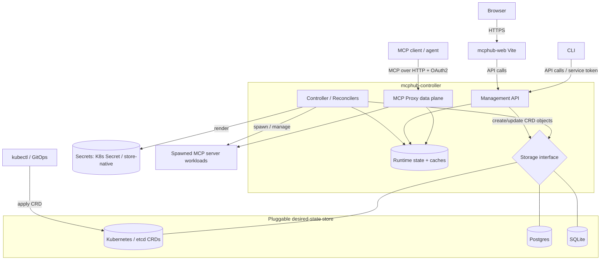

# Architecture

MCPHub is a Kubernetes control plane for MCP servers. It ships as **three Go binaries** plus
a **TypeScript MCP** component, and a set of Custom Resource Definitions (CRDs).
Configuration is **not** a single YAML file — every object is modeled as a CRD, and the
desired state is persisted in a **pluggable backing store** (Kubernetes/etcd, Postgres, or
SQLite).

## Components at a glance

| Component | Language | Role |
|-----------|----------|------|
| `mcphub-controller` | Go | Controller + management API + MCP proxy (data plane) |
| `mcphub-web` | Go | Serves the Vite/React web UI, reverse-proxies the API |
| `mcphub` (CLI) | Go | Operator/dev CLI: talks to the API, manages MCPs/bundles/policies/tokens |
| `mcphub-mcp` | TypeScript | The MCP surface agents connect to (npm-distributed) |

## Binaries

### 1. `mcphub-controller` (controller + API + proxy)

A single process that combines three responsibilities:

- **Controller (Kubebuilder).** Watches `Mcp`, `McpBundle`, and `McpPolicy` custom
  resources. Reconciles them into runtime state: spawns/teardowns MCP server workloads,
  resolves and renders referenced `Secret`s, and keeps the proxy's routing table current.
- **API.** A REST/JSON + (optionally) gRPC management surface used by the web UI, the CLI,
  and automation. Exposes CRUD over MCPs/bundles/policies, tool discovery, execution
  control (pause/resume), and auth/token management.
- **MCP proxy.** The data plane. Each `Mcp` is reachable at its own proxied URL; each
  `McpBundle` is reachable as an aggregated endpoint. The proxy validates OAuth2/service
  tokens, applies policy, and forwards MCP requests to the correct upstream server.

> Controller and API run in one binary so that the routing table, secret cache, and
> permission cache are shared in-process without a round trip.

### 2. `mcphub-web` (Vite web server)

A thin static + proxy server that:

- Serves the **Vite**-built single-page web interface (React).
- Handles the browser side of the OAuth2 login flow.
- Reverse-proxies API calls to `mcphub-controller`.

It holds no business logic and no secrets; it is safe to expose publicly while keeping the
controller/API on an internal address.

### 3. `mcphub` (CLI, Go)

A standalone Go binary for operators and developers. It is a thin client over the
`mcphub-controller` API (authenticating with an OAuth2 token or a service token):

- CRUD over `Mcp` / `McpBundle` / `McpPolicy` objects (create, list, describe, delete).
- Mint and revoke granular service tokens.
- Run tool discovery, inspect schemas, and call/replay tools for debugging.
- Resume paused (approval/auth) executions.

The CLI never touches the store directly; everything goes through the API so the same
validation, policy, and audit apply.

### 4. `mcphub-mcp` (the MCP, TypeScript)

The MCP surface that agents (Claude Code, Cursor, OpenCode, Pi via a bridge) actually point
at is implemented in **TypeScript** and distributed on npm (e.g. `npx @mcphub/mcp`). It is
the ecosystem-native piece: the MCP/JSON-RPC client and tooling libraries are strongest in
TypeScript, and shipping via npm matches how MCP clients expect to launch servers.

It connects to the `mcphub-controller` proxy over streamable-HTTP (or runs as a stdio shim
that forwards to it), presenting per-MCP and per-bundle endpoints to the agent. It carries
the caller's OAuth2/service token through to the proxy and surfaces pause/resume
(approval) prompts back to the agent. All authorization, secret rendering, and routing
stay in the Go controller; the TypeScript MCP is a thin, distributable transport layer.

## State model

Every MCPHub object — `Mcp`, `McpBundle`, `McpPolicy`, `Token` — is defined as a CRD
(schema, validation, versioning). There are two layers of state, intentionally separate
from a single config file:

1. **Desired state — CRD objects in the configured store.** Created via `kubectl`, GitOps,
   the API, or the web UI. **The UI and the CRD create each other:** anything you create in
   the web UI is written as a CRD object, and any CRD applied out-of-band (`kubectl`,
   GitOps) appears in the UI. They are two faces of the same object, not a copy.
2. **Runtime state — controller store.** Resolved routing tables, rendered (in-memory)
   secrets, live server health, cached permissions, and in-flight/paused executions. This
   is rebuilt by reconciliation and never checked into Git.

### Pluggable storage backend

The CRD *schema* is fixed; where those objects are **persisted** is pluggable. The
controller talks to its store through a single storage interface with three drivers:

| Backend | Desired-state store | When to use |
|---------|---------------------|-------------|
| **Kubernetes (default)** | CRDs in the cluster's etcd, via the Kubernetes API | Running inside a cluster; native `kubectl`/GitOps workflow, RBAC, watches |
| **Postgres** | CRD objects as rows in Postgres | Running outside a cluster, or wanting a shared/HA external database |
| **SQLite** | CRD objects in a local SQLite file | Single-node, local, or embedded/self-host deployments |

In Kubernetes mode, the controller uses controller-runtime watches/informers directly. In
Postgres/SQLite mode it runs the **same** CRD types and reconcile loops against an embedded
object store that emulates the apiserver's get/list/watch semantics, so `kubectl`-applied
YAML and UI-created objects behave identically regardless of backend. Switching backends
changes *where* objects live, not *what* they are.

> The web UI never bypasses the model: "create MCP" in the UI is an API call that writes an
> `Mcp` CRD object into whichever backend is configured. The same object can equally be
> created with `kubectl apply` (Kubernetes backend) or seeded via SQL/migration.

## Request paths

- **Management:** Browser → `mcphub-web` → `mcphub-controller` API.
- **Automation:** CLI/CI → `mcphub-controller` API (service token).
- **Tool execution:** Agent → `mcphub-controller` proxy → upstream MCP server.

## Tech stack

- **Controller/API/proxy:** Go, Kubebuilder / controller-runtime.
- **CLI:** Go (`mcphub`), thin client over the API.
- **MCP surface:** TypeScript (`mcphub-mcp`), npm-distributed, streamable-HTTP/stdio to the proxy.
- **Web:** Vite + React (TypeScript).
- **Auth:** OAuth2 (authorization code + PKCE) for users, service tokens for machines.
- **Persistence:** CRD-modeled desired state in a pluggable backend (Kubernetes/etcd,
  Postgres, or SQLite); controller store for runtime state.
- **Secrets:** Kubernetes `Secret`s when on the Kubernetes backend; an encrypted
  store-native secret table when on Postgres/SQLite.
