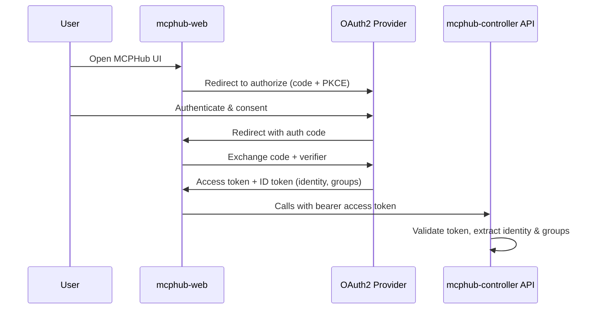
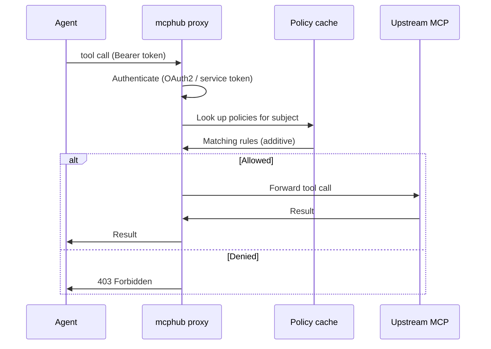

# Authentication & Authorization

MCPHub uses a two-phase model, like MCP Shield, but the authentication mechanism is
**OAuth2** (not a CLI-minted JWT), and machine clients use **service tokens**.

- **Authentication** — who are you?
  - **Users:** OAuth2 authorization code flow with PKCE, via an external identity provider.
  - **Machines:** long-lived **service tokens** issued by MCPHub.
- **Authorization** — what may you do?
  - Kubernetes-native `McpPolicy` resources mapping subjects to allowed MCPs/bundles/tools.

## Authentication

### Users — OAuth2



- The web UI never sees a long-lived secret; it holds a short-lived OAuth2 access token.
- The controller validates the token (signature, expiry, audience) and extracts identity
  (subject, email, groups) for authorization.
- Agents that support OAuth2 can authenticate directly against the proxy endpoint with a
  bearer access token.

### Machines — service tokens

For CI, scripts, and agents that cannot run an interactive OAuth2 flow:

```bash
# Issued via API / UI by an authorized user.
mcphub token create --name ci-runner --scope "mcp:github,bundle:devtools"
# => mh_svc_8f3c... (shown once)
```

Service tokens:

- Are minted and revoked through the API (and surfaced in the web UI).
- Carry an explicit scope (which MCPs/bundles/tools they may reach).
- Are presented as `Authorization: Bearer mh_svc_...` to the proxy or API.
- Are validated by the controller and resolve to a subject for policy evaluation.

### Using a token against the proxy

```json
{
  "mcpServers": {
    "mcphub-github": {
      "type": "streamable-http",
      "url": "https://mcphub.example.com/mcp/github",
      "headers": {
        "Authorization": "Bearer <oauth2-access-token-or-service-token>"
      }
    }
  }
}
```

## Authorization

Authorization is expressed as `McpPolicy` custom resources, so it is version-controllable
and GitOps-friendly — but, like everything else, it lives in cluster state, not in one
config file.

```yaml
apiVersion: mcphub.io/v1alpha1
kind: McpPolicy
metadata:
  name: sre-team
spec:
  subjects:
    - kind: Group
      match: "sre@example.com"          # from OAuth2 groups claim
    - kind: ServiceToken
      match: "ci-runner"                # by token name/label
  rules:
    - mcp: github
      tools: ["create_*", "get_*", "list_*"]
    - bundle: devtools
      tools: ["*"]
---
apiVersion: mcphub.io/v1alpha1
kind: McpPolicy
metadata:
  name: org-defaults
spec:
  subjects:
    - kind: EmailDomain
      match: "example.com"
  rules:
    - mcp: weather
      tools: ["*"]
```

### Evaluation

For each proxied call the controller:

1. Resolves the caller's identity (OAuth2 claims or service-token subject).
2. Looks up matching `McpPolicy` resources from the in-memory cache (policies are
   watched, not re-read from the API per request).
3. Combines all matching rules **additively**.
4. Checks the requested MCP/bundle + tool against the combined allow set.
5. Allows (forward) or denies (`403`).



## Security notes

- OAuth2 access tokens are short-lived; refresh is handled by the web UI / IdP.
- Service tokens are revocable and scoped; revocation takes effect on the next request.
- Policy changes are picked up live via watch — no restart.
- Upstream credentials (the `Secret`s rendered into MCP servers) are never exposed to
  callers; clients only ever present their own MCPHub identity. See [manifest.md](manifest.md).
