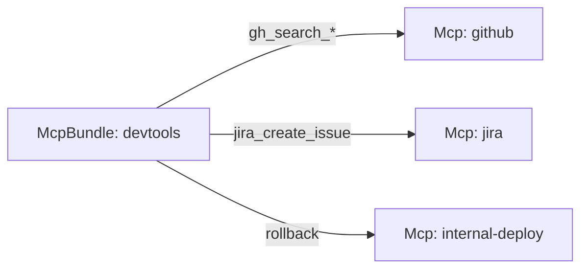

# Bundles

A **bundle** is the core differentiator of MCPHub's proxy. Where each `Mcp` exposes one
upstream server at its own URL, an `McpBundle` composes a **curated set of tools drawn
from one or many MCPs** and exposes them behind a single endpoint with its own tool
surface and authorization.

This is the MCPHub analogue of executor's "one catalog, shared across agents," expressed
as a Kubernetes resource.

## Why bundles

- **Curate per use case.** A "devtools" bundle for engineers, a "support" bundle for the
  help desk — each with exactly the tools that role needs, no more.
- **Span multiple MCPs.** Pull `search_*` from GitHub, `create_issue` from Jira, and a
  custom internal MCP into one endpoint.
- **Rename / namespace tools.** Present a clean, consistent tool surface to agents,
  decoupled from upstream tool names.
- **One auth boundary.** A bundle has its own policy and its own URL, so you can grant a
  team access to a bundle without granting access to each underlying MCP.

## The `McpBundle` kind

```yaml
apiVersion: mcphub.io/v1alpha1
kind: McpBundle
metadata:
  name: devtools
  namespace: mcphub
spec:
  description: "Core tools for the platform engineering team"
  tools:
    - from: github
      select: ["search_*", "get_*", "list_*"]
      as: "gh_{{ .tool }}"        # optional rename template
    - from: jira
      select: ["create_issue", "get_issue", "search"]
      as: "jira_{{ .tool }}"
    - from: internal-deploy
      select: ["status", "rollback"]
  # Optional: require human approval for specific tools in this bundle.
  approvals:
    require:
      - "jira_create_issue"
      - "rollback"
status:
  phase: Ready
  url: https://mcphub/bundle/devtools
  exposedTools: 9
  sources: ["github", "jira", "internal-deploy"]
```

## Resolution

When the controller reconciles an `McpBundle`:

1. It resolves each `from` to a `Mcp` resource and that server's discovered tools.
2. It applies `select` (glob allow patterns) against the discovered tools, intersected
   with each source `Mcp`'s own allow/deny.
3. It applies the `as` rename template to produce the exposed tool names.
4. It registers a routing entry: bundle tool name → (source MCP, upstream tool name).
5. It publishes the bundle at `/bundle/<name>`.



## Calling a bundle

```json
{
  "mcpServers": {
    "mcphub-devtools": {
      "type": "streamable-http",
      "url": "https://mcphub.example.com/bundle/devtools",
      "headers": { "Authorization": "Bearer <token>" }
    }
  }
}
```

The agent sees only the bundle's exposed tools (`gh_search_*`, `jira_create_issue`,
`rollback`, ...). The proxy maps each call back to the correct upstream MCP, renders that
MCP's secrets in-cluster, enforces policy, and — for tools listed under `approvals` —
pauses the execution for human approval before forwarding. See
[features.md](features.md) for the approval/pause-resume flow.
