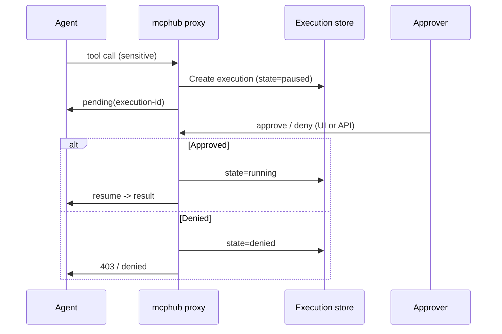

# Catalog Features (Executor-inspired)

Beyond the MCP Shield foundation (proxy, controller, RBAC), MCPHub adopts several features
from [RhysSullivan/executor](https://github.com/RhysSullivan/executor), adapted to a
Kubernetes-native, state-backed system.

## 1. Unified tool catalog

Every tool from every registered `Mcp` is indexed into a single searchable catalog held in
the controller's runtime state. The catalog is the backing data for discovery, bundles,
and the web UI. Unlike executor's local-first store, MCPHub's catalog is derived from
cluster state (the set of `Mcp` resources) and rebuilt by reconciliation.

## 2. Source auto-detection

When adding an MCP via the API or web UI, MCPHub probes the target to detect its transport
(`stdio`, `streamable-http`, `sse`) and performs an initial tool discovery to populate the
catalog and the `Mcp` status. The result is written into an `Mcp` resource — so the UI
"add a source" action is just a guided way to create a CR.

## 3. Intent-based tool discovery

Agents and users can search the catalog by natural-language intent rather than knowing
exact tool names:

```
GET /api/tools/search?q=open a pull request
=> [ { mcp: github, tool: create_pull_request, score: 0.92, ... }, ... ]
```

This is exposed both through the API/UI and as a meta-tool on the proxy (`discover`) so
agents can find tools at runtime.

## 4. Pause / resume executions (human-in-the-loop)

Sensitive tools — flagged on an `Mcp` or under a bundle's `approvals` — do not execute
immediately. Instead the execution **pauses** and waits for a human (or a second factor)
to approve or deny.



- Executions are first-class objects with an id, subject, target tool, arguments, and
  state (`paused | running | done | denied | failed`).
- Approve/deny happens in the web UI or via `POST /api/executions/{id}/resume`.
- The same mechanism handles pausing for **auth** (e.g. an upstream needs an OAuth2
  re-consent) in addition to **approval**.

## 5. Policy enforcement

Authorization rules are `McpPolicy` resources (see
[authentication-flow.md](authentication-flow.md)). Approval requirements are a complementary
control layered on bundles/MCPs. Together they cover "may you call this at all" (policy) and
"should a human confirm this specific call" (approval).

## 6. Web UI

The Vite/React UI (served by `mcphub-web`) provides:

- A catalog browser (search, inspect tool schemas).
- Source management (add/edit `Mcp`s, view discovery + health).
- Bundle composition (build `McpBundle`s visually).
- Policy and service-token management.
- An approvals inbox for pending executions.
- Audit/usage views.

## Mapping to executor

| Executor concept | MCPHub equivalent |
|------------------|-------------------|
| Unified tool catalog | Catalog derived from `Mcp` resources |
| Source auto-detection / indexing | Transport probe + discovery on `Mcp` create |
| `tools.discover` intent search | `/api/tools/search` + proxy `discover` meta-tool |
| Pause/resume, `resume --execution-id` | Execution objects + `/executions/{id}/resume` |
| Auth & policy management | OAuth2 + service tokens + `McpPolicy` |
| MCP server mode (`executor mcp`) | The proxy itself (per-MCP URLs + bundles) |
| Web dashboard | `mcphub-web` (Vite/React) |
| Sandboxed kernel execution | Container-runtime MCPs managed by the controller |

## Out of scope (vs. executor)

- A typed TypeScript SDK runtime (executor's `tools.*`) — MCPHub exposes tools over MCP,
  not as an embedded TS runtime.
- Service emulators (`@executor-js/emulate`).
- A desktop app.
