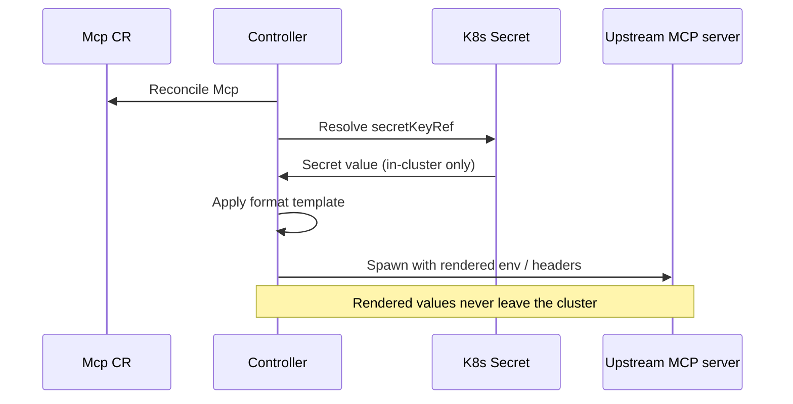

# The `Mcp` Manifest & State-Backed Configuration

MCPHub does **not** use a single `mcp.yaml` / `config.yaml` as its source of truth. Instead,
every MCP server is declared as an `Mcp` custom resource. The controller reconciles those
resources into runtime state, and the proxy serves from that state.

This is the central twist versus MCP Shield: **configuration is Kubernetes-native and
stored in state, not in one file.**

## Why state-backed?

- **Multiple authors.** MCPs can be created via `kubectl`, GitOps, the API, or the web UI.
  There is no single file to serialize edits through.
- **Live updates.** Adding or changing an `Mcp` triggers reconciliation; no restart and no
  file reload.
- **Secret safety.** Secret material is referenced, never inlined, and is rendered only
  inside the cluster at spawn time.

## The `Mcp` kind

```yaml
apiVersion: mcphub.io/v1alpha1
kind: Mcp
metadata:
  name: github
  namespace: mcphub
spec:
  # How to run the upstream MCP server.
  runtime:
    type: container          # container | remote
    image: ghcr.io/github/github-mcp-server:latest
    command: ["server"]
    args: ["--stdio"]

  # Transport the proxy uses to reach this server.
  transport: stdio           # stdio | streamable-http | sse

  # Secret rendering: referenced, never inlined.
  env:
    - name: GITHUB_PERSONAL_ACCESS_TOKEN
      valueFrom:
        secretKeyRef:
          name: github-credentials
          key: token

  # Optional headers (for remote transports) can also render from secrets.
  headers:
    - name: Authorization
      valueFrom:
        secretKeyRef:
          name: github-credentials
          key: bearer
          format: "Bearer {{ .value }}"

  # Tool surface controls.
  tools:
    exposePrefix: "github_"  # how proxied tool names appear to clients
    allow: ["search_*", "get_*", "list_*"]
    deny: ["delete_*"]
status:
  phase: Ready               # Pending | Ready | Degraded | Failed
  url: https://mcphub/internal/mcp/github
  discoveredTools: 42
  exposedTools: 18
  lastReconciled: "2026-06-19T12:00:00Z"
```

### A remote MCP example

```yaml
apiVersion: mcphub.io/v1alpha1
kind: Mcp
metadata:
  name: weather
spec:
  runtime:
    type: remote
    url: https://weather-mcp.example.com/sse
  transport: sse
  tools:
    exposePrefix: "weather_"
```

## Profiles

A single `Mcp` can expose several **profiles** — named variants of the same upstream
server that differ in their **params** (env values) and **secrets** (`secretKeyRef`s).
The fields at the top of `spec` form the **default profile**; entries under
`spec.profiles` add named variants that override `env` and `headers` by `name`.

```yaml
apiVersion: mcphub.io/v1alpha1
kind: Mcp
metadata:
  name: github
spec:
  runtime:
    type: container
    image: ghcr.io/github/github-mcp-server:latest
  transport: stdio

  # Default profile: used when a binding names no profile.
  env:
    - name: GITHUB_PERSONAL_ACCESS_TOKEN
      valueFrom:
        secretKeyRef: { name: github-readonly, key: token }

  profiles:
    - name: admin
      # Different secret (a higher-privilege token).
      env:
        - name: GITHUB_PERSONAL_ACCESS_TOKEN
          valueFrom:
            secretKeyRef: { name: github-admin, key: token }
    - name: enterprise
      # Different params + a different secret.
      env:
        - name: GITHUB_HOST
          value: github.acme.internal
        - name: GITHUB_PERSONAL_ACCESS_TOKEN
          valueFrom:
            secretKeyRef: { name: github-enterprise, key: token }
```

Rules:

- An entry in a profile's `env`/`headers` **replaces** the default entry with the same
  `name`; names absent from the profile fall through to the default.
- A profile changes only params and secrets — `runtime`, `transport`, and the `tools`
  surface come from the base spec.
- Bindings select a profile by name (`mcp: github`, `profile: admin`). Omitting it uses
  the default profile. See [bundles.md](bundles.md) and
  [authentication-flow.md](authentication-flow.md).
- Secret rendering (below) runs per resolved profile; profiles never inline secret values.

## Secret rendering

The controller is responsible for turning secret references into the values the upstream
server needs — and for keeping those values inside the cluster.

1. The `Mcp` spec references `Secret`s via `secretKeyRef` (never literal values).
2. On reconcile/spawn, the controller resolves the `Secret` and renders it into:
   - **env vars** for container-runtime MCPs, or
   - **request headers** for remote-transport MCPs.
3. An optional `format` template (e.g. `"Bearer {{ .value }}"`) wraps the rendered value.
4. Rendered values live only in the spawned workload's environment and the proxy's
   in-memory cache. They are **never** written back to the `Mcp` status, the API
   responses, the catalog, or logs.



## Related resources

- **`McpBundle`** — composes tools from one or more `Mcp`s into a single endpoint. See
  [bundles.md](bundles.md).
- **`McpPolicy`** — authorization rules mapping subjects (OAuth2 identities, service
  tokens) to allowed MCPs/tools. See [authentication-flow.md](authentication-flow.md).
