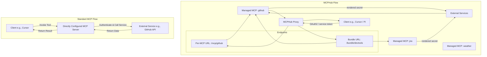

# MCP Flow Comparison

This document contrasts a standard MCP client-server interaction with the MCPHub flow,
and shows the extra twist MCPHub adds on top of MCP Shield: **per-MCP proxied URLs** and
**bundles** (curated, aggregated tool endpoints).

## Flow Diagram

## Two ways to consume MCPHub

1. **Per-MCP URL.** Every `Mcp` resource is reachable at its own proxied URL
   (e.g. `/mcp/github`). The client sees that single server's tools (subject to the
   `Mcp`'s allow/deny and the caller's policy). This is the drop-in "managed single
   server" mode.

2. **Bundle URL.** An `McpBundle` aggregates selected tools from one or more `Mcp`s behind
   one endpoint (e.g. `/bundle/devtools`). The client sees a curated, renamed tool surface
   that may span GitHub + Jira + an internal MCP. See [bundles.md](bundles.md).

## Key Differences

| Feature | Standard Flow | MCPHub Flow |
|---------|---------------|-------------|
| **Configuration** | Client configures each MCP server individually, from local files. | MCPs are declared as `Mcp` CRs in cluster state; clients point at a proxied URL or bundle. |
| **Config source** | A local config file per client. | Kubernetes resources + controller state — no single YAML source. |
| **Tool discovery** | One configured server at a time. | Per-MCP, or aggregated/curated via bundles; intent-based search across the catalog. |
| **Endpoint** | One endpoint per server. | One endpoint per MCP **and** composable bundle endpoints. |
| **Authentication** | Per-server, often credentials in client config. | Centralized OAuth2 (users) + service tokens (machines). |
| **Authorization** | By the MCP server, if at all. | Centralized, fine-grained `McpPolicy` (RBAC) in cluster. |
| **Secrets** | Often exposed client-side. | Referenced by `Mcp`, rendered in-cluster only, never exposed to clients. |
| **Approvals** | None. | Optional human-in-the-loop pause/resume on sensitive tools. See [features.md](features.md). |
